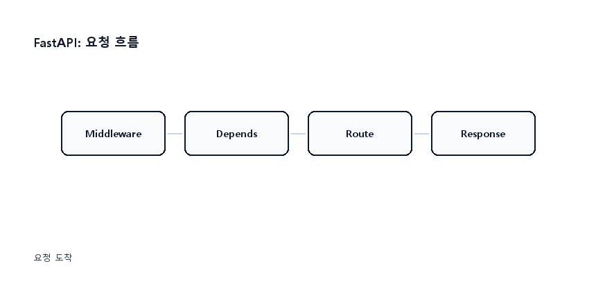
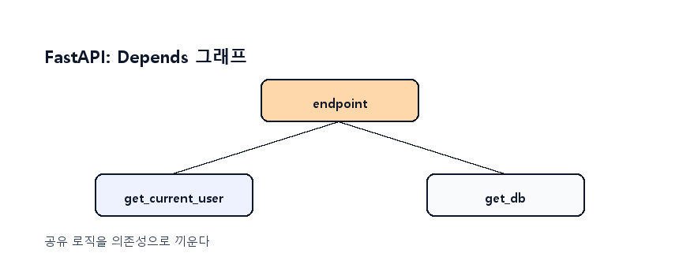

<picture>
  <source media="(prefers-color-scheme: dark)" srcset="../../assets/sections/banner-cs-dark.svg" />
  
</picture>

# 01. 라우팅과 의존성

**경로를 열고, Depends로 공유 로직을 끼운다.**

  
  &nbsp;
  
  &nbsp;
  

 

<picture>
  <source media="(prefers-color-scheme: dark)" srcset="../../assets/sections/section-goals-dark.svg" />
  
</picture>

FastAPI는 라우트 함수가 컨트롤러 역할을 하고, **`Depends`** 가 DI·가드·공유 자원의 허브다.  
Spring/Nest의 “조립”을 파이썬 함수 그래프로 표현한다고 보면 된다.

대응: Spring **[01](../spring/01_웹요청흐름.md)** · Nest **[01](../nestjs/01_모듈과DI.md)** / **[02](../nestjs/02_컨트롤러와파이프.md)**

 

<picture>
  <source media="(prefers-color-scheme: dark)" srcset="../../assets/sections/section-contents-dark.svg" />
  
</picture>

| # | 주제 | 한 줄 |
| :--- | :--- | :--- |
| 01 | APIRouter / path | 엔드포인트 |
| 02 | 의존성 주입 Depends | 공유 로직 |
| 03 | Request / Response | 입출력 |
| 04 | 앱 수명주기 | startup 감각 |

 

<picture>
  <source media="(prefers-color-scheme: dark)" srcset="../../assets/sections/section-concept-dark.svg" />
  
</picture>

### 01. APIRouter / path

**경로와 HTTP 메서드를 함수에 연결한다.**

<picture>
  <source media="(prefers-color-scheme: dark)" srcset="../../assets/videos/fastapi-request-dark.gif" />
  
</picture>

#### 직관

메뉴판이다.  
`@router.get("/orders/{id}")`가 항목이다.

#### 핵심 성질

| 개념 | 내용 |
| :--- | :--- |
| `APIRouter` | 기능별 경로 묶음 |
| path / query | 경로·쿼리 파라미터 |
| `include_router` | 앱에 라우터 장착 |
| OpenAPI | 경로가 문서로 자동 반영 |

- **쓰임**: 도메인별 라우터 분리

---

### 02. 의존성 주입 Depends

**공통 준비 로직을 그래프로 끼운다.**

<picture>
  <source media="(prefers-color-scheme: dark)" srcset="../../assets/diagrams/fastapi-depends-dark.png" />
  
</picture>

#### 직관

조립 설명서다.  
엔드포인트가 `Depends(get_db)`를 선언하면, 호출 전에 DB 세션이 준비된다.

#### 핵심 성질

| 개념 | 내용 |
| :--- | :--- |
| `Depends` | 서브 의존성 호출·캐시 |
| 중첩 Depends | 인증 → 현재 유저 → 권한처럼 쌓임 |
| yield 의존성 | 사용 후 cleanup (세션 close) |

- **쓰임**: DB 세션, 설정, 현재 유저 (4장과 이어짐)

---

### 03. Request / Response

**필요하면 Starlette 요청·응답 객체에 직접 닿는다.**

#### 직관

편지지와 회신 봉투다.  
대개는 타입 힌트·Pydantic으로 충분하고, 헤더·쿠키·스트리밍 때 직접 쓴다.

#### 핵심 성질

| 개념 | 내용 |
| :--- | :--- |
| `Request` | 헤더·클라이언트·바디 스트림 |
| `Response` / `JSONResponse` | 상태·헤더 제어 |
| 반환 모델 | `response_model`로 출력 계약 |

- **쓰임**: 커스텀 헤더, 쿠키, 파일 응답

---

### 04. 앱 수명주기

**기동·종료 때 한 번 할 일을 붙인다.**

#### 직관

가게 문 열고 닫기다.  
풀 생성, 모델 로드, 연결 정리를 lifespan에 둔다.

#### 핵심 성질

| 개념 | 내용 |
| :--- | :--- |
| lifespan / startup·shutdown | 앱 수명 훅 |
| 리소스 공유 | 앱 state에 보관하기도 함 |
| 요청 단위와 구분 | 매 요청 Depends vs 앱 수명 |

- **쓰임**: DB 엔진, 캐시 클라이언트 초기화

 

<picture>
  <source media="(prefers-color-scheme: dark)" srcset="../../assets/sections/section-summary-dark.svg" />
  
</picture>

### 무엇을 먼저 떠올릴까

| 상황 | 후보 |
| :--- | :--- |
| URL 매핑 | APIRouter |
| 공유 준비물 | Depends |
| 헤더·스트리밍 | Request / Response |
| 기동 시 초기화 | lifespan |

 

<picture>
  <source media="(prefers-color-scheme: dark)" srcset="../../assets/sections/section-next-dark.svg" />
  
</picture>

다음 장: **[02. Pydantic 검증](02_Pydantic검증.md)** — 입출력 스키마와 OpenAPI
