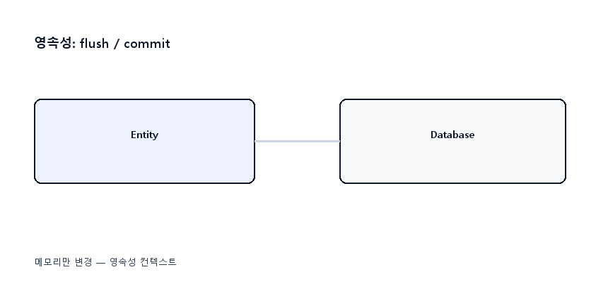

<picture>
  <source media="(prefers-color-scheme: dark)" srcset="../../assets/sections/banner-cs-dark.svg" />
  
</picture>

# 03. SQLAlchemy

**엔진·세션으로 연결하고, ORM으로 표와 관계를 다룬다.**

  
  &nbsp;
  
  &nbsp;
  

 

<picture>
  <source media="(prefers-color-scheme: dark)" srcset="../../assets/sections/section-goals-dark.svg" />
  
</picture>

FastAPI와 자주 붙는 SQLAlchemy는 JPA와 같은 **매핑·세션·트랜잭션** 문제를 푼다.  
세션을 `Depends`로 나누어 주는 패턴이 관례다.

대응: Spring **[03](../spring/03_JPA와영속성.md)** · Nest **[03](../nestjs/03_ORM과DB.md)**

 

<picture>
  <source media="(prefers-color-scheme: dark)" srcset="../../assets/sections/section-contents-dark.svg" />
  
</picture>

| # | 주제 | 한 줄 |
| :--- | :--- | :--- |
| 01 | Engine / Session | 연결 |
| 02 | ORM 모델 | 표 매핑 |
| 03 | 관계 | FK |
| 04 | 트랜잭션 | 커밋·롤백 |

 

<picture>
  <source media="(prefers-color-scheme: dark)" srcset="../../assets/sections/section-concept-dark.svg" />
  
</picture>

### 01. Engine / Session

**엔진은 연결 공장, 세션은 작업 단위에 가깝다.**

#### 직관

전화 교환기와 통화다.  
엔진이 회선을 만들고, 세션이 한 통화(요청/유스케이스)를 연다.

#### 핵심 성질

| 개념 | 내용 |
| :--- | :--- |
| Engine | DB URL·풀 |
| Session / SessionLocal | 단위 작업, 보통 요청당 |
| `Depends(get_db)` | yield로 열고 닫기 |

- **쓰임**: 요청마다 세션을 열고 끝나며 close

---

### 02. ORM 모델

**파이썬 클래스를 테이블에 매핑한다.**

#### 직관

명함철의 한 장이다.  
컬럼이 필드가 된다.

#### 핵심 성질

| 개념 | 내용 |
| :--- | :--- |
| Declarative / Mapped | 테이블·컬럼 선언 |
| PK / 타입 | id, 제약 |
| Pydantic과 분리 | ORM 모델 ≠ API 스키마가 안전한 기본 |

- **쓰임**: Repository/쿼리 계층의 중심 객체

---

### 03. 관계

**FK를 relationship으로 표현한다.**

<picture>
  <source media="(prefers-color-scheme: dark)" srcset="../../assets/videos/be-persist-dark.gif" />
  
</picture>

#### 직관

팀·멤버 링크다.  
lazy 로딩과 joinedload 선택이 N+1을 가른다.

#### 핵심 성질

| 개념 | 내용 |
| :--- | :--- |
| `relationship` | 객체 그래프 |
| lazy / eager 옵션 | 로딩 타이밍 |
| N+1 | 목록 후 연관 추가 조회 |

- **쓰임**: 목록 API에서 selectinload 등으로 묶기

---

### 04. 트랜잭션

**commit으로 확정, 예외 시 rollback.**

#### 직관

영수증 한 장이다.  
여러 add/flush 뒤 한 번에 커밋한다.

#### 핵심 성질

| 개념 | 내용 |
| :--- | :--- |
| commit / rollback | 확정·취소 |
| flush | SQL 전송(아직 커밋 전일 수 있음) |
| 서비스 경계 | 유스케이스 단위로 묶기 |

- **쓰임**: 주문+재고처럼 원자성이 필요한 쓰기

 

<picture>
  <source media="(prefers-color-scheme: dark)" srcset="../../assets/sections/section-summary-dark.svg" />
  
</picture>

### 무엇을 먼저 떠올릴까

| 상황 | 후보 |
| :--- | :--- |
| 연결·풀 | Engine |
| 요청 단위 DB | Session + Depends |
| 표 매핑 | ORM 모델 |
| 여러 쓰기 | 트랜잭션 |

 

<picture>
  <source media="(prefers-color-scheme: dark)" srcset="../../assets/sections/section-next-dark.svg" />
  
</picture>

다음 장: **[04. 의존성 공유와 보안](04_의존성공유와보안.md)** — Bearer와 현재 유저
