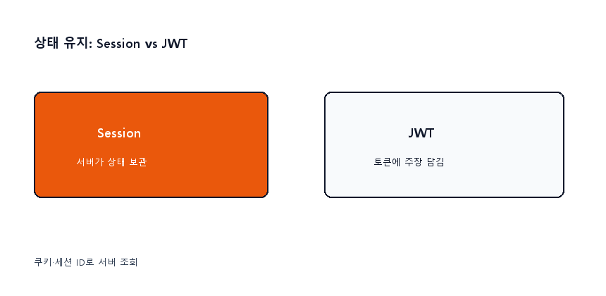
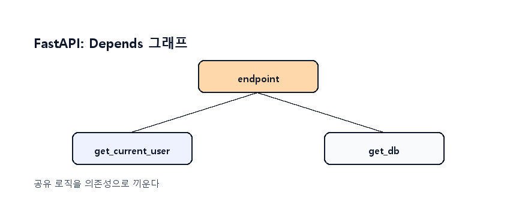
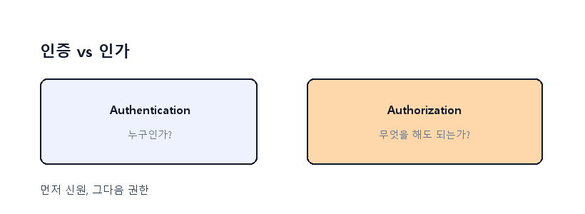

<picture>
  <source media="(prefers-color-scheme: dark)" srcset="../../assets/sections/banner-cs-dark.svg" />
  
</picture>

# 04. 의존성 공유와 보안

**Bearer·Depends로 인증을 끼우고, 권한과 비밀번호 해시를 분리한다.**

  
  &nbsp;
  
  &nbsp;
  

 

<picture>
  <source media="(prefers-color-scheme: dark)" srcset="../../assets/sections/section-goals-dark.svg" />
  
</picture>

FastAPI 보안의 자주 쓰는 패턴은 **OAuth2 Bearer + `get_current_user` 의존성**이다.  
Spring Security·Nest Guard와 같은 “요청 앞 검문”을 Depends 그래프로 표현한다.

대응: Spring **[05](../spring/05_인증인가.md)** · Nest **[04](../nestjs/04_가드와인증.md)**

 

<picture>
  <source media="(prefers-color-scheme: dark)" srcset="../../assets/sections/section-contents-dark.svg" />
  
</picture>

| # | 주제 | 한 줄 |
| :--- | :--- | :--- |
| 01 | OAuth2 / Bearer | 토큰 |
| 02 | get_current_user | 의존성 패턴 |
| 03 | 권한 검사 | 인가 |
| 04 | 비밀번호 해시 | 저장 안전 |

 

<picture>
  <source media="(prefers-color-scheme: dark)" srcset="../../assets/sections/section-concept-dark.svg" />
  
</picture>

### 01. OAuth2 / Bearer

**Authorization 헤더의 토큰으로 신원을 확인한다.**

<picture>
  <source media="(prefers-color-scheme: dark)" srcset="../../assets/videos/be-session-jwt-dark.gif" />
  
</picture>

#### 직관

서명된 출입증이다.  
클라이언트가 Bearer 토큰을 보내고, 서버가 서명·만료를 검증한다.

#### 핵심 성질

| 개념 | 내용 |
| :--- | :--- |
| `OAuth2PasswordBearer` | 토큰 URL·헤더 관례 |
| JWT | 클레임 + 서명 |
| 토큰 없음 (기본) | Bearer 누락 시 종종 **403** (`OAuth2PasswordBearer`) |
| 토큰 무효·만료 | `get_current_user` 등에서 보통 **401** |

- **쓰임**: SPA·모바일 API 인증

---

### 02. get_current_user

**토큰 → 사용자 객체를 Depends로 재사용한다.**

<picture>
  <source media="(prefers-color-scheme: dark)" srcset="../../assets/diagrams/fastapi-depends-dark.png" />
  
</picture>

#### 직관

통과 후 방문증 발급이다.  
여러 엔드포인트가 같은 `Depends(get_current_user)`를 선언한다.

#### 핵심 성질

| 개념 | 내용 |
| :--- | :--- |
| 의존성 체인 | bearer → decode → DB 조회 |
| 엔드포인트 인자 | `user: User = Depends(...)` |
| 캐시 | 같은 요청 안 Depends 결과 재사용 |

- **쓰임**: “로그인한 사용자만” 경로의 공통 입구

---

### 03. 권한 검사

**인증 이후에 인가를 한 단계 더 둔다.**

<picture>
  <source media="(prefers-color-scheme: dark)" srcset="../../assets/diagrams/be-authn-authz-dark.png" />
  
</picture>

#### 직관

배지 확인 다음 열쇠 확인이다.  
`get_current_active_admin`처럼 역할을 검사하는 Depends를 얹는다.

#### 핵심 성질

| 개념 | 내용 |
| :--- | :--- |
| 401 vs 403 | 관례는 미인증/권한 부족. Bearer 누락은 FastAPI 기본이 403인 점에 주의 |
| 역할 Depends | 재사용 가능한 인가 함수 |
| 본인 리소스 | id 비교를 서비스/의존성에서 |

- **쓰임**: 관리자 API, 소유자만 수정

---

### 04. 비밀번호 해시

**평문 비밀번호를 저장하지 않는다.**

#### 직관

금고 안 요약본이다.  
검증 때는 같은 해시 함수로 비교하고, 원문을 되돌리지 않는다.

#### 핵심 성질

| 개념 | 내용 |
| :--- | :--- |
| 해시 + salt | bcrypt/argon2 등 |
| verify | 로그인 시 비교 |
| 절대 응답 금지 | response_model에서 제외 |

- **쓰임**: 회원가입·로그인 저장 계층

 

<picture>
  <source media="(prefers-color-scheme: dark)" srcset="../../assets/sections/section-summary-dark.svg" />
  
</picture>

### 무엇을 먼저 떠올릴까

| 상황 | 후보 |
| :--- | :--- |
| 토큰 헤더 | OAuth2 Bearer / JWT |
| 공통 현재 유저 | get_current_user Depends |
| 관리자만 | 인가 Depends |
| 비밀번호 저장 | 해시 |

 

<picture>
  <source media="(prefers-color-scheme: dark)" srcset="../../assets/sections/section-next-dark.svg" />
  
</picture>

다음 장: **[05. 미들웨어와 예외](05_미들웨어와예외.md)** — 전후 처리와 에러 계약
