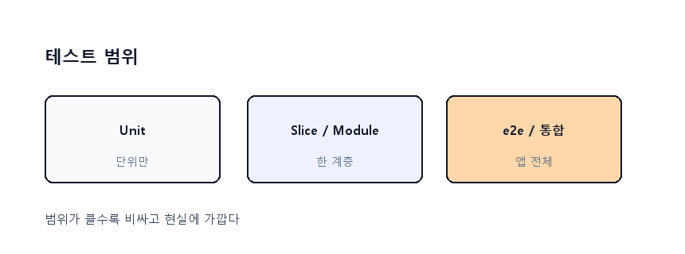

<picture>
  <source media="(prefers-color-scheme: dark)" srcset="../../assets/sections/banner-cs-dark.svg" />
  
</picture>

# 06. 테스트

**TestClient로 HTTP를 검증하고, Depends를 오버라이드해 경계를 고정한다.**

  
  &nbsp;
  
  &nbsp;
  

 

<picture>
  <source media="(prefers-color-scheme: dark)" srcset="../../assets/sections/section-goals-dark.svg" />
  
</picture>

FastAPI 테스트의 축은 **`TestClient`** 와 **`dependency_overrides`** 다.  
Nest TestingModule·Spring MockBean과 같은 “테스트용 조립”이다.

대응: Spring **[06](../spring/06_Test_Docs.md)** · Nest **[06](../nestjs/06_Testing.md)**

 

<picture>
  <source media="(prefers-color-scheme: dark)" srcset="../../assets/sections/section-contents-dark.svg" />
  
</picture>

| # | 주제 | 한 줄 |
| :--- | :--- | :--- |
| 01 | TestClient | HTTP 테스트 |
| 02 | 의존성 오버라이드 | DB 대체 |
| 03 | 단위 vs 통합 | 범위 |
| 04 | 픽스처 | 준비 코드 |

 

<picture>
  <source media="(prefers-color-scheme: dark)" srcset="../../assets/sections/section-concept-dark.svg" />
  
</picture>

### 01. TestClient

**앱에 HTTP를 흉내 내어 보낸다.**

#### 직관

연습용 창구다.  
실제 포트 바인딩 없이도 GET/POST와 상태·JSON을 확인한다.

#### 핵심 성질

| 개념 | 내용 |
| :--- | :--- |
| `TestClient(app)` | Starlette 테스트 클라이언트 |
| `client.get/post` | 요청 |
| 수명주기 | context manager로 기동·종료 |

- **쓰임**: 라우트·검증·예외 핸들러 경로 확인

---

### 02. 의존성 오버라이드

**`get_db` 같은 Depends를 테스트 구현으로 교체한다.**

#### 직관

부품 대타다.  
실 DB 대신 메모리·테스트 세션을 끼운다.

#### 핵심 성질

| 개념 | 내용 |
| :--- | :--- |
| `app.dependency_overrides` | 원본 → 테스트 함수 |
| 인증 우회 | `get_current_user`를 고정 유저로 |
| 테스트 후 clear | 오염 방지 |

- **쓰임**: 통합 테스트에서 외부/DB 경계 고정

---

### 03. 단위 vs 통합

**범위를 고른다.**

<picture>
  <source media="(prefers-color-scheme: dark)" srcset="../../assets/diagrams/be-test-scope-dark.png" />
  
</picture>

#### 직관

리허설 규모다.  
함수만 / 앱+오버라이드 / 실DB에 가깝게.

#### 핵심 성질

| 범위 | 감각 |
| :--- | :--- |
| 단위 | 순수 함수·서비스, FastAPI 없이 |
| API 통합 | TestClient + overrides |
| 실DB | 컨테이너·테스트 DB (비용↑) |

- **쓰임**: 빠른 피드백과 현실성 사이 균형

---

### 04. 픽스처

**준비·정리를 재사용한다.**

#### 직관

소품 세트다.  
클라이언트·유저·시드 데이터를 pytest fixture로 둔다.

#### 핵심 성질

| 개념 | 내용 |
| :--- | :--- |
| pytest fixture | setup/teardown |
| 공유 client | 모듈/세션 스코프 |
| 시드 데이터 | 테스트 간 격리 |

- **쓰임**: 반복되는 클라이언트·토큰 준비

 

<picture>
  <source media="(prefers-color-scheme: dark)" srcset="../../assets/sections/section-summary-dark.svg" />
  
</picture>

### 무엇을 먼저 떠올릴까

| 상황 | 후보 |
| :--- | :--- |
| HTTP 계약 | TestClient |
| DB·유저 대체 | dependency_overrides |
| 범위 선택 | 단위 vs 통합 |
| 반복 준비 | pytest fixture |

 

<picture>
  <source media="(prefers-color-scheme: dark)" srcset="../../assets/sections/section-next-dark.svg" />
  
</picture>

FastAPI 트랙 본문은 여기까지.  
허브로: **[backend/README.md](../README.md)**
