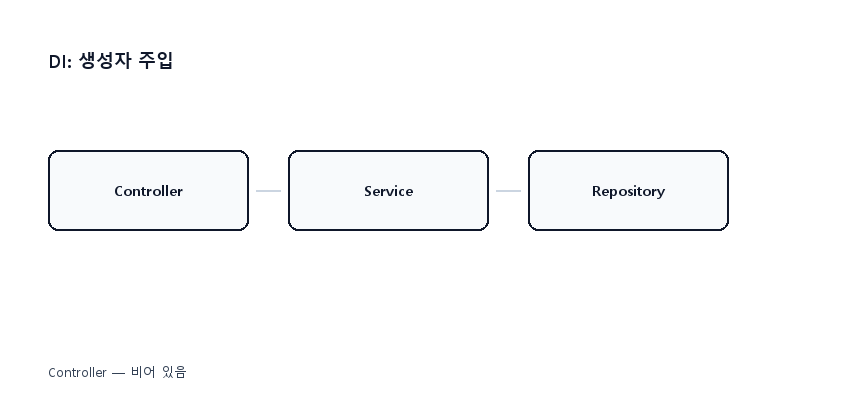
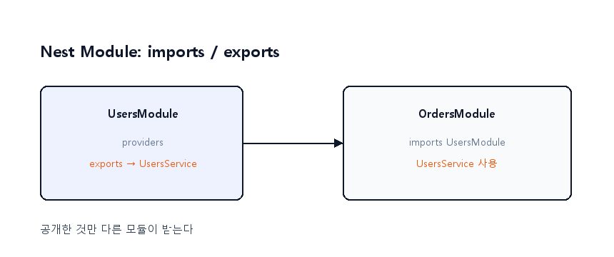

<picture>
  <source media="(prefers-color-scheme: dark)" srcset="../../assets/sections/banner-cs-dark.svg" />
  
</picture>

# 01. 모듈과 DI

**기능을 모듈로 묶고, Provider를 생성자로 주입한다.**

  
  &nbsp;
  
  &nbsp;
  

 

<picture>
  <source media="(prefers-color-scheme: dark)" srcset="../../assets/sections/section-goals-dark.svg" />
  
</picture>

Nest는 Spring의 계층·DI 감각을 TypeScript로 옮긴 구조가 강하다.  
먼저 **Module 경계**와 **Provider 주입**을 잡으면 나머지 장이 같은 지도 위에 올라간다.

대응: Spring **[02. 계층과 DI](../spring/02_계층과DI.md)**

 

<picture>
  <source media="(prefers-color-scheme: dark)" srcset="../../assets/sections/section-contents-dark.svg" />
  
</picture>

| # | 주제 | 한 줄 |
| :--- | :--- | :--- |
| 01 | Module | 기능 단위 경계 |
| 02 | Provider / Injectable | 서비스 등록 |
| 03 | 생성자 주입 | 의존성 받기 |
| 04 | exports / imports | 모듈 간 공유 |

 

<picture>
  <source media="(prefers-color-scheme: dark)" srcset="../../assets/sections/section-concept-dark.svg" />
  
</picture>

### 01. Module

**컨트롤러·프로바이더를 한 기능 단위로 묶는 상자.**

#### 직관

팀 칸막이다.  
주문팀·유저팀이 각자 파일과 책임을 모은다.

#### 핵심 성질

| 개념 | 내용 |
| :--- | :--- |
| `@Module` | `controllers` / `providers` / `imports` / `exports` |
| `AppModule` | 루트에서 기능 모듈을 조립 |
| feature module | 도메인별 분할의 기본 단위 |

- **쓰임**: 파일이 늘 때 “어느 모듈에 둘까”를 먼저 물을 때

---

### 02. Provider / Injectable

**주입 가능한 서비스를 컨테이너에 등록한다.**

#### 직관

부품 목록이다.  
`@Injectable()`이 찍힌 클래스만 Nest가 만들어 나눠 준다.

#### 핵심 성질

| 개념 | 내용 |
| :--- | :--- |
| `@Injectable` | Provider 표식 |
| `providers` 배열 | 모듈에 등록 |
| custom provider | `useClass` / `useValue` / `useFactory` |
| scope | 기본은 singleton |

- **쓰임**: Spring `@Service`와 같은 자리의 업무 로직

---

### 03. 생성자 주입

**필수 의존성을 생성자 파라미터로 받는다.**

<picture>
  <source media="(prefers-color-scheme: dark)" srcset="../../assets/videos/be-di-dark.gif" />
  
</picture>

#### 직관

Spring과 같다.  
컨트롤러가 서비스를, 서비스가 리포지토리를 생성자로 받는다.

#### 핵심 성질

| 개념 | 내용 |
| :--- | :--- |
| constructor DI | Nest의 기본 권장 |
| 타입 기반 토큰 | 클래스 타입이 주입 키 |
| `@Inject` | 커스텀 토큰이 필요할 때 |

- **쓰임**: 테스트에서 구현체를 모킹으로 갈아끼울 때

---

### 04. exports / imports

**다른 모듈이 쓸 수 있게 Provider를 공개한다.**

<picture>
  <source media="(prefers-color-scheme: dark)" srcset="../../assets/diagrams/nest-modules-dark.png" />
  
</picture>

#### 직관

부서 간 공문이다.  
`exports`에 올린 서비스만 다른 모듈이 `imports`로 받아 쓸 수 있다.

#### 핵심 성질

| 개념 | 내용 |
| :--- | :--- |
| exports | 공개 API에 가까운 Provider 목록 |
| imports | 다른 모듈의 export를 가져옴 |
| 순환 imports | 설계 냄새. 공유 모듈로 빼는 경우가 많음 |

- **쓰임**: `UsersService`를 `OrdersModule`에서 재사용할 때

 

<picture>
  <source media="(prefers-color-scheme: dark)" srcset="../../assets/sections/section-summary-dark.svg" />
  
</picture>

### 무엇을 먼저 떠올릴까

| 상황 | 후보 |
| :--- | :--- |
| 기능이 섞일 때 | Module 경계 |
| `new`로 직접 연결 | Provider + 생성자 주입 |
| 다른 모듈에서 못 찾을 때 | exports / imports |

 

<picture>
  <source media="(prefers-color-scheme: dark)" srcset="../../assets/sections/section-next-dark.svg" />
  
</picture>

다음 장: **[02. 컨트롤러와 파이프](02_컨트롤러와파이프.md)** — 엔드포인트와 입력 검증
