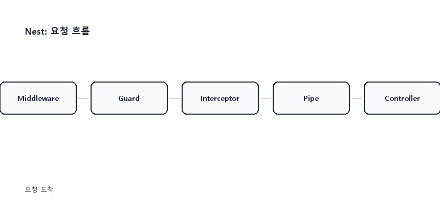

<picture>
  <source media="(prefers-color-scheme: dark)" srcset="../../assets/sections/banner-cs-dark.svg" />
  
</picture>

# 02. 컨트롤러와 파이프

**라우트를 열고, DTO와 Pipe로 입력을 다듬는다.**

  
  &nbsp;
  
  &nbsp;
  

 

<picture>
  <source media="(prefers-color-scheme: dark)" srcset="../../assets/sections/section-goals-dark.svg" />
  
</picture>

Nest의 컨트롤러는 Spring MVC 컨트롤러와 같은 입구다.  
그 앞에서 **Pipe**가 변환·검증을 맡아 Spring의 `@Valid` 자리에 가깝다.

대응: Spring **[01. 웹 요청 흐름](../spring/01_웹요청흐름.md)** · **[04. 검증과 예외](../spring/04_검증과예외.md)** (검증 부분)

 

<picture>
  <source media="(prefers-color-scheme: dark)" srcset="../../assets/sections/section-contents-dark.svg" />
  
</picture>

| # | 주제 | 한 줄 |
| :--- | :--- | :--- |
| 01 | Controller / Route | 엔드포인트 |
| 02 | DTO | 입출력 형태 |
| 03 | ValidationPipe | 검증 |
| 04 | Pipe 체인 | 변환·검증 순서 |

 

<picture>
  <source media="(prefers-color-scheme: dark)" srcset="../../assets/sections/section-concept-dark.svg" />
  
</picture>

### 01. Controller / Route

**HTTP 메서드와 경로를 핸들러에 연결한다.**

<picture>
  <source media="(prefers-color-scheme: dark)" srcset="../../assets/videos/nest-request-dark.gif" />
  
</picture>

#### 직관

메뉴판이다.  
`@Get(':id')`가 “이 주문을 이 메서드가 받는다”는 표기다.

#### 핵심 성질

| 개념 | 내용 |
| :--- | :--- |
| `@Controller` | 경로 prefix |
| `@Get` / `@Post` 등 | 메서드 매핑 |
| `@Param` / `@Query` / `@Body` | 바인딩 |
| 요청 파이프라인 | Middleware → Guard → Interceptor → Pipe → Handler |

- **쓰임**: API 입구. 업무 규칙은 Service로 넘긴다.

---

### 02. DTO

**요청·응답의 형태를 클래스로 고정한다.**

#### 직관

양식 용지다.  
필드 이름과 타입이 칸으로 정해져 있다.

#### 핵심 성질

| 개념 | 내용 |
| :--- | :--- |
| class-based DTO | Nest에서 검증·변환의 기준 |
| 요청 DTO vs 응답 DTO | 노출 필드를 분리하는 편이 안전 |
| `class-transformer` | plain → class 변환 |

- **쓰임**: OpenAPI 스키마·ValidationPipe의 입력

---

### 03. ValidationPipe

**DTO 제약으로 잘못된 입력을 입구에서 거른다.**

#### 직관

접수 창구 필수 칸 검사다.  
비어 있거나 형식이 틀리면 핸들러까지 안 간다.

#### 핵심 성질

| 개념 | 내용 |
| :--- | :--- |
| `class-validator` | `@IsString` / `@IsEmail` 등 |
| 전역 ValidationPipe | `whitelist`, `forbidNonWhitelisted`, `transform` |
| 400 응답 | 검증 실패의 기본 감각 |

- **쓰임**: Spring Bean Validation과 같은 “형식 검증” 층

---

### 04. Pipe 체인

**값을 변환하고 검증하는 작은 단계들.**

#### 직관

컨베이어 벨트다.  
문자열 id → 숫자 변환 → 존재 여부 확인처럼 이어 붙인다.

#### 핵심 성질

| 개념 | 내용 |
| :--- | :--- |
| 내장 Pipe | `ParseIntPipe`, `ParseUUIDPipe` 등 |
| 커스텀 Pipe | `transform` 구현 |
| 적용 위치 | 파라미터·전역·컨트롤러 |

- **쓰임**: 경로 변수 정규화, 공통 변환 로직

 

<picture>
  <source media="(prefers-color-scheme: dark)" srcset="../../assets/sections/section-summary-dark.svg" />
  
</picture>

### 무엇을 먼저 떠올릴까

| 상황 | 후보 |
| :--- | :--- |
| URL 매핑 | Controller / Route |
| 바디 형태 | DTO |
| 필수·형식 오류 | ValidationPipe |
| id 파싱 | Parse* Pipe |

 

<picture>
  <source media="(prefers-color-scheme: dark)" srcset="../../assets/sections/section-next-dark.svg" />
  
</picture>

다음 장: **[03. ORM과 DB](03_ORM과DB.md)** — 엔티티와 트랜잭션
