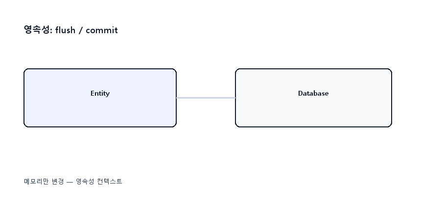

<picture>
  <source media="(prefers-color-scheme: dark)" srcset="../../assets/sections/banner-cs-dark.svg" />
  
</picture>

# 03. ORM과 DB

**엔티티·리포지토리로 표를 다루고, 트랜잭션 경계를 잡는다.**

  
  &nbsp;
  
  &nbsp;
  

 

<picture>
  <source media="(prefers-color-scheme: dark)" srcset="../../assets/sections/section-goals-dark.svg" />
  
</picture>

Nest에서는 TypeORM·Prisma 등이 흔하다.  
이름은 달라도 **매핑 · 로딩 · 트랜잭션** 감각은 Spring JPA와 같다.

대응: Spring **[03. JPA와 영속성](../spring/03_JPA와영속성.md)**

 

<picture>
  <source media="(prefers-color-scheme: dark)" srcset="../../assets/sections/section-contents-dark.svg" />
  
</picture>

| # | 주제 | 한 줄 |
| :--- | :--- | :--- |
| 01 | Entity / Repository | 매핑 |
| 02 | Module에 DB 붙이기 | 설정 |
| 03 | 관계와 로딩 | 조인·lazy |
| 04 | 트랜잭션 | 서비스 경계 |

 

<picture>
  <source media="(prefers-color-scheme: dark)" srcset="../../assets/sections/section-concept-dark.svg" />
  
</picture>

### 01. Entity / Repository

**표의 행을 객체로, 접근 API를 Repository(또는 클라이언트)로 둔다.**

#### 직관

명함철과 창구다.  
Entity는 한 장, Repository는 찾아/저장 창구.

#### 핵심 성질

| 개념 | 내용 |
| :--- | :--- |
| Entity | 컬럼·PK 매핑 |
| Repository | CRUD·쿼리 메서드 |
| Prisma 등 | Repository 대신 Client API여도 역할은 같음 |

- **쓰임**: 저장 계층을 서비스에서 분리할 때

---

### 02. Module에 DB 붙이기

**연결 설정을 루트/기능 모듈에 등록한다.**

#### 직관

창고 주소를 팀 안내판에 적는 일이다.  
`TypeOrmModule.forRoot` / `forFeature`처럼 전역·기능 단위로 나눈다.

#### 핵심 성질

| 개념 | 내용 |
| :--- | :--- |
| forRoot | 연결·방언·엔티티 목록 |
| forFeature | 모듈이 쓸 엔티티 등록 |
| ConfigModule | 환경 변수로 URL·비밀번호 |

- **쓰임**: 로컬/운영 연결 분리, 테스트 DB 교체

---

### 03. 관계와 로딩

**FK 관계를 객체 링크로 표현하고, 언제 불러올지 고른다.**

<picture>
  <source media="(prefers-color-scheme: dark)" srcset="../../assets/videos/be-persist-dark.gif" />
  
</picture>

#### 직관

팀·멤버 명단이다.  
lazy면 필요할 때 열고, eager/join이면 미리 가져온다.

#### 핵심 성질

| 개념 | 내용 |
| :--- | :--- |
| relation | OneToMany 등 |
| lazy / eager | 추가 조회 타이밍 |
| N+1 | 목록 후 연관마다 쿼리 |
| select / include | Prisma 등에서의 명시적 로딩 |

- **쓰임**: 목록 API 성능, over-fetch 방지

---

### 04. 트랜잭션

**여러 쓰기를 한 유스케이스 경계로 묶는다.**

#### 직관

한 장 영수증이다.  
주문 생성과 재고 차감이 함께 성공하거나 함께 실패한다.

#### 핵심 성질

| 개념 | 내용 |
| :--- | :--- |
| 서비스 메서드 경계 | 트랜잭션을 두기 좋은 자리 |
| QueryRunner / `$transaction` | 도구별 API |
| 롤백 | 예외 시 되돌림 |

- **쓰임**: 부분 성공이 위험한 쓰기 경로

 

<picture>
  <source media="(prefers-color-scheme: dark)" srcset="../../assets/sections/section-summary-dark.svg" />
  
</picture>

### 무엇을 먼저 떠올릴까

| 상황 | 후보 |
| :--- | :--- |
| 표 ↔ 객체 | Entity |
| 모듈에서 저장소 사용 | forFeature / DI |
| 목록이 느림 | N+1 · 로딩 전략 |
| 여러 쓰기 | 트랜잭션 |

 

<picture>
  <source media="(prefers-color-scheme: dark)" srcset="../../assets/sections/section-next-dark.svg" />
  
</picture>

다음 장: **[04. 가드와 인증](04_가드와인증.md)** — 접근 허용과 토큰
