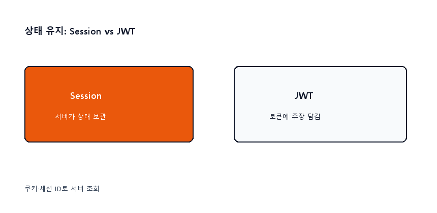
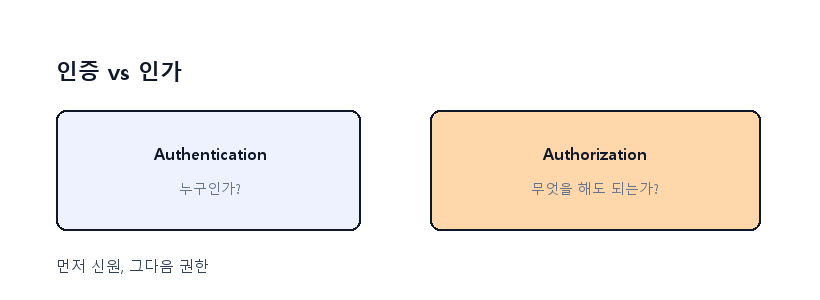

<picture>
  <source media="(prefers-color-scheme: dark)" srcset="../../assets/sections/banner-cs-dark.svg" />
  
</picture>

# 04. 가드와 인증

**가드·전략으로 인증·인가를 요청 앞에 둔다.**

  
  &nbsp;
  
  &nbsp;
  

 

<picture>
  <source media="(prefers-color-scheme: dark)" srcset="../../assets/sections/section-goals-dark.svg" />
  
</picture>

Nest의 Guard는 “이 요청을 핸들러까지 보낼까?”를 답한다.  
Passport/JWT 전략과 합치면 Spring Security 필터의 역할을 TypeScript 방식으로 나눈 모습이 된다.

대응: Spring **[05. 인증·인가](../spring/05_인증인가.md)**

 

<picture>
  <source media="(prefers-color-scheme: dark)" srcset="../../assets/sections/section-contents-dark.svg" />
  
</picture>

| # | 주제 | 한 줄 |
| :--- | :--- | :--- |
| 01 | Guard | 접근 허용 여부 |
| 02 | Passport / JWT | 전략 |
| 03 | Decorator / 요청 유저 | 누가 호출했는지 |
| 04 | 역할 기반 접근 | 인가 |

 

<picture>
  <source media="(prefers-color-scheme: dark)" srcset="../../assets/sections/section-concept-dark.svg" />
  
</picture>

### 01. Guard

**핸들러 호출 전에 통과/거절을 결정한다.**

#### 직관

층별 검문이다.  
미들웨어보다 안쪽, 파이프·핸들러보다 앞에서 막는다.

#### 핵심 성질

| 개념 | 내용 |
| :--- | :--- |
| `CanActivate` | `true`면 통과 |
| `@UseGuards` | 메서드·컨트롤러·전역 |
| 실행 순서 | Middleware → Guard → Interceptor → Pipe → Handler |

- **쓰임**: 인증 여부, API 키, 간단한 인가 게이트

---

### 02. Passport / JWT

**전략으로 “어떻게 신원을 확인할지”를 고른다.**

<picture>
  <source media="(prefers-color-scheme: dark)" srcset="../../assets/videos/be-session-jwt-dark.gif" />
  
</picture>

#### 직관

검문 방식 선택이다.  
쿠키 세션 전략과 Bearer JWT 전략을 갈아 끼울 수 있다.

#### 핵심 성질

| 개념 | 내용 |
| :--- | :--- |
| Passport strategy | local / jwt 등 |
| JWT | 서명 검증 후 payload |
| AuthGuard('jwt') | 전략과 Guard 결합 |

- **쓰임**: SPA·모바일 API의 Bearer 인증

---

### 03. Decorator / 요청 유저

**인증된 사용자를 핸들러 인자로 꺼낸다.**

#### 직관

통과 후 방문증을 건네는 일이다.  
`request.user`에 실린 정보를 `@CurrentUser()` 같은 데코레이터로 읽는다.

#### 핵심 성질

| 개념 | 내용 |
| :--- | :--- |
| `request.user` | 전략이 붙인 principal |
| 커스텀 데코레이터 | 반복되는 `req.user` 접근 정리 |
| 비밀번호 제외 | user 객체에 비밀을 실지 않기 |

- **쓰임**: “내 리소스” 조회·수정

---

### 04. 역할 기반 접근

**역할·권한으로 인가를 선언한다.**

<picture>
  <source media="(prefers-color-scheme: dark)" srcset="../../assets/diagrams/be-authn-authz-dark.png" />
  
</picture>

#### 직관

배지와 열쇠다.  
Roles Guard가 `admin` 배지 없는 요청을 403으로 돌린다.

#### 핵심 성질

| 개념 | 내용 |
| :--- | :--- |
| `@Roles` + RolesGuard | 역할 목록 검사 |
| 401 vs 403 | 미인증 vs 권한 부족 |
| 메서드 단위 인가 | 컨트롤러 if문 분산 방지 |

- **쓰임**: 관리자 API, 본인만 접근 가능한 경로

 

<picture>
  <source media="(prefers-color-scheme: dark)" srcset="../../assets/sections/section-summary-dark.svg" />
  
</picture>

### 무엇을 먼저 떠올릴까

| 상황 | 후보 |
| :--- | :--- |
| 로그인 여부 | Guard + 전략 |
| 토큰 검증 | JWT strategy |
| 핸들러에서 사용자 | request.user / 데코레이터 |
| 관리자만 | Roles / 인가 Guard |

 

<picture>
  <source media="(prefers-color-scheme: dark)" srcset="../../assets/sections/section-next-dark.svg" />
  
</picture>

다음 장: **[05. 예외와 인터셉터](05_예외와인터셉터.md)** — 공통 에러와 횡단 관심사
