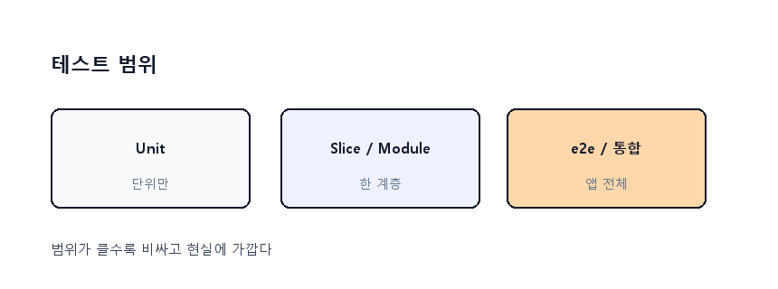

<picture>
  <source media="(prefers-color-scheme: dark)" srcset="../../assets/sections/banner-cs-dark.svg" />
  
</picture>

# 06. 테스트

**TestingModule로 DI를 재조립하고, 단위·e2e로 범위를 나눈다.**

  
  &nbsp;
  
  &nbsp;
  

 

<picture>
  <source media="(prefers-color-scheme: dark)" srcset="../../assets/sections/section-goals-dark.svg" />
  
</picture>

Nest 테스트의 핵심은 **테스트용 모듈을 다시 조립**하는 것이다.  
Spring의 Slice/MockBean과 같은 문제를 다른 이름으로 푼다.

대응: Spring **[06. 테스트와 문서](../spring/06_테스트와문서.md)**

 

<picture>
  <source media="(prefers-color-scheme: dark)" srcset="../../assets/sections/section-contents-dark.svg" />
  
</picture>

| # | 주제 | 한 줄 |
| :--- | :--- | :--- |
| 01 | TestingModule | 테스트용 DI |
| 02 | 단위 테스트 | 서비스 고립 |
| 03 | e2e | 앱 기동 검증 |
| 04 | 모킹 | 외부 의존 대체 |

 

<picture>
  <source media="(prefers-color-scheme: dark)" srcset="../../assets/sections/section-concept-dark.svg" />
  
</picture>

### 01. TestingModule

**프로덕션과 같은 DI 규칙을 테스트에서 다시 깐다.**

<picture>
  <source media="(prefers-color-scheme: dark)" srcset="../../assets/diagrams/be-test-scope-dark.png" />
  
</picture>

#### 직관

연습용 무대 세트다.  
필요한 컨트롤러·서비스만 올리고 나머지는 대타(mock)로 둔다.

#### 핵심 성질

| 개념 | 내용 |
| :--- | :--- |
| `Test.createTestingModule` | 테스트 모듈 빌더 |
| `compile` / `get` | 인스턴스 획득 |
| overrideProvider | 구현 교체 |

- **쓰임**: 가드·파이프가 붙은 컨트롤러 테스트 준비

---

### 02. 단위 테스트

**서비스 규칙만 고립해 검증한다.**

#### 직관

대본 리딩이다.  
DB·HTTP 없이 메서드 결과만 본다.

#### 핵심 성질

| 개념 | 내용 |
| :--- | :--- |
| Jest | Nest 기본에 가까운 러너 |
| mock repository | 저장 계층 대체 |
| 빠른 피드백 | 피라미드 아래층 |

- **쓰임**: 도메인 분기·계산·예외 메시지

---

### 03. e2e

**앱을 띄워 HTTP로 동작을 확인한다.**

#### 직관

리허설 공연이다.  
실제에 가까운 요청/응답으로 배선까지 본다.

#### 핵심 성질

| 개념 | 내용 |
| :--- | :--- |
| `supertest` | HTTP 호출 |
| AppModule 기동 | 넓고 느림 |
| 테스트 DB | 환경 분리 필수 |

- **쓰임**: 인증 가드 + 컨트롤러 + 파이프가 한 경로로 맞는지

---

### 04. 모킹

**외부 의존을 가짜로 바꿔 경계를 고정한다.**

#### 직관

스턴트 배우다.  
결제·메일·타 서비스 호출을 흉내 낸다.

#### 핵심 성질

| 개념 | 내용 |
| :--- | :--- |
| `jest.fn` / mock | 호출 여부·반환값 |
| overrideGuard | 인증을 우회하거나 고정 |
| 과도한 모킹 | 실제와 어긋난 가짜 안정감 |

- **쓰임**: 단위 테스트의 경계, e2e에서의 외부 API

 

<picture>
  <source media="(prefers-color-scheme: dark)" srcset="../../assets/sections/section-summary-dark.svg" />
  
</picture>

### 무엇을 먼저 떠올릴까

| 상황 | 후보 |
| :--- | :--- |
| DI 재조립 | TestingModule |
| 서비스만 | 단위 + mock |
| HTTP 경로 | e2e |
| 외부 장애 격리 | 모킹 |

 

<picture>
  <source media="(prefers-color-scheme: dark)" srcset="../../assets/sections/section-next-dark.svg" />
  
</picture>

NestJS 트랙 본문은 여기까지.  
다음 트랙: **[FastAPI](../fastapi/README.md)** — Depends와 Pydantic으로 같은 문제를 푼다
