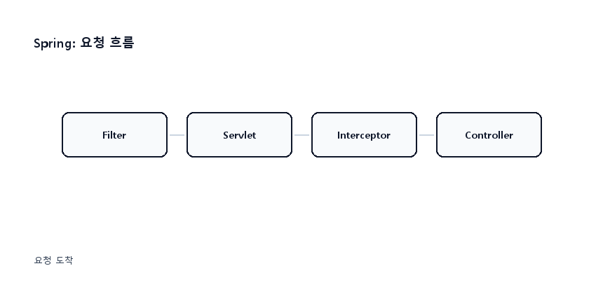

<picture>
  <source media="(prefers-color-scheme: dark)" srcset="../../assets/sections/banner-cs-dark.svg" />
  
</picture>

# 01. 웹 요청 흐름

**HTTP 요청이 컨트롤러까지 오고 응답으로 돌아가기까지의 길을 본다.**

  
  &nbsp;
  
  &nbsp;
  

 

<picture>
  <source media="(prefers-color-scheme: dark)" srcset="../../assets/sections/section-goals-dark.svg" />
  
</picture>

백엔드를 말할 때 가장 먼저 잡는 그림은 **요청이 어디서 들어와 어디로 나가는가**다.  
Spring MVC에서는 그 길의 중심에 `DispatcherServlet`이 있다.

 

<picture>
  <source media="(prefers-color-scheme: dark)" srcset="../../assets/sections/section-contents-dark.svg" />
  
</picture>

| # | 주제 | 한 줄 |
| :--- | :--- | :--- |
| 01 | DispatcherServlet | 요청 진입점 |
| 02 | Controller | 엔드포인트 매핑 |
| 03 | 요청/응답 객체 | HttpServletRequest 감각 |
| 04 | 필터·인터셉터 | 앞뒤에서 끼어드는 단계 |

 

<picture>
  <source media="(prefers-color-scheme: dark)" srcset="../../assets/sections/section-concept-dark.svg" />
  
</picture>

### 00. 왜 흐름을 먼저 보는가

버그·로그·보안·성능 이슈는 대부분 “어느 단계에서 막혔는가”로 설명한다.  
컨트롤러 코드만 보면 그 앞의 Filter·Servlet·Interceptor를 놓치기 쉽다.

---

### 01. DispatcherServlet

**들어온 HTTP 요청을 알맞은 핸들러로 넘기는 프론트 컨트롤러.**

<picture>
  <source media="(prefers-color-scheme: dark)" srcset="../../assets/videos/spring-request-dark.gif" />
  
</picture>

#### 직관

호텔 프론트다.  
손님(요청)이 오면 프론트가 방(핸들러)을 찾아 안내하고, 결과가 나오면 다시 손님에게 건넨다.

#### 핵심 성질

| 개념 | 내용 |
| :--- | :--- |
| Front Controller | 진입을 한곳으로 모은다 |
| HandlerMapping | URL·메서드에 맞는 컨트롤러를 찾는다 |
| HandlerAdapter | 찾은 핸들러를 실제로 호출한다 |
| ViewResolver | 뷰 이름 → 화면 응답 (전통 MVC) |
| HttpMessageConverter | JSON 등 ↔ 객체 (REST에 흔함) |

- **쓰임**: `@RestController`가 “마법”이 아니라 Servlet 위의 매핑·변환 결과임을 이해할 때

> Boot는 이 Servlet을 자동 구성한다. 직접 만들 일은 적어도, **요청이 여기로 모인다**는 감각은 남긴다.

---

### 02. Controller

**URL과 HTTP 메서드를 메서드에 연결하는 엔드포인트 계층.**

#### 직관

메뉴판이다.  
`GET /orders/{id}` 같은 항목이 “이 메서드를 호출하라”는 표기다.

#### 핵심 성질

| 개념 | 내용 |
| :--- | :--- |
| `@RequestMapping` 계열 | 경로·메서드·미디어 타입 매핑 |
| `@PathVariable` / `@RequestParam` | 경로·쿼리 값 바인딩 |
| `@RequestBody` | JSON 등을 객체로 변환 |
| `@ResponseBody` / `@RestController` | 반환값을 본문으로 직렬화 |

- **쓰임**: API 계약의 입구. 비즈니스 규칙은 여기보다 Service에 두는 편이 흔하다.

> 컨트롤러는 **입출력을 열고 닫는 문**이지, 창고 전체를 운영하는 곳이 아니다.

---

### 03. 요청/응답 객체

**서블릿이 넘겨 주는 요청·응답의 껍데기를 감각으로 잡는다.**

#### 직관

편지지와 회신 봉투다.  
헤더·바디·상태 코드·쿠키가 그 안에 적힌다.

#### 핵심 성질

| 개념 | 내용 |
| :--- | :--- |
| `HttpServletRequest` | 메서드, URI, 헤더, 파라미터, 바디 스트림 |
| `HttpServletResponse` | 상태 코드, 헤더, 바디 출력 |
| `HttpEntity` / `ResponseEntity` | Spring이 감싼 요청·응답 표현 |
| 메시지 컨버터 | JSON ↔ 객체 변환 (Jackson 등) |

- **쓰임**: 로그에 method/path/status를 남길 때, 커스텀 헤더·쿠키를 다룰 때

> 프레임워크 애너테이션은 결국 이 객체들에서 값을 꺼내 담는 단축 표기다.

---

### 04. 필터·인터셉터

**컨트롤러 앞뒤에서 공통 작업을 끼워 넣는 단계.**

#### 직관

건물 출입구 보안 검색(Filter)과, 안내 데스크 이후의 층별 검문(Interceptor)이다.  
둘 다 “중간에 끼어든다”는 점은 같고, **걸리는 위치가 다르다**.

#### 핵심 성질

| 구분 | Filter | Interceptor |
| :--- | :--- | :--- |
| 위치 | Servlet 컨테이너 쪽 | Spring MVC 안 |
| 대표 용도 | 인코딩, CORS, 보안 필터 | 로깅, 공통 모델, 핸들러 전후 처리 |
| 인터페이스 | `javax/jakarta.servlet.Filter` | `HandlerInterceptor` |

- **쓰임**: “컨트롤러에 도달하기 전인지, 핸들러 선택 후인지”를 가릴 때

> Spring Security의 필터 체인은 이 Filter 자리에 얹힌다. 다음 인증 장과 이어진다.

 

<picture>
  <source media="(prefers-color-scheme: dark)" srcset="../../assets/sections/section-summary-dark.svg" />
  
</picture>

### 무엇을 먼저 떠올릴까

| 상황 | 후보 |
| :--- | :--- |
| 요청이 컨트롤러에 안 올 때 | Filter / Security / 매핑 |
| URL은 맞는데 메서드가 안 맞을 때 | HandlerMapping · HTTP 메서드 |
| JSON이 안 붙을 때 | 메시지 컨버터 · Content-Type |
| 공통 전처리가 필요할 때 | Filter vs Interceptor 위치 |

요청 흐름을 말로 그릴 수 있으면, 이후 계층·보안·예외 장을 같은 지도 위에 올릴 수 있다.

 

<picture>
  <source media="(prefers-color-scheme: dark)" srcset="../../assets/sections/section-next-dark.svg" />
  
</picture>

다음 장: **[02. 계층과 DI](02_Layers_DI.md)** — 역할을 나누고 조립하는 방법
