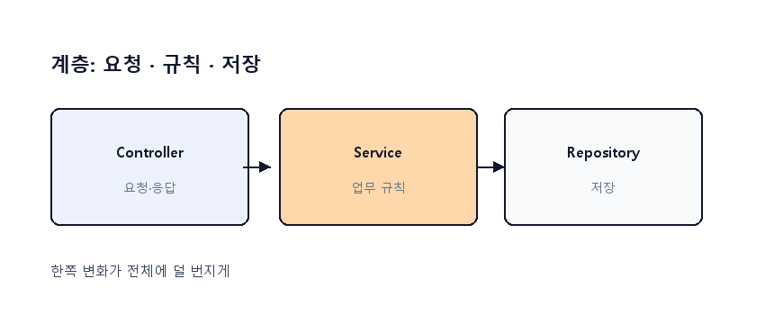
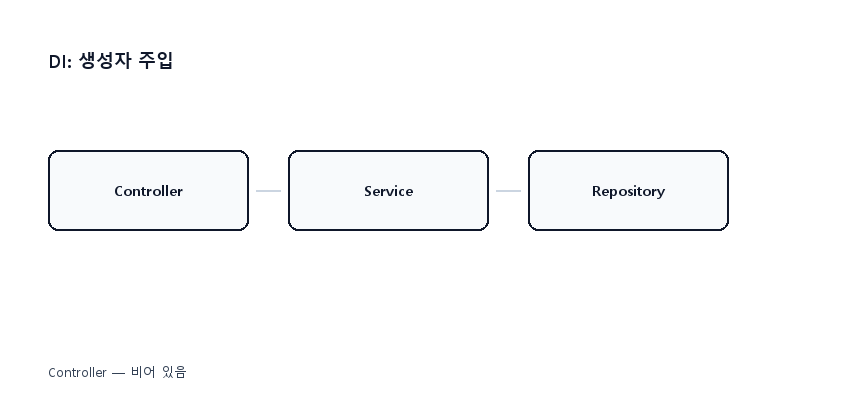

<picture>
  <source media="(prefers-color-scheme: dark)" srcset="../../assets/sections/banner-cs-dark.svg" />
  
</picture>

# 02. 계층과 DI

**역할을 나누고, 필요한 의존성을 조립해 넣는 방식.**

  
  &nbsp;
  
  &nbsp;
  

 

<picture>
  <source media="(prefers-color-scheme: dark)" srcset="../../assets/sections/section-goals-dark.svg" />
  
</picture>

컨트롤러만 비대해지면 테스트·변경·이해가 한꺼번에 어려워진다.  
Spring은 **계층으로 책임을 나누고**, 그 사이를 **의존성 주입(DI)** 으로 연결한다.

 

<picture>
  <source media="(prefers-color-scheme: dark)" srcset="../../assets/sections/section-contents-dark.svg" />
  
</picture>

| # | 주제 | 한 줄 |
| :--- | :--- | :--- |
| 01 | 계층 구조 | 요청·규칙·저장 분리 |
| 02 | @Bean / @Component | 빈 등록 |
| 03 | 생성자 주입 | 권장 주입 방식 |
| 04 | 설정과 프로파일 | 환경별 조립 |

 

<picture>
  <source media="(prefers-color-scheme: dark)" srcset="../../assets/sections/section-concept-dark.svg" />
  
</picture>

### 01. 계층 구조

**요청 입구, 업무 규칙, 저장을 역할별로 나눈다.**

<picture>
  <source media="(prefers-color-scheme: dark)" srcset="../../assets/diagrams/spring-layers-dark.png" />
  
</picture>

#### 직관

식당이다.  
홀(Controller)은 주문을 받고, 주방(Service)은 요리를 정하며, 창고(Repository)는 재료를 꺼낸다.

#### 핵심 성질

| 계층 | 역할 |
| :--- | :--- |
| Controller | HTTP 입출력, 상태 코드, DTO 변환 |
| Service | 유스케이스·트랜잭션 경계·도메인 규칙 |
| Repository | DB·외부 API 같은 저장/조회 |

- **쓰임**: “어디를 고쳐야 하는가”를 말할 때, 테스트 범위를 나눌 때

> 이름이 달라도 **입구 / 규칙 / 저장** 삼분법이 반복된다.

---

### 02. @Bean / @Component

**스프링 컨테이너가 관리할 객체를 등록하는 표식.**

#### 직관

부품 창고 목록이다.  
등록된 부품만 “필요할 때 꺼내 조립”할 수 있다.

#### 핵심 성질

| 개념 | 내용 |
| :--- | :--- |
| `@Component` | 클래스 자체에 “빈이다” 표기 (`@Service` 등 특수화 포함) |
| `@Bean` | `@Configuration` 메서드가 만든 인스턴스를 빈으로 등록 |
| IoC 컨테이너 | 생성·수명·주입을 프레임워크가 관리 |
| 스코프 | 기본 singleton, 요청마다 새로 만드는 request 등 |

- **쓰임**: 서드파티 객체를 `@Bean`으로 감쌀 때, 직접 `new`로 연결하지 않을 때

> DI는 “누가 `new` 하느냐”의 문제다. 컨테이너가 만들면 테스트에서 대체하기 쉽다.

---

### 03. 생성자 주입

**필수 의존성을 생성자로 받아 불변에 가깝게 고정한다.**

<picture>
  <source media="(prefers-color-scheme: dark)" srcset="../../assets/videos/be-di-dark.gif" />
  
</picture>

#### 직관

조립 설명서다.  
부품이 빠진 채로 상자가 완성되지 않게, 처음부터 필요한 것을 다 끼운다.

#### 핵심 성질

| 방식 | 감각 |
| :--- | :--- |
| 생성자 주입 | 필수 의존, 테스트·불변에 유리 (권장) |
| 필드 `@Autowired` | 짧지만 테스트·순환 의존 추적이 어려울 수 있음 |
| Setter 주입 | 선택적 의존에 가깝다 |

- **쓰임**: Service가 Repository를 받을 때, 순환 참조가 보이면 설계를 다시 볼 때

> “이 객체 없이 동작하면 안 된다”면 생성자로 받는다.

---

### 04. 설정과 프로파일

**환경(local/dev/prod)마다 다른 빈·설정을 고른다.**

#### 직관

무대 세트 교체다.  
같은 연극(앱)인데 배경(DB URL, 외부 키)만 바꾼다.

#### 핵심 성질

| 개념 | 내용 |
| :--- | :--- |
| `application.yml` | 기본 설정 |
| `spring.profiles.active` | 활성 프로파일 |
| `@Profile` | 특정 환경에서만 빈 등록 |
| `@ConfigurationProperties` | 설정 값을 타입 있는 객체로 |

- **쓰임**: 로컬은 H2, 운영은 RDS처럼 조립만 갈아끼울 때

> 비밀값은 코드에 박지 말고 **환경·시크릿 저장소** 쪽 감각으로 둔다.

 

<picture>
  <source media="(prefers-color-scheme: dark)" srcset="../../assets/sections/section-summary-dark.svg" />
  
</picture>

### 무엇을 먼저 떠올릴까

| 상황 | 후보 |
| :--- | :--- |
| 컨트롤러가 비대할 때 | Service로 규칙 이동 |
| `new`로 직접 연결할 때 | 빈 등록 + 생성자 주입 |
| 환경마다 DB가 다를 때 | Profile / 설정 분리 |
| 테스트에서 대체하고 싶을 때 | 인터페이스 + DI |

계층은 폴더 이름이 아니라 **변경의 경계를 긋는 말**이다.

 

<picture>
  <source media="(prefers-color-scheme: dark)" srcset="../../assets/sections/section-next-dark.svg" />
  
</picture>

다음 장: **[03. JPA와 영속성](03_JPA_Persistence.md)** — 객체와 표를 어떻게 이어 두는가
