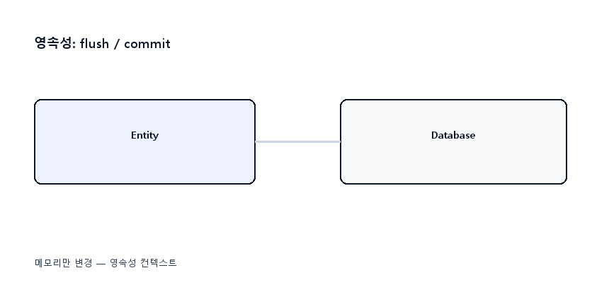

<picture>
  <source media="(prefers-color-scheme: dark)" srcset="../../assets/sections/banner-cs-dark.svg" />
  
</picture>

# 03. JPA와 영속성

**객체를 표에 어떻게 매핑하고, 언제 DB에 반영되는지 본다.**

  
  &nbsp;
  
  &nbsp;
  

 

<picture>
  <source media="(prefers-color-scheme: dark)" srcset="../../assets/sections/section-goals-dark.svg" />
  
</picture>

SQL을 매번 손으로 쓰지 않아도, **언제 INSERT/UPDATE가 나가는지**를 모르면 버그가 난다.  
JPA는 객체 ↔ 관계형 표의 번역기이고, 영속성 컨텍스트가 그 중간 메모장이다.

 

<picture>
  <source media="(prefers-color-scheme: dark)" srcset="../../assets/sections/section-contents-dark.svg" />
  
</picture>

| # | 주제 | 한 줄 |
| :--- | :--- | :--- |
| 01 | Entity / Repository | 표와 객체의 매핑 |
| 02 | 영속성 컨텍스트 | 1차 캐시 감각 |
| 03 | 연관관계 | FK와 매핑 |
| 04 | 트랜잭션 | @Transactional 경계 |

 

<picture>
  <source media="(prefers-color-scheme: dark)" srcset="../../assets/sections/section-concept-dark.svg" />
  
</picture>

### 01. Entity / Repository

**표의 한 행을 객체로, 조회·저장 API를 Repository로 둔다.**

#### 직관

명함철(표)과 명함(행)이다.  
Entity는 명함 한 장, Repository는 “이름으로 찾아 줘 / 꽂아 줘” 창구다.

#### 핵심 성질

| 개념 | 내용 |
| :--- | :--- |
| `@Entity` | 테이블에 매핑되는 도메인 객체 |
| `@Id` / 생성 전략 | 기본키와 채번 방식 |
| `JpaRepository` | 기본 CRUD·쿼리 메서드 |
| DTO와 구분 | API 입출력 ≠ 영속 엔티티를 그대로 노출 |

- **쓰임**: Spring Data JPA로 저장 계층을 얇게 유지할 때

> 엔티티를 API에 그대로 내보내면 지연 로딩·순환 참조에 자주 걸린다.

---

### 02. 영속성 컨텍스트

**엔티티를 추적하는 1차 캐시. 커밋 전까지의 작업 공간.**

<picture>
  <source media="(prefers-color-scheme: dark)" srcset="../../assets/videos/be-persist-dark.gif" />
  
</picture>

#### 직관

칠판 초안이다.  
글자를 고쳐도 아직 인쇄(DB)는 안 됐고, flush/commit 때 반영된다.

#### 핵심 성질

| 개념 | 내용 |
| :--- | :--- |
| 1차 캐시 | 같은 트랜잭션에서 동일 id는 같은 인스턴스 |
| dirty checking | 변경 감지 후 UPDATE 후보 |
| flush | SQL을 DB에 전송 (아직 커밋 전일 수 있음) |
| detach / clear | 추적에서 벗어남 |

- **쓰임**: “저장 안 했는데 DB에 있다/없다” 혼란을 풀 때

> `save` 호출 ≠ 즉시 커밋. **트랜잭션 경계**와 함께 본다.

---

### 03. 연관관계

**FK로 이어진 표를 객체 참조로 표현한다.**

#### 직관

팀과 멤버 명단이다.  
멤버 카드에 팀 이름이 적혀 있거나(단방향), 팀 명단에 멤버가 적혀 있다(양방향).

#### 핵심 성질

| 개념 | 내용 |
| :--- | :--- |
| `@ManyToOne` / `@OneToMany` 등 | 카디널리티 매핑 |
| 연관의 주인 | FK를 실제로 가진 쪽 |
| LAZY / EAGER | 언제 조인·추가 조회할지 |
| N+1 | 목록 조회 후 연관마다 추가 쿼리 |

- **쓰임**: fetch join·엔티티 그래프·DTO 조회로 N+1을 줄일 때

> “객체 그래프가 편하다”와 “쿼리가 폭발한다”는 한 쌍으로 기억한다.

---

### 04. 트랜잭션

**성공하면 함께 커밋, 실패하면 함께 롤백하는 경계.**

#### 직관

한 장의 영수증이다.  
항목 중 하나라도 실패하면 전체 결제가 취소된다.

#### 핵심 성질

| 개념 | 내용 |
| :--- | :--- |
| `@Transactional` | 보통 Service 메서드에 경계 |
| 전파(propagation) | 기존 트랜잭션에 참여할지 새로 열지 |
| 롤백 규칙 | 런타임 예외 기준이 흔함 (설정으로 조정) |
| 읽기 전용 | 조회 전용 힌트 |

- **쓰임**: 주문 생성 + 재고 차감처럼 여러 쓰기를 한 유스케이스로 묶을 때

> 컨트롤러에 트랜잭션을 두기보다 **유스케이스(Service)** 에 두는 편이 경계가 분명하다.

 

<picture>
  <source media="(prefers-color-scheme: dark)" srcset="../../assets/sections/section-summary-dark.svg" />
  
</picture>

### 무엇을 먼저 떠올릴까

| 상황 | 후보 |
| :--- | :--- |
| 저장했는데 DB에 없을 때 | 트랜잭션·커밋·예외 롤백 |
| 같은 id가 두 객체처럼 보일 때 | 영속성 컨텍스트 밖 |
| 목록이 유독 느릴 때 | N+1 · LAZY |
| API에 엔티티를 실을 때 | DTO 분리 검토 |

JPA를 쓴다는 것은 SQL을 숨기는 것이 아니라 **매핑과 타이밍을 프레임워크에 위임**하는 것이다.

 

<picture>
  <source media="(prefers-color-scheme: dark)" srcset="../../assets/sections/section-next-dark.svg" />
  
</picture>

다음 장: **[04. 검증과 예외](04_Validation_Exception.md)** — 잘못된 입력과 실패를 어떻게 계약으로 돌리는가
