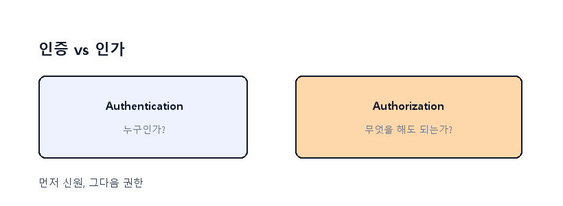
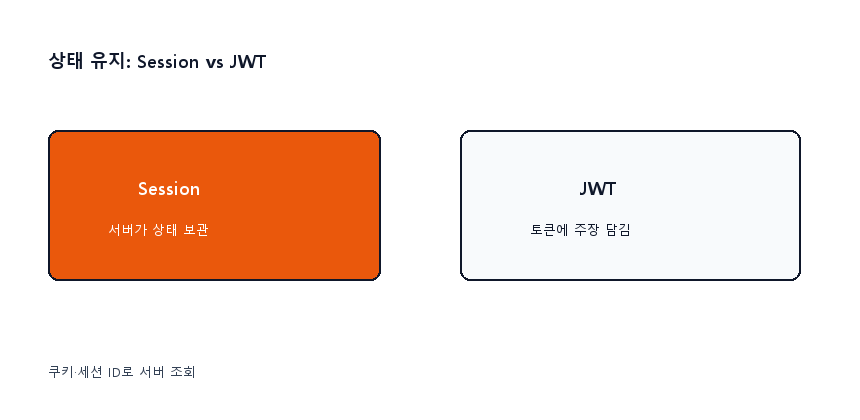
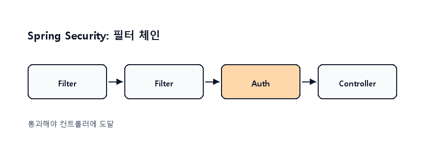

<picture>
  <source media="(prefers-color-scheme: dark)" srcset="../../assets/sections/banner-cs-dark.svg" />
  
</picture>

# 05. 인증·인가

**누구인지 확인하고, 무엇을 할 수 있는지 가른다.**

  
  &nbsp;
  
  &nbsp;
  

 

<picture>
  <source media="(prefers-color-scheme: dark)" srcset="../../assets/sections/section-goals-dark.svg" />
  
</picture>

보안은 “로그인 화면”이 전부가 아니다.  
**신원(인증)** 과 **권한(인가)** 을 요청 파이프라인 어디에 둘지가 Spring Security의 핵심이다.

 

<picture>
  <source media="(prefers-color-scheme: dark)" srcset="../../assets/sections/section-contents-dark.svg" />
  
</picture>

| # | 주제 | 한 줄 |
| :--- | :--- | :--- |
| 01 | Authentication vs Authorization | 인증과 인가 |
| 02 | Session / JWT | 상태 유지 방식 |
| 03 | Spring Security 흐름 | 필터 체인 감각 |
| 04 | 역할·권한 | 메서드 보안 개요 |

 

<picture>
  <source media="(prefers-color-scheme: dark)" srcset="../../assets/sections/section-concept-dark.svg" />
  
</picture>

### 01. Authentication vs Authorization

**인증은 신원, 인가는 허용 범위.**

<picture>
  <source media="(prefers-color-scheme: dark)" srcset="../../assets/diagrams/be-authn-authz-dark.png" />
  
</picture>

#### 직관

회사 출입이다.  
사원증으로 “누구인지” 확인하고(인증), 서버실 출입 권한이 있는지 본다(인가).

#### 핵심 성질

| 구분 | 질문 | 실패 시 감각 |
| :--- | :--- | :--- |
| Authentication | 누구인가? | 401 Unauthorized |
| Authorization | 해도 되는가? | 403 Forbidden |

- **쓰임**: 로그·에러 코드를 나눌 때, 보안 리뷰에서 경계를 말할 때

> 두 단어를 섞어 쓰면 원인 분석이 흐려진다. 먼저 갈라 말한다.

---

### 02. Session / JWT

**로그인 상태를 서버에 둘지, 토큰에 실을지.**

<picture>
  <source media="(prefers-color-scheme: dark)" srcset="../../assets/videos/be-session-jwt-dark.gif" />
  
</picture>

#### 직관

옷깃 번호표(세션 ID) vs 서명된 출입증(JWT)이다.  
번호표는 창고(서버 세션 저장소)를 열어 보고, 출입증은 도장(서명)을 검증한다.

#### 핵심 성질

| 방식 | 감각 |
| :--- | :--- |
| Session | 서버가 상태 보관, 쿠키에 세션 ID |
| JWT | 클레임을 토큰에 담고 서명 검증 |
| 만료·갱신 | 둘 다 필요. 로그아웃·폐지 전략이 다름 |
| 스케일 | 세션은 공유 저장소, JWT는 무상태 지향 |

- **쓰임**: 브라우저 쿠키 기반 vs 모바일·SPA Bearer 헤더

> JWT가 “더 안전”한 것이 아니다. **탈취·만료·갱신·폐기** 설계가 안전하다.

---

### 03. Spring Security 흐름

**필터 체인에서 인증·인가를 요청 앞에 둔다.**

<picture>
  <source media="(prefers-color-scheme: dark)" srcset="../../assets/diagrams/spring-security-chain-dark.png" />
  
</picture>

#### 직관

건물 로비 검색대 여러 개다.  
통과하지 못하면 사무실(컨트롤러)에 못 간다.

#### 핵심 성질

| 개념 | 내용 |
| :--- | :--- |
| Security Filter Chain | 요청이 컨트롤러 전 필터들을 순서대로 통과 |
| `SecurityContext` | 현재 인증 정보를 담는 통 |
| `Authentication` | principal + authorities |
| `SecurityFilterChain` 빈 | Boot 3 스타일의 HTTP 보안 설정 |

- **쓰임**: 401/403이 컨트롤러 전에 나는 이유를 추적할 때

> 디버깅은 “컨트롤러 breakpoint”보다 **어느 필터에서 거절했는지**가 먼저다.

---

### 04. 역할·권한

**역할(Role)과 권한(Authority)으로 접근을 나눈다.**

#### 직관

직책 배지와 열쇠 묶음이다.  
`ROLE_ADMIN` 배지가 있으면 관리 열쇠 묶음을 준다고 약속할 수 있다.

#### 핵심 성질

| 개념 | 내용 |
| :--- | :--- |
| Role | 권한의 묶음으로 쓰는 관례 (`ROLE_` 접두) |
| Authority | 개별 허가 단위 |
| URL 보안 | `authorizeHttpRequests` 등 경로 규칙 |
| 메서드 보안 | `@PreAuthorize` 등으로 서비스 메서드 보호 |

- **쓰임**: “관리자만”, “본인 리소스만” 같은 규칙을 URL과 메서드에 나눌 때

> 인가 규칙을 컨트롤러 if문에 흩뿌리면 빠뜨리기 쉽다. **선언적 위치**를 정한다.

 

<picture>
  <source media="(prefers-color-scheme: dark)" srcset="../../assets/sections/section-summary-dark.svg" />
  
</picture>

### 무엇을 먼저 떠올릴까

| 상황 | 후보 |
| :--- | :--- |
| 로그인 전/후 구분 | Authentication |
| 로그인은 됐는데 거부 | Authorization · Role |
| 상태 유지 방식 | Session vs JWT |
| 컨트롤러에 도달 전 거절 | Security Filter Chain |

보안은 기능 추가가 아니라 **요청 길 위에 검문소를 어디에 둘지**의 설계다.

 

<picture>
  <source media="(prefers-color-scheme: dark)" srcset="../../assets/sections/section-next-dark.svg" />
  
</picture>

다음 장: **[06. 테스트와 문서](06_테스트와문서.md)** — 동작을 고정하고 계약을 드러낸다
