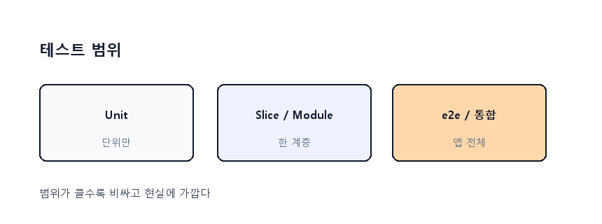

<picture>
  <source media="(prefers-color-scheme: dark)" srcset="../../assets/sections/banner-cs-dark.svg" />
  
</picture>

# 06. 테스트와 문서

**동작을 테스트로 고정하고, API 계약을 문서로 드러낸다.**

  
  &nbsp;
  
  &nbsp;
  

 

<picture>
  <source media="(prefers-color-scheme: dark)" srcset="../../assets/sections/section-goals-dark.svg" />
  
</picture>

구현만 있고 검증·문서가 없으면 리팩터링이 무섭다.  
Spring에서는 **테스트 범위**를 고르고, OpenAPI로 **계약을 공유**하는 패턴이 흔하다.

 

<picture>
  <source media="(prefers-color-scheme: dark)" srcset="../../assets/sections/section-contents-dark.svg" />
  
</picture>

| # | 주제 | 한 줄 |
| :--- | :--- | :--- |
| 01 | @SpringBootTest / Slice | 테스트 범위 |
| 02 | MockMvc | 웹 계층 검증 |
| 03 | Testcontainers 감각 | 실 DB에 가깝게 |
| 04 | OpenAPI / SpringDoc | 문서화 |

 

<picture>
  <source media="(prefers-color-scheme: dark)" srcset="../../assets/sections/section-concept-dark.svg" />
  
</picture>

### 01. @SpringBootTest / Slice

**전체를 띄울지, 한 조각만 띄울지 고른다.**

<picture>
  <source media="(prefers-color-scheme: dark)" srcset="../../assets/diagrams/be-test-scope-dark.png" />
  
</picture>

#### 직관

리허설 규모다.  
대사만(단위), 한 막만(슬라이스), 전 공연(통합)을 고른다.

#### 핵심 성질

| 애너테이션 감각 | 범위 |
| :--- | :--- |
| 순수 단위 | 스프링 없이 클래스만 |
| `@WebMvcTest` 등 Slice | 웹·JPA 등 한 계층 |
| `@SpringBootTest` | 애플리케이션에 가깝게 |
| `@MockBean` | 경계 너머 의존 대체 |

- **쓰임**: 빠른 피드백이 필요하면 좁게, 배선 검증이 필요하면 넓게

> 모든 테스트를 통합으로 두면 느리고 깨지기 쉽다. **피라미드**를 의식한다.

---

### 02. MockMvc

**HTTP를 흉내 내어 컨트롤러 계층을 검증한다.**

#### 직관

연습용 창구다.  
실제 포트에 바인딩하지 않고도 GET/POST와 상태 코드·JSON을 확인한다.

#### 핵심 성질

| 개념 | 내용 |
| :--- | :--- |
| `mockMvc.perform` | 요청 시뮬레이션 |
| `andExpect` | status, jsonPath 등 단언 |
| 보안 테스트 | `with(user(...))` 등으로 인증 맥락 |
| `@AutoConfigureMockMvc` | Boot 테스트와 함께 자주 사용 |

- **쓰임**: 매핑·검증·예외 Advice가 기대 응답을 만드는지 확인할 때

> MockMvc는 “브라우저”가 아니라 **디스패처 경로의 연습**에 가깝다.

---

### 03. Testcontainers 감각

**테스트에서 실제 DB·브로커에 가까운 환경을 잠깐 띄운다.**

#### 직관

이동식 연습실이다.  
테스트가 시작되면 Docker로 Postgres 등을 올리고, 끝나면 치운다.

#### 핵심 성질

| 개념 | 내용 |
| :--- | :--- |
| 컨테이너 수명 | 테스트 클래스/스위트 단위로 재사용 가능 |
| 이점 | H2와 다른 SQL 방언·제약 차이를 줄임 |
| 비용 | Docker 필요, 단위 테스트보다 느림 |
| 대안 | 로컬 Testcontainers vs CI 서비스 컨테이너 |

- **쓰임**: JPA 매핑·마이그레이션·제약조건이 중요한 통합 테스트

> “항상 실DB”가 목표는 아니다. **위험도가 높은 경계**에 쓴다.

---

### 04. OpenAPI / SpringDoc

**코드에서 API 명세를 드러내 공유한다.**

#### 직관

메뉴판 자동 생성이다.  
엔드포인트·스키마·예제가 Swagger UI로 보인다.

#### 핵심 성질

| 개념 | 내용 |
| :--- | :--- |
| OpenAPI | 계약 기술 표준 |
| springdoc-openapi | Boot와 연동해 문서·UI 제공 |
| 애너테이션 | 요약, 예제, 보안 스키마 보강 |
| 계약 우선 | 문서가 코드와 어긋나면 신뢰를 잃음 |

- **쓰임**: 프론트·외부 팀과 엔드포인트를 맞출 때, 수동 Wiki 대신

> 문서는 장식이 아니라 **테스트와 같은 계약 산출물**로 다룬다.

 

<picture>
  <source media="(prefers-color-scheme: dark)" srcset="../../assets/sections/section-summary-dark.svg" />
  
</picture>

### 무엇을 먼저 떠올릴까

| 상황 | 후보 |
| :--- | :--- |
| 서비스 로직만 검증 | 단위 테스트 |
| HTTP 매핑·검증 | MockMvc / WebMvcTest |
| SQL·제약 실제성 | Testcontainers |
| 팀과 API 공유 | OpenAPI / SpringDoc |

Spring 트랙의 축은 여기까지다.  
같은 주제를 Nest·FastAPI 이름으로 다시 읽으면 비교가 빨라진다.

 

<picture>
  <source media="(prefers-color-scheme: dark)" srcset="../../assets/sections/section-next-dark.svg" />
  
</picture>

Spring 트랙 본문은 여기까지.  
다음 트랙: **[NestJS](../nestjs/README.md)** — 모듈·가드·파이프로 같은 문제를 푼다
