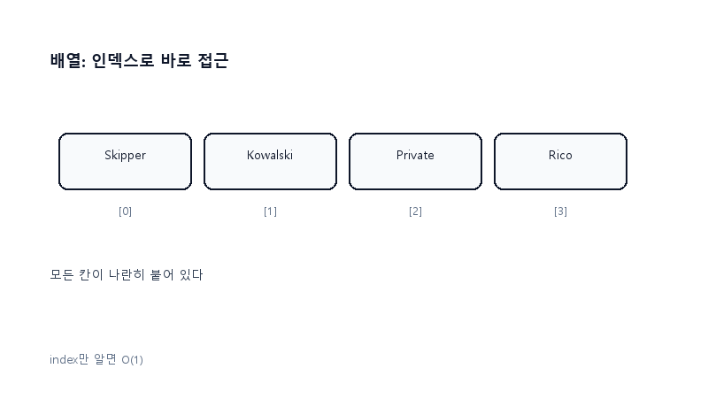
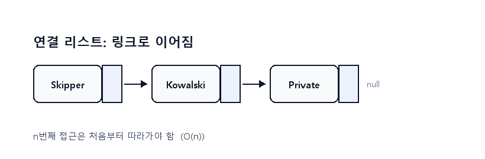
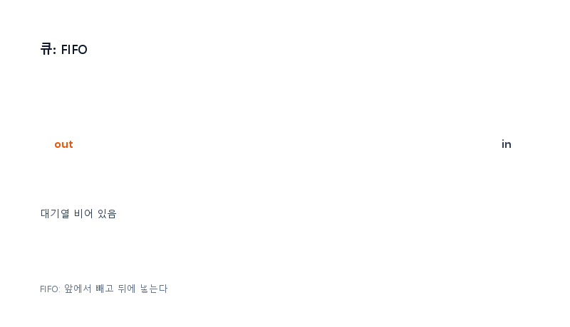
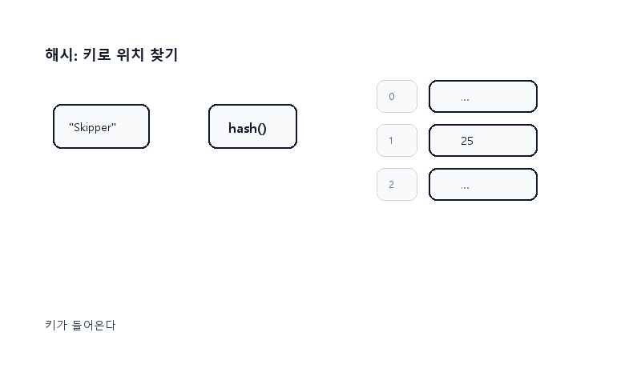
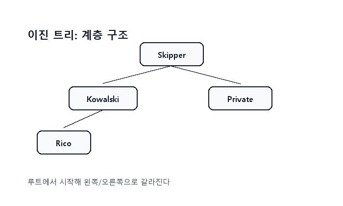
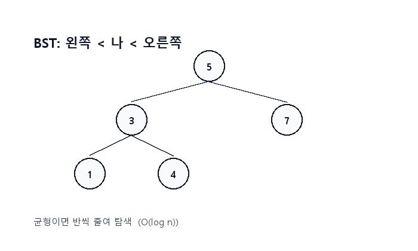
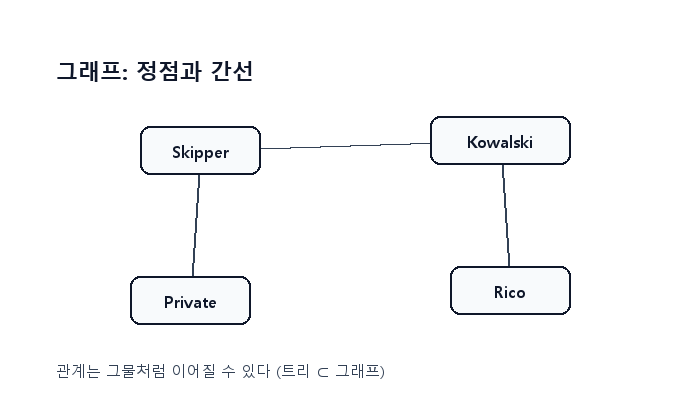
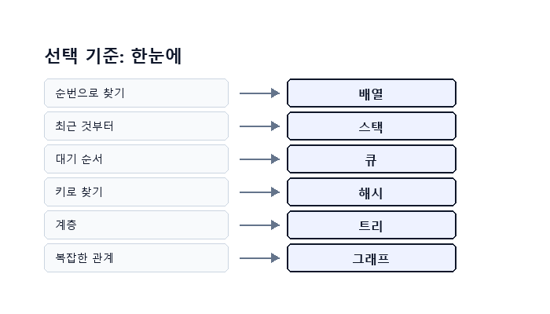

<picture>
  <source media="(prefers-color-scheme: dark)" srcset="../assets/sections/banner-cs-dark.svg" />
  
</picture>

# 01. 자료구조

**데이터를 어떻게 담느냐가, 찾고 넣고 지우는 비용을 가릅니다.**

  
  &nbsp;
  
  &nbsp;
  

 

<picture>
  <source media="(prefers-color-scheme: dark)" srcset="../assets/sections/section-goals-dark.svg" />
  
</picture>

프로그램은 결국 **데이터를 담고, 찾고, 넣고, 지우는 일**의 반복이다.  
자료구조는 그 데이터를 **어떤 모양으로 담을지**에 대한 약속이다.

같은 데이터라도 담는 방식에 따라

- 찾는 속도
- 중간에 끼워 넣는 비용
- 메모리 사용 방식

이 크게 달라진다. “정답 자료구조”는 없고, **문제에 맞는 선택**이 있다.

 

<picture>
  <source media="(prefers-color-scheme: dark)" srcset="../assets/sections/section-concept-dark.svg" />
  
</picture>

### 00. 왜 자료구조가 필요한가

예를 들어 “펭귄 이름 목록에서 스키퍼를 찾고 싶다”고 하자.

- 이름이 **줄 서 있는 명단**이면, 앞에서부터 하나씩 확인해야 할 수 있다.
- 이름표가 **가나다순 사물함**처럼 정해진 칸에 있다면, 훨씬 빨리 열 수 있다.

자료구조를 고른다는 것은 곧 이런 질문에 답하는 것이다.

1. 자주 하는 작업이 **찾기**인가, **추가/삭제**인가?
2. **순서**가 중요한가?
3. **키(이름)로 바로** 찾고 싶은가, **몇 번째**로 찾고 싶은가?

복잡도는 보통 Big-O로 말한다. 지금 단계에서는 숫자보다 감만 잡으면 충분하다.

| 표기 | 감각 |
| :--- | :--- |
| O(1) | 칸 번호를 알면 바로 연다 |
| O(log n) | 반씩 나눠 가며 찾는다 |
| O(n) | 처음부터 끝까지 훑을 수 있다 |
| O(n²) | 이중으로 훑어, 커질수록 급격히 느리다 |

---

### 01. 배열 (Array)

**연속된 칸 + 인덱스로 바로 접근하는 기본 구조.**

<picture>
  <source media="(prefers-color-scheme: dark)" srcset="../assets/videos/array-index-dark.gif" />
  
</picture>

#### 직관

영화관 좌석처럼 칸마다 번호(인덱스)가 붙어 있다.  
“몇 번 좌석”을 말하면 그 자리로 바로 갈 수 있다.

#### 핵심 성질

| 작업 | 대략적 비용 | 이유 |
| :--- | :--- | :--- |
| 인덱스로 읽기/쓰기 | O(1) | 주소 계산으로 바로 접근 |
| 맨 끝 추가 | 평균 빠름 | 뒤에 붙이면 됨 |
| 중간 삽입/삭제 | O(n) | 뒤쪽을 밀거나 당겨야 함 |

- **장점**: 임의 접근이 빠르고, 이해/구현이 단순하다.
- **단점**: 중간 삽입 비용이 크고, 값으로 찾기는 기본적으로 O(n)일 수 있다.
- **쓰임**: 순서가 있는 목록, 인덱스가 의미 있는 데이터, 스택/큐 구현의 기반.

> Python `list`, Java `ArrayList`는 크기가 늘어나는 배열에 가깝다.  
> **인덱스 접근은 빠르고 중간 삽입은 비싸다**는 직관은 같다.

---

### 02. 연결 리스트 (Linked List)

**값 + 다음 노드 링크로 이어진 목록.**

<picture>
  <source media="(prefers-color-scheme: dark)" srcset="../assets/diagrams/ds-linked-list-dark.png" />
  
</picture>

#### 직관

보물찾기처럼 “다음 쪽지는 저쪽”이라는 화살표로 이어진다.  
좌석 번호로 점프하기보다, 링크를 따라가야 한다.

#### 핵심 성질

| 작업 | 대략적 비용 | 이유 |
| :--- | :--- | :--- |
| 맨 앞 삽입/삭제 | O(1) | head만 바꾸면 됨 |
| n번째 접근 | O(n) | 처음부터 따라가야 함 |
| 중간 삽입 (노드를 이미 알 때) | O(1) | 링크만 다시 연결 |

- **배열**: “몇 번?” → 빠름 / “사이에 끼우기” → 느릴 수 있음
- **연결 리스트**: “사이에 끼우기” → 상대적으로 쉬움 / “100번째” → 느림
- **쓰임**: 앞뒤에서 넣고 빼는 구조의 이론적 기반, 면접/시험 단골 개념

실무에서는 동적 배열을 더 자주 쓰지만, **연속 저장 vs 링크 연결** 차이는 다른 구조를 이해할 때 계속 쓰인다.

---

### 03. 스택 (Stack)

**나중에 넣은 것이 먼저 나온다. (LIFO)**

<picture>
  <source media="(prefers-color-scheme: dark)" srcset="../assets/videos/stack-lifo-dark.gif" />
  
</picture>

#### 직관

접시 쌓기. 맨 위 접시만 내려놓을 수 있다.

- **push**: 맨 위에 넣기
- **pop**: 맨 위에서 꺼내기
- **peek**: 맨 위만 보기

- **쓰임**: 함수 호출 스택, Undo, 괄호 짝, DFS

**한 문장**: 스택은 “가장 최근 것부터 처리”할 때 쓴다.

---

### 04. 큐 (Queue)

**먼저 넣은 것이 먼저 나온다. (FIFO)**

<picture>
  <source media="(prefers-color-scheme: dark)" srcset="../assets/videos/queue-fifo-dark.gif" />
  
</picture>

#### 직관

은행 대기열. 줄 선 순서대로 창구에 간다.

- **enqueue**: 뒤에 넣기
- **dequeue**: 앞에서 꺼내기

- **쓰임**: 인쇄/메시지 대기열, BFS, 요청을 순서대로 처리하는 모델

| | 스택 | 큐 |
| :--- | :--- | :--- |
| 순서 | 최신 우선 | 오래된 것 우선 |
| 비유 | 접시 더미 | 대기줄 |

---

### 05. 해시 테이블 (Hash Table)

**키를 해시해 저장 위치를 정하고, 평균 O(1)로 찾는다.**

<picture>
  <source media="(prefers-color-scheme: dark)" srcset="../assets/videos/hash-lookup-dark.gif" />
  
</picture>

#### 직관

사물함. “스키퍼”라는 이름표를 규칙(해시)으로 사물함 번호로 바꾼 뒤 그 칸을 연다.

- **평균**: 삽입/삭제/조회가 O(1)에 가깝다
- **최악**: 충돌이 몰리면 느려질 수 있다
- **순서**: 본질적으로 순서를 보장하지 않는다 (구현에 따라 다름)

**충돌**: 서로 다른 키가 같은 칸으로 모이는 현상.  
연결 리스트로 칸에 여러 개를 달거나, 다른 빈 칸을 찾는 식으로 해결한다.

- **쓰임**: `dict` / `HashMap`, 캐시, 카운팅, 빠른 멤버십 검사
- **선택 기준**: 순번이 중요하면 배열, 키가 중요하면 해시

---

### 06. 트리 (Tree)

**루트에서 시작해 자식으로 갈라지는 계층 구조.**

<picture>
  <source media="(prefers-color-scheme: dark)" srcset="../assets/diagrams/ds-tree-dark.png" />
  
</picture>

#### 직관

족보, 폴더 트리, 회사 조직도. (사이클이 없는 연결 구조)

- **루트**: 가장 위 노드
- **부모 / 자식**: 연결 관계
- **잎(leaf)**: 자식이 없는 노드
- **이진 트리**: 자식이 최대 2개 (left, right)

- **쓰임**: 파일 시스템, HTML DOM, 검색 트리의 뼈대

---

### 07. 이진 탐색 트리 (BST)

**왼쪽 &lt; 나 &lt; 오른쪽**을 지키는 이진 트리.

<picture>
  <source media="(prefers-color-scheme: dark)" srcset="../assets/diagrams/ds-bst-dark.png" />
  
</picture>

#### 직관

사전을 펼쳐 “중간보다 앞/뒤”로 범위를 좁히는 것과 같다.

- 균형이 맞으면 탐색/삽입이 대략 **O(log n)**
- 한쪽으로 치우치면 **O(n)** 으로 퇴화(degenerate)될 수 있다

실무에서는 AVL, Red-Black처럼 **균형을 유지하는 트리**로 이어진다.  
지금은 “정렬된 이진 트리면 반씩 줄여 찾을 수 있다”만 잡아도 충분하다.

---

### 08. 그래프 (Graph)

**정점(node) + 간선(edge)으로 관계를 표현한다.**

<picture>
  <source media="(prefers-color-scheme: dark)" srcset="../assets/diagrams/ds-graph-dark.png" />
  
</picture>

#### 직관

지하철 노선도, 친구 관계, 길찾기.  
트리는 “특수한 그래프”(연결되어 있고 사이클이 없음)로 볼 수 있다.

- **무방향 / 방향**: 간선에 화살표가 있는지
- **가중치**: 거리/시간 같은 비용이 있는지
- **인접 행렬**: 표로 연결 여부 표시 (단순, 정점 많으면 메모리 부담)
- **인접 리스트**: 각 정점의 이웃 목록 (실무에서 흔함)

- **쓰임**: 길찾기, 추천, 의존성 분석, DFS/BFS의 무대

 

<picture>
  <source media="(prefers-color-scheme: dark)" srcset="../assets/sections/section-summary-dark.svg" />
  
</picture>

### 무엇을 고를까

<picture>
  <source media="(prefers-color-scheme: dark)" srcset="../assets/diagrams/ds-choose-dark.png" />
  
</picture>

| 하고 싶은 일 | 후보 |
| :--- | :--- |
| n번째를 바로 읽기 | 배열 / 리스트 |
| 최근 것부터 처리 | 스택 |
| 들어온 순서대로 처리 | 큐 |
| 키로 바로 찾기 | 해시 테이블 |
| 계층 표현 | 트리 |
| 정렬된 탐색 | BST (또는 균형 트리) |
| 그물 같은 관계 | 그래프 |

자료구조는 암기 과목이 아니라 **트레이드오프 과목**이다.  
“빠른 찾기”를 얻으면 순서 보장/메모리/구현 복잡도 중 무언가를 내주는 경우가 많다.

 

<picture>
  <source media="(prefers-color-scheme: dark)" srcset="../assets/sections/section-next-dark.svg" />
  
</picture>

다음 장: **[02. 알고리즘](02_알고리즘.md)** — 이 구조 위에서 문제를 푸는 절차
