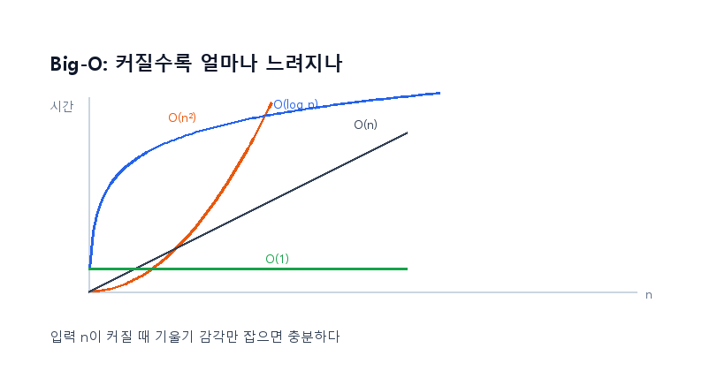
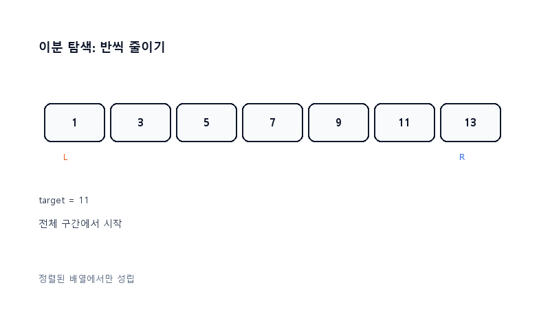
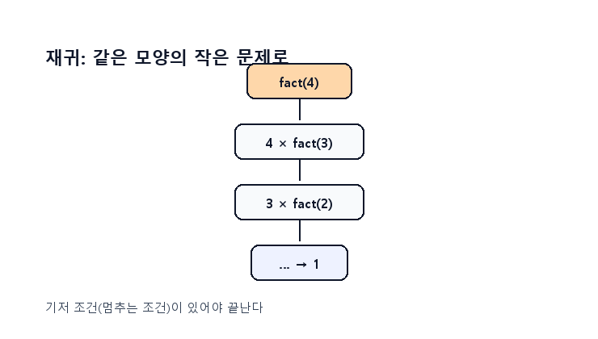
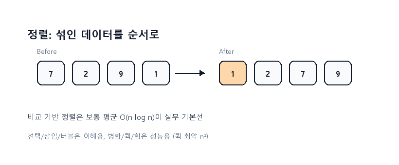
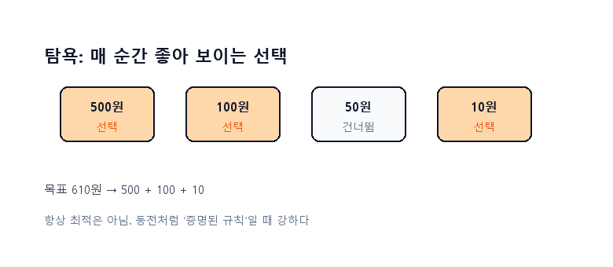
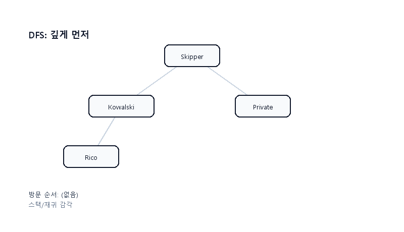
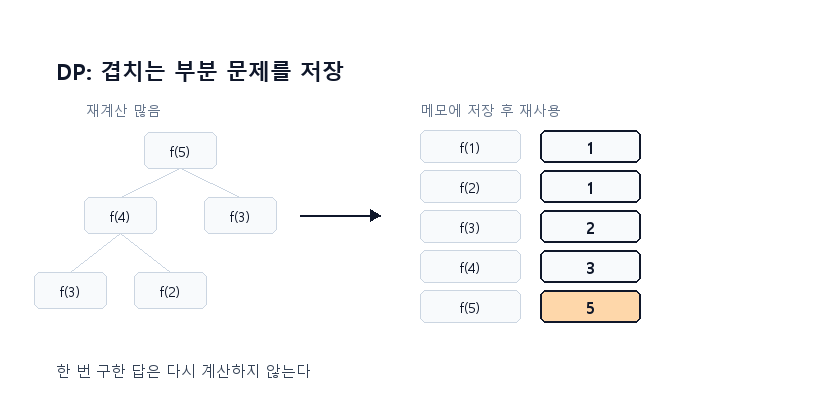
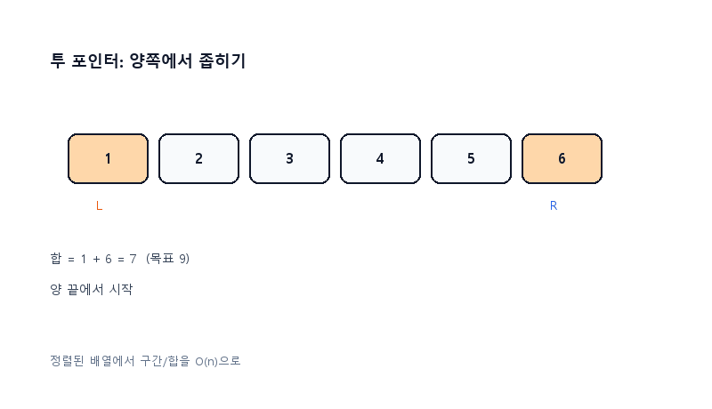

<picture>
  <source media="(prefers-color-scheme: dark)" srcset="../assets/sections/banner-cs-dark.svg" />
  
</picture>

# 02. 알고리즘

**자료구조가 그릇이라면, 알고리즘은 그 위에서 문제를 푸는 절차다.**

  
  &nbsp;
  
  &nbsp;
  

 

<picture>
  <source media="(prefers-color-scheme: dark)" srcset="../assets/sections/section-goals-dark.svg" />
  
</picture>

같은 데이터라도 **절차**에 따라 수 밀리초와 수 분이 갈린다.  
이 장에서는 “얼마나 느려지는가”를 말하는 법과, 대표 전략의 직관을 쌓는다.

선행: **[01. 자료구조](01_자료구조.md)** — 그릇을 안 뒤에, 그 위에서 움직이는 방법을 본다.

 

<picture>
  <source media="(prefers-color-scheme: dark)" srcset="../assets/sections/section-contents-dark.svg" />
  
</picture>

| # | 주제 | 한 줄 |
| :--- | :--- | :--- |
| 00 | 시간/공간 복잡도 (Big-O) | 커질수록 얼마나 느려지는가 |
| 01 | 완전 탐색 | 일단 모든 경우를 본다 |
| 02 | 이분 탐색 | 정렬된 데이터에서 반씩 줄인다 |
| 03 | 재귀 | 같은 모양의 작은 문제로 나눈다 |
| 04 | 정렬 개요 | 섞인 데이터를 순서 있게 |
| 05 | 탐욕 (Greedy) | 매 순간 좋아 보이는 선택 |
| 06 | DFS / BFS | 깊게 / 넓게 순회 |
| 07 | DP 입문 | 겹치는 부분 문제를 저장해 재사용 |
| 08 | 투 포인터/슬라이딩 윈도우 | 구간을 효율적으로 훑기 |

 

<picture>
  <source media="(prefers-color-scheme: dark)" srcset="../assets/sections/section-concept-dark.svg" />
  
</picture>

### 00. 시간/공간 복잡도 (Big-O)

**입력이 커질 때, 시간과 메모리가 어떻게 커지는지를 말하는 언어.**

<picture>
  <source media="(prefers-color-scheme: dark)" srcset="../assets/diagrams/algo-bigo-dark.png" />
  
</picture>

#### 직관

스키퍼가 펭귄 n마리를 검사한다고 하자.

- 한 명만 보면 끝 → **O(1)**
- 반씩 나눠 가며 찾기 → **O(log n)**
- 전원 한 번씩 → **O(n)**
- 전원끼리 서로 비교 → **O(n²)**

지금 단계에서는 정확한 상수보다 **기울기 감각**이 중요하다.

| 표기 | 감각 | 예 |
| :--- | :--- | :--- |
| O(1) | 거의 일정 | 배열 인덱스 접근, 해시 평균 조회 |
| O(log n) | 반씩 줄어듦 | 이분 탐색, 균형 트리 탐색 |
| O(n) | 입력에 비례 | 한 번 순회 |
| O(n log n) | 실무 정렬의 기본선 | 병합/힙, 퀵(평균) |
| O(n²) | 이중 루프 | 단순 정렬, 모든 쌍 비교 |

- **시간 복잡도**: 연산이 몇 번 도는가
- **공간 복잡도**: 추가로 얼마나 담는가
- **쓰임**: “이 방법이 데이터가 커져도 버틸까?”를 먼저 가늠할 때

---

### 01. 완전 탐색 (Brute Force)

**가능한 경우를 빠짐없이 본다. 느리지만 맞는 답을 보장하기 쉽다.**

#### 직관

금고 비밀번호 네 자리를 전부 누르는 것과 같다.  
경우의 수가 작으면 가장 안전한 출발점이다.

#### 핵심 성질

| 장점 | 단점 |
| :--- | :--- |
| 구현이 단순하고 검증이 쉽다 | n이 조금만 커져도 폭발한다 |
| “답이 있는지”를 확실히 알 수 있다 | 최적화/가지치기 없이는 실무에 못 쓰는 경우가 많다 |

- **쓰임**: 작은 입력, 정답 검증용, 다른 알고리즘을 만들기 전 기준선(baseline)

> 완전 탐색으로 맞춘 뒤, “어디를 줄일 수 있나?”를 묻는 것이 알고리즘 공부의 기본 루프다.

---

### 02. 이분 탐색 (Binary Search)

**정렬된 데이터에서 가운데를 보고, 절반을 버린다.**

<picture>
  <source media="(prefers-color-scheme: dark)" srcset="../assets/videos/binary-search-dark.gif" />
  
</picture>

#### 직관

가나다순 명단에서 이름을 찾을 때, 중간 페이지를 펴고  
“더 앞 / 더 뒤”만 남기는 것과 같다.

#### 핵심 성질

| 조건/결과 | 내용 |
| :--- | :--- |
| 전제 | **정렬**되어 있어야 한다 |
| 시간 | O(log n) |
| 실수 포인트 | 경계(L/R), 무한 루프, “이상/초과” 조건 |

- **쓰임**: 정렬된 배열 검색, “최소로 가능한 값”을 이분하는 파라메트릭 서치

---

### 03. 재귀 (Recursion)

**같은 모양의 더 작은 문제로 나누고, 기저 조건에서 멈춘다.**

<picture>
  <source media="(prefers-color-scheme: dark)" srcset="../assets/diagrams/algo-recursion-dark.png" />
  
</picture>

#### 직관

“4! = 4 × 3!”처럼, 큰 일을 **닮은 작은 일**로 미룬다.  
멈추는 조건(기저 사례)이 없으면 끝없이 내려간다.

#### 핵심 성질

- **기저 조건**: 더 이상 쪼개지 않는 경우
- **재귀 단계**: 문제를 작게 만들고 자신을 다시 호출
- **콜 스택**: 호출이 쌓였다가 돌아오며 결과가 합쳐진다
- **주의**: 깊이가 크면 스택 오버플로 / 같은 부분 문제를 반복하면 느려짐 → DP로 이어짐

- **쓰임**: 트리/그래프 순회, 분할 정복, 백트래킹

---

### 04. 정렬 개요

**섞인 데이터를 정해진 순서로 늘어놓는다.**

<picture>
  <source media="(prefers-color-scheme: dark)" srcset="../assets/diagrams/algo-sort-dark.png" />
  
</picture>

#### 직관

임무 전에 장비를 크기순으로 정리해 두면,  
이후 찾기 / 이분 탐색 / 투 포인터가 모두 쉬워진다.

| 계열 | 대표 | 대략적 비용 | 역할 |
| :--- | :--- | :--- | :--- |
| 이해용 | 선택/삽입/버블 | O(n²) | 동작 원리 학습 |
| 성능용 | 병합/퀵/힙 | 평균 O(n log n) | 실무/라이브러리 기본 (퀵은 최악 O(n²)) |
| 특수 | 카운팅/기수 등 | 조건부로 더 빠름 | 정수/자릿수 등 제약이 있을 때 |

- **안정 정렬**: 같은 키의 상대 순서를 유지하는가
- **제자리 정렬**: 추가 메모리를 거의 안 쓰는가
- **쓰임**: 검색 전처리, 순위/스케줄, 많은 고급 알고리즘의 전제

---

### 05. 탐욕 (Greedy)

**매 순간 당장 좋아 보이는 선택을 한다.**

<picture>
  <source media="(prefers-color-scheme: dark)" srcset="../assets/diagrams/algo-greedy-dark.png" />
  
</picture>

#### 직관

거스름돈을 큰 동전부터 내는 것처럼,  
“지금 최선”을 고르고 다음으로 넘어간다.

#### 핵심 성질

| 언제 잘 되나 | 언제 위험한가 |
| :--- | :--- |
| 선택의 정당성이 증명된 문제 | 눈앞의 이득이 전체를 망치는 구조 |
| 활동 선택, 최단 경로(조건 충족 시) 등 | “항상 최적”이 아닌데 탐욕을 쓰는 경우 |

- **쓰임**: 스케줄링, 최소 비용 선택, 일부 그래프 알고리즘의 뼈대
- **태도**: 탐욕으로 풀기 전에 “이 선택이 나중에 후회 없는가?”를 한 번 의심한다

---

### 06. DFS / BFS

**그래프/트리를 깊게 파고들거나, 넓게 퍼지며 방문한다.**

<picture>
  <source media="(prefers-color-scheme: dark)" srcset="../assets/videos/dfs-bfs-dark.gif" />
  
</picture>

#### 직관

- **DFS (깊이 우선)**: 한 길을 끝까지 가보고, 막히면 돌아온다 (스택/재귀)
- **BFS (너비 우선)**: 가까운 곳부터 층층이 방문한다 (큐)

| | DFS | BFS |
| :--- | :--- | :--- |
| 자료구조 감각 | 스택 | 큐 |
| 잘 맞는 문제 | 경로 존재, 사이클, 백트래킹 | 최단 거리(가중치 동일), 레벨 순회 |
| 메모리 | 깊이에 민감 | 너비에 민감 |

- **쓰임**: 미로, 연결 요소, 최단 경로(단위 가중치), 위상 정렬로 이어지는 탐색의 출발점

---

### 07. DP 입문 (Dynamic Programming)

**겹치는 부분 문제의 답을 저장해 두고 재사용한다.**

<picture>
  <source media="(prefers-color-scheme: dark)" srcset="../assets/diagrams/algo-dp-dark.png" />
  
</picture>

#### 직관

피보나치처럼 `f(3)`을 여러 번 다시 계산하지 말고,  
한 번 구한 값을 표에 적어 두는 것이다.

#### 성립 조건 (감각)

- **최적 부분 구조**: 큰 답 = 작은 최적 답들의 조합
- **중복 부분 문제**: 같은 작은 문제가 반복해서 등장

| 방식 | 설명 |
| :--- | :--- |
| Top-down | 재귀 + 메모이제이션 |
| Bottom-up | 작은 값부터 표를 채워 올림 |

- **쓰임**: 경로 수, 배낭, 최장 공통 부분 수열 등 “중복 계산이 심한” 문제

---

### 08. 투 포인터 / 슬라이딩 윈도우

**구간을 두 개의 포인터(또는 창)로 한 번에 훑어 효율을 낸다.**

<picture>
  <source media="(prefers-color-scheme: dark)" srcset="../assets/videos/two-pointer-dark.gif" />
  
</picture>

#### 직관

정렬된 배열에서 합이 목표인 쌍을 찾을 때,  
양쪽 끝에서 시작해 합이 작으면 왼쪽 포인터를 오른쪽으로, 크면 오른쪽 포인터를 왼쪽으로 옮긴다.

- **투 포인터**: L/R이 조건을 보며 이동 (주로 정렬/양끝)
- **슬라이딩 윈도우**: 고정/가변 길이 창을 밀며 구간 합/개수를 유지

| 효과 | 내용 |
| :--- | :--- |
| 복잡도 | 이중 루프 O(n²)를 O(n)으로 줄이는 경우가 많음 |
| 전제 | 단조 성질, 정렬, 창 안에서 갱신이 쉬운 값 등 |

- **쓰임**: 구간 합, 연속 부분 배열, 고유 문자 구간, 두 수의 합

 

<picture>
  <source media="(prefers-color-scheme: dark)" srcset="../assets/sections/section-summary-dark.svg" />
  
</picture>

### 무엇을 먼저 떠올릴까

| 상황 | 후보 전략 |
| :--- | :--- |
| 입력이 아주 작고 확신이 필요할 때 | 완전 탐색 |
| 정렬되어 있고 찾고/경계 나눌 때 | 이분 탐색 |
| 계층/그래프를 돌아야 할 때 | DFS / BFS |
| 눈앞 선택이 정당할 때 | 탐욕 |
| 같은 부분 문제가 반복될 때 | DP |
| 구간을 효율적으로 볼 때 | 투 포인터 / 슬라이딩 윈도우 |
| 순서 정돈이 필요할 때 | 정렬 (이후 이분/투 포인터와 조합) |

알고리즘은 마법 이름이 아니라 **문제에 맞는 줄이는 방법**이다.  
완전 탐색으로 기준을 잡고, 정렬/분할/저장/포인터로 중복과 범위를 줄이는 흐름을 기억하면 된다.

 

<picture>
  <source media="(prefers-color-scheme: dark)" srcset="../assets/sections/section-next-dark.svg" />
  
</picture>

다음 장: **[03. 운영체제](03_운영체제.md)** — 프로그램이 실제로 돌아가는 환경
