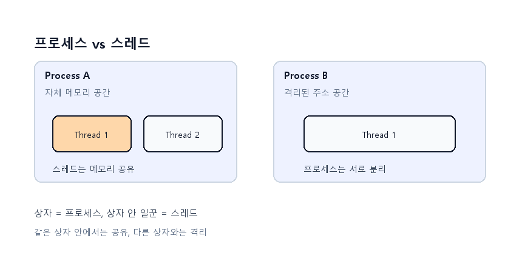
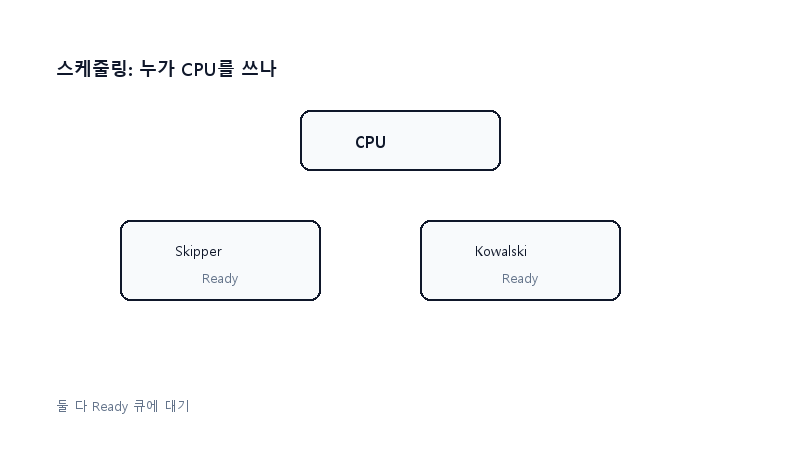
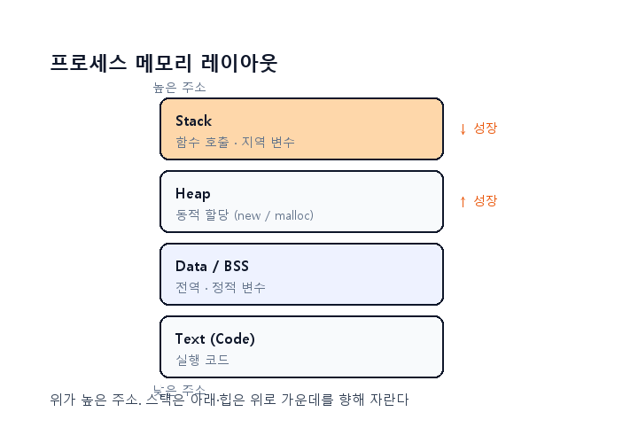
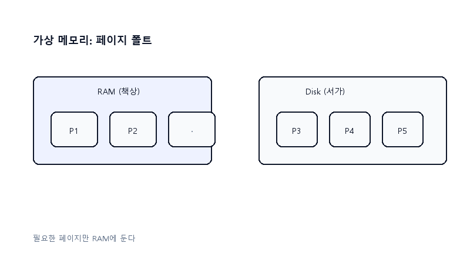
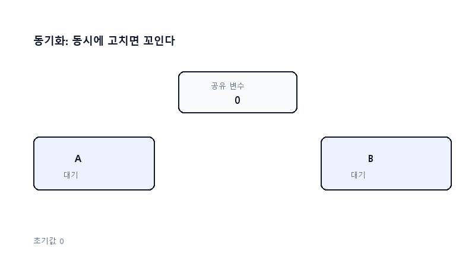
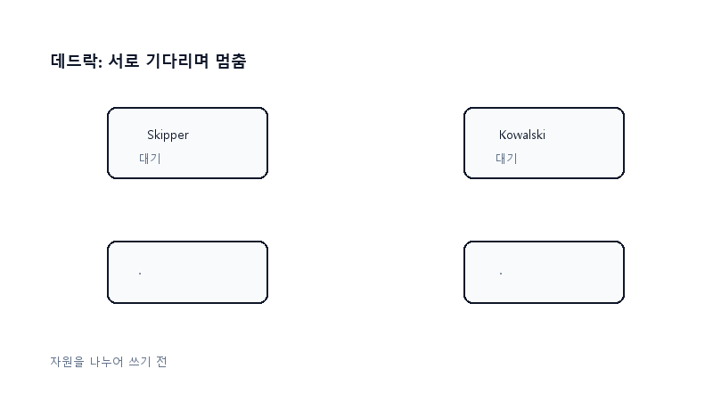
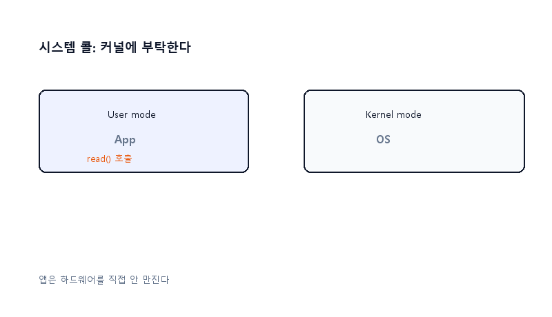

<picture>
  <source media="(prefers-color-scheme: dark)" srcset="../assets/sections/banner-cs-dark.svg" />
  
</picture>

# 03. 운영체제

**앱이 혼자 도는 것처럼 보여도, 실행/메모리/파일/동시성은 OS가 받쳐 줍니다.**

  
  &nbsp;
  
  &nbsp;
  

 

<picture>
  <source media="(prefers-color-scheme: dark)" srcset="../assets/sections/section-goals-dark.svg" />
  
</picture>

백엔드·모바일·인프라를 할수록 반복해서 나오는 밑그림이다.  
이 장에서는 “프로그램이 어떻게 돌아가고, 어떻게 자원을 나누는지”를 말로 잡는다.

선행: **[02. 알고리즘](02_알고리즘.md)** — 절차를 짠 뒤, 그 절차가 실제로 도는 환경을 본다.

 

<picture>
  <source media="(prefers-color-scheme: dark)" srcset="../assets/sections/section-contents-dark.svg" />
  
</picture>

| # | 주제 | 한 줄 |
| :--- | :--- | :--- |
| 01 | 프로세스와 스레드 | 실행 단위의 기본 |
| 02 | 스케줄링 | 누가 CPU를 언제 쓰는지 |
| 03 | 메모리 구조 | 스택/힙, 코드/데이터 |
| 04 | 가상 메모리 | 한정된 RAM을 크게 쓰는 기법 |
| 05 | 동기화 | 동시에 건드리면 생기는 문제와 락 |
| 06 | 데드락 | 서로 기다리며 멈춤 |
| 07 | 파일 시스템/시스템 콜 | 앱이 커널에 부탁하는 창구 |

 

<picture>
  <source media="(prefers-color-scheme: dark)" srcset="../assets/sections/section-concept-dark.svg" />
  
</picture>

### 01. 프로세스와 스레드

**프로세스는 실행 중인 프로그램의 상자이고, 스레드는 그 안에서 CPU를 쓰는 일꾼이다.**

<picture>
  <source media="(prefers-color-scheme: dark)" srcset="../assets/diagrams/os-process-thread-dark.png" />
  
</picture>

#### 직관

브라우저 탭 여러 개를 켠다고 하자.  
각 탭(또는 브라우저 프로세스)은 서로 메모리를 크게 나누고,  
한 탭 안에서는 여러 스레드가 그림 그리기·네트워크·입력을 나눠 맡는다.

#### 핵심 성질

| 구분 | 프로세스 | 스레드 |
| :--- | :--- | :--- |
| 메모리 | 주소 공간이 대체로 분리됨 | 같은 프로세스 메모리를 공유 |
| 생성 비용 | 상대적으로 큼 | 상대적으로 작음 |
| 격리 | 한 프로세스가 죽어도 다른 쪽은 남을 수 있음 | 한 스레드 장애가 프로세스 전체에 영향 |
| 통신 | IPC, 소켓, 파일 등 | 공유 변수·큐로 바로 소통 (동기화 필요) |

- **쓰임**: 웹 서버의 워커 프로세스/스레드 모델, JVM의 스레드 풀, Docker 컨테이너 안의 PID 1

> “동시에 도는 것처럼 보이는 일”을 말할 때, 먼저 프로세스인지 스레드인지부터 구분한다.

---

### 02. 스케줄링

**CPU는 한 번에 하나씩(코어당) 일한다. OS가 누구에게 얼마나 줄지 고른다.**

<picture>
  <source media="(prefers-color-scheme: dark)" srcset="../assets/videos/os-schedule-dark.gif" />
  
</picture>

#### 직관

창구 하나인 은행이다.  
손님(프로세스/스레드)이 많고, 창구 직원(CPU)은 제한되어 있다.  
누가 얼마나 길게 창구를 쓰게 할지 정하는 규칙이 스케줄링이다.

#### 핵심 성질

| 개념 | 내용 |
| :--- | :--- |
| Ready / Running / Waiting | 준비됨 → 실행 중 → I/O·락 등으로 대기 |
| Context switch | 실행 주체를 바꿀 때 레지스터·상태를 갈아끼움 |
| Preemptive | 시간을 끊고 강제 전환 (현대 OS의 기본 감각) |
| I/O bound vs CPU bound | 대기 많은 일 vs 계산 많은 일 |

- **쓰임**: 응답 지연, CPU 포화, 우선순위·nice, 컨테이너/VM의 CPU 제한을 이해할 때

> “느리다”가 CPU 부족인지, I/O 대기인지, 락 대기인지부터 가른다.

---

### 03. 메모리 구조

**한 프로세스 안의 주소 공간은 역할이 다른 구역으로 나뉜다.**

<picture>
  <source media="(prefers-color-scheme: dark)" srcset="../assets/diagrams/os-memory-layout-dark.png" />
  
</picture>

#### 직관

창고를 구역별로 쓴다.

- **코드(Text)**: 실행할 명령
- **데이터(Data/BSS)**: 전역·정적 변수
- **힙(Heap)**: 실행 중 빌려 쓰는 공간 (동적 할당)
- **스택(Stack)**: 함수 호출, 지역 변수, 돌아갈 주소

#### 핵심 성질

| 구역 | 감각 |
| :--- | :--- |
| 스택 | 호출이 깊어지면 커짐. 넘치면 스택 오버플로 |
| 힙 | `new` / `malloc` / 객체 할당. 관리를 못하면 누수·단편화 |
| 코드 | 보통 읽기 전용에 가깝게 보호됨 |

- **쓰임**: OOM, 스택 트레이스, GC가 힙을 청소한다는 말의 배경

---

### 04. 가상 메모리

**프로세스는 “아주 큰 자기만의 주소”를 보는 척하고, OS가 실제 RAM·디스크로 매핑한다.**

<picture>
  <source media="(prefers-color-scheme: dark)" srcset="../assets/videos/os-pagefault-dark.gif" />
  
</picture>

#### 직관

책상(RAM)은 좁은데, 서가(디스크/스왑)까지 포함해  
“내 책상은 넓다”고 믿게 만드는 책갈피 시스템이다.  
페이지 단위로 필요한 부분만 책상에 올린다.

#### 핵심 성질

| 개념 | 내용 |
| :--- | :--- |
| 가상 주소 ↔ 물리 주소 | MMU / 페이지 테이블이 연결 |
| 페이지 폴트 | 필요한 페이지가 RAM에 없으면 예외가 나고, OS가 디스크 등에서 적재 |
| 스왑 / 페이징 | 모자라면 디스크로 내림 → 급격히 느려질 수 있음 |
| 격리 | 프로세스끼리 서로의 주소를 함부로 못 건드림 |

- **쓰임**: 메모리 부족 시 thrashing, `OOM Killer`, 컨테이너 memory limit

> “메모리가 부족하다”는 말이 RAM 용량만의 문제가 아니라, 매핑·스왑·한도 정책의 문제일 수 있다.

---

### 05. 동기화

**여러 실행 흐름이 같은 데이터를 건드리면, 순서를 약속하지 않으면 결과가 꼬인다.**

<picture>
  <source media="(prefers-color-scheme: dark)" srcset="../assets/videos/os-sync-dark.gif" />
  
</picture>

#### 직관

화이트보드에 두 사람이 동시에 숫자를 고쳐 쓴다.  
읽기 → 더하기 → 쓰기가 겹치면, 한쪽의 수정이 사라질 수 있다.  
이게 레이스 컨디션이다.

#### 핵심 성질

| 도구/개념 | 역할 |
| :--- | :--- |
| Critical section | 한 번에 하나만 들어와야 하는 구간 |
| Mutex / Lock | “열쇠”를 가진 자만 들어감 |
| Semaphore | 입장 인원을 세는 티켓 |
| Atomic / CAS | 더 작은 단위의 원자적 갱신 |

- **쓰임**: 스레드 풀, DB 트랜잭션·락, Redis 분산 락, `synchronized` / `ReentrantLock`

> 락은 안전하지만 과하면 성능이 죽고, 없으면 간헐적 버그가 난다. “무엇을 지키는지”를 먼저 정한다.

---

### 06. 데드락

**서로가 가진 것을 기다리며, 아무도 앞으로 못 가는 상태.**

<picture>
  <source media="(prefers-color-scheme: dark)" srcset="../assets/videos/os-deadlock-dark.gif" />
  
</picture>

#### 직관

스키퍼가 펜을, 코왈스키가 노트를 쥐고  
서로 “네 것을 먼저 달라”고만 하면 영원히 멈춘다.

#### 네 가지 조건 (동시에 성립할 때)

| 조건 | 의미 |
| :--- | :--- |
| 상호 배제 | 자원을 동시에 못 씀 |
| 점유 대기 | 가진 채로 다른 것을 기다림 |
| 비선점 | 남의 것을 강제로 뺏지 못함 |
| 순환 대기 | 대기 관계가 원을 이룸 |

- **예방/대응 감각**: 락 순서 통일, 타임아웃, 필요한 자원을 한 번에 요청, 감지 후 희생자 선택
- **쓰임**: DB 데드락 로그, 스레드 덤프의 “waiting to lock”, 분산 시스템에서의 순환 의존

---

### 07. 파일 시스템 / 시스템 콜

**앱은 하드웨어를 직접 만지지 않고, 커널에 “해 주세요”라고 부탁한다.**

<picture>
  <source media="(prefers-color-scheme: dark)" srcset="../assets/videos/os-syscall-dark.gif" />
  
</picture>

#### 직관

식당 손님(유저 모드)은 주방에 들어가지 않는다.  
주문(시스템 콜)을 내면 주방(커널)이 요리(디스크·네트워크·메모리 작업)를 한다.

#### 핵심 성질

| 개념 | 내용 |
| :--- | :--- |
| 시스템 콜 | `read`, `write`, `open`, `fork`, `mmap` 등 커널 진입점 |
| 파일 디스크립터 | 열린 파일·소켓을 가리키는 번호 |
| 유저 모드 / 커널 모드 | 권한과 보호 수준이 다름 |
| 파일 시스템 | 이름·경로·권한·블록을 디스크에 구조화 |

- **쓰임**: 로그 파일, 업로드 저장, 소켓 I/O, “권한 거부”, inode·디스크 full

> API 프레임워크 아래에도 결국 시스템 콜과 파일·소켓이 있다. 장애 메시지를 읽을 때 이 층이 보인다.

 

<picture>
  <source media="(prefers-color-scheme: dark)" srcset="../assets/sections/section-summary-dark.svg" />
  
</picture>

### 무엇을 먼저 떠올릴까

| 상황 | 후보 개념 |
| :--- | :--- |
| 일이 동시에 도는 구조를 말할 때 | 프로세스 vs 스레드 |
| CPU는 놀고 응답만 늦을 때 | 스케줄링, I/O 대기, 락 대기 |
| 할당·재귀·OOM을 볼 때 | 스택 / 힙 / 가상 메모리 |
| 간헐적으로 값이 틀어질 때 | 레이스 → 동기화 |
| 서로 기다리며 멈출 때 | 데드락 네 조건 |
| 파일·포트·권한 오류를 볼 때 | 시스템 콜 / 파일 디스크립터 |

운영체제는 마법 상자가 아니라 **자원을 나누고 보호하는 규칙**이다.  
앱 로그의 “느림·멈춤·메모리·권한”을 이 단어들로 다시 말할 수 있으면 된다.

 

<picture>
  <source media="(prefers-color-scheme: dark)" srcset="../assets/sections/section-next-dark.svg" />
  
</picture>

다음 장: **[04. 네트워크](04_네트워크.md)** — 요청이 기계를 넘어 다른 곳으로 가는 길
