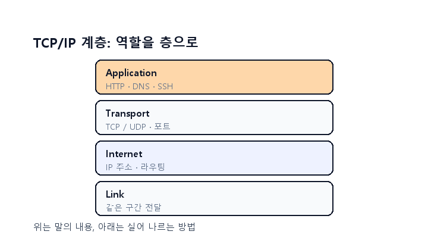
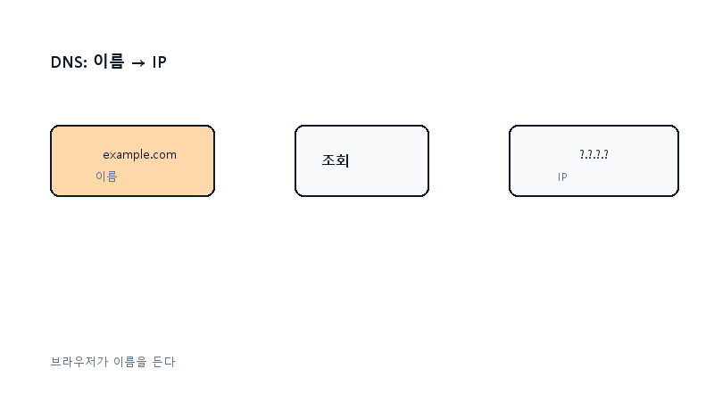
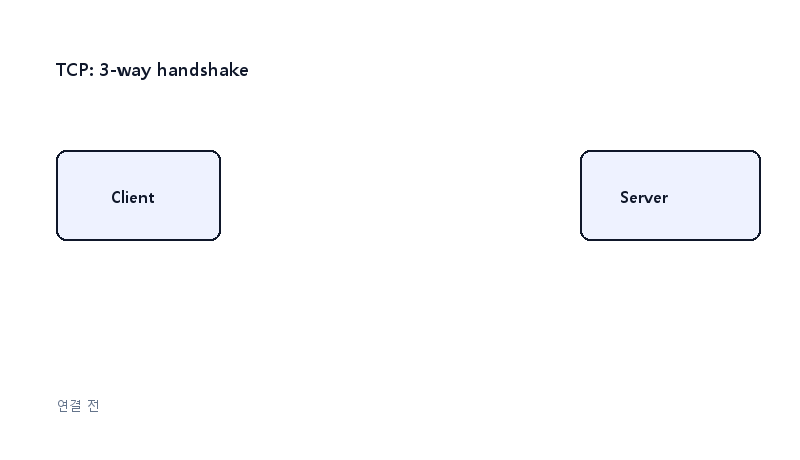
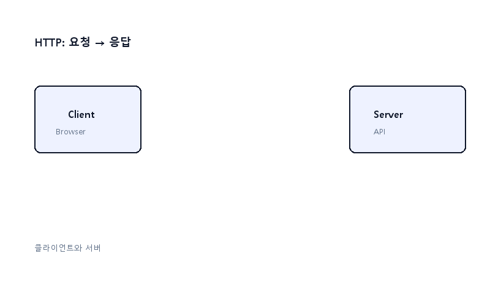
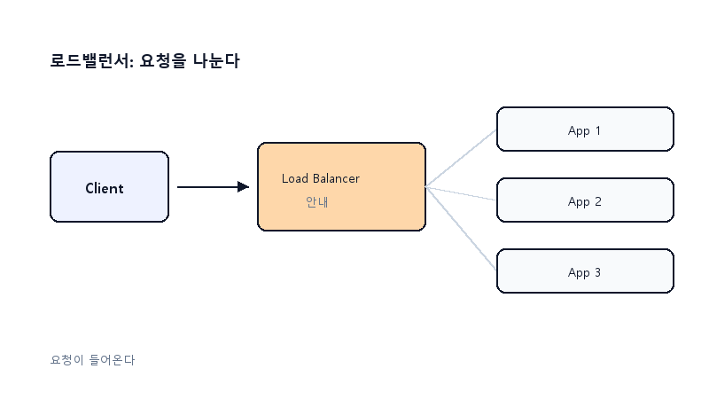

<picture>
  <source media="(prefers-color-scheme: dark)" srcset="../assets/sections/banner-cs-dark.svg" />
  
</picture>

# 04. 네트워크

**URL 입력부터 화면이 뜨기까지, 주소 찾기 → 연결 → 요청/응답을 계층으로 봅니다.**

  
  &nbsp;
  
  &nbsp;
  

 

<picture>
  <source media="(prefers-color-scheme: dark)" srcset="../assets/sections/section-goals-dark.svg" />
  
</picture>

웹·API·배포를 할수록 “어디에, 어떻게, 무슨 말로” 데이터가 오가는지가 반복된다.  
이 장에서는 계층 → 주소 → 전송 → HTTP → API/중개까지 한 줄로 이어 본다.

선행: **[03. 운영체제](03_운영체제.md)** — 한 기계 안의 실행을 본 뒤, 기계 밖으로 나가는 길을 본다.

 

<picture>
  <source media="(prefers-color-scheme: dark)" srcset="../assets/sections/section-contents-dark.svg" />
  
</picture>

| # | 주제 | 한 줄 |
| :--- | :--- | :--- |
| 01 | OSI / TCP/IP 계층 | 역할을 층으로 나눈 이유 |
| 02 | IP/포트/DNS | 어디에, 어떤 문으로, 이름→주소 |
| 03 | TCP vs UDP | 신뢰성 vs 단순/속도 |
| 04 | HTTP / HTTPS | 웹의 기본 대화법 |
| 05 | 상태 코드/헤더 | 성공/실패와 부가 정보 |
| 06 | 쿠키/세션/토큰 | 로그인 상태 유지 |
| 07 | REST | 자원을 기준으로 한 API 습관 |
| 08 | 프록시/로드밸런서 | 요청을 가운데서 나누는 장치 |

 

<picture>
  <source media="(prefers-color-scheme: dark)" srcset="../assets/sections/section-concept-dark.svg" />
  
</picture>

### 01. OSI / TCP/IP 계층

**복잡한 통신을 “층”으로 나눠, 각 층이 자기 일만 하게 한다.**

<picture>
  <source media="(prefers-color-scheme: dark)" srcset="../assets/diagrams/net-layers-dark.png" />
  
</picture>

#### 직관

편지를 보낼 때 내용·봉투·우체국·트럭이 역할을 나누는 것과 같다.  
위층은 “무엇을 말할지”, 아래층은 “어떻게 실어 나를지”에 가깝다.

#### 핵심 성질

| 감각 | TCP/IP에서 | 하는 일 |
| :--- | :--- | :--- |
| 응용 | Application | HTTP, DNS, SSH 등 앱이 쓰는 약속 |
| 전송 | Transport | 포트, 신뢰성(TCP) / 단순 전달(UDP) |
| 인터넷 | Internet | IP 주소로 패킷을 어디로 보낼지 |
| 링크 | Link | 같은 네트워크 구간에서의 실제 전달 |

OSI 7계층은 교과서용 세분, 실무 대화는 대부분 **TCP/IP 4계층** 감각으로 충분하다.

- **쓰임**: “이 문제는 DNS인가, TCP 핸드셰이크인가, HTTP인가”를 층으로 가를 때

---

### 02. IP / 포트 / DNS

**IP는 건물 주소, 포트는 호수, DNS는 상호→주소를 찾는 전화부다.**

<picture>
  <source media="(prefers-color-scheme: dark)" srcset="../assets/videos/net-dns-dark.gif" />
  
</picture>

#### 직관

`www.example.com`을 치면, 먼저 “그 가게 주소가 뭐야?”(DNS)를 묻고  
그 IP의 **특정 포트**(보통 HTTPS 443)로 들어간다.

#### 핵심 성질

| 개념 | 내용 |
| :--- | :--- |
| IP | 호스트(또는 인터페이스)를 가리키는 주소 |
| 포트 | 그 안에서 어떤 서비스인지 (0–65535) |
| DNS | 도메인 이름 → IP (캐시·TTL이 중요) |
| 잘 알려진 포트 | 80 HTTP, 443 HTTPS, 22 SSH, 5432 PostgreSQL 등 |

- **쓰임**: `Connection refused`(포트에 아무도 없음), DNS 전파 지연, 보안 그룹/방화벽 규칙

---

### 03. TCP vs UDP

**TCP는 확인하고 이어 붙이는 전화, UDP는 던지고 보는 엽서에 가깝다.**

<picture>
  <source media="(prefers-color-scheme: dark)" srcset="../assets/videos/net-tcp-dark.gif" />
  
</picture>

#### 직관

중요한 계약서는 등기로 보내고(TCP),  
실시간 위치나 게임 프레임은 빠른 쪽을 택한다(UDP).

#### 핵심 성질

| | TCP | UDP |
| :--- | :--- | :--- |
| 연결 | 핸드셰이크로 연결 후 통신 | 연결 없이 데이터그램 |
| 신뢰성 | 순서·재전송·혼잡 제어 | 보장 약함, 손실 가능 |
| 오버헤드 | 상대적으로 큼 | 작음 |
| 대표 쓰임 | HTTP, DB, SSH | DNS 질의(전통), 스트리밍, 일부 게임 |

전통 DNS 질의는 UDP가 흔하지만, 큰 응답·DNS over TLS/HTTPS는 TCP(또는 별도 보안 채널)를 쓰기도 한다.

- **쓰임**: “패킷이 가끔 빠져도 되는가?”를 먼저 묻는 기준

---

### 04. HTTP / HTTPS

**클라이언트가 요청하고, 서버가 응답하는 웹의 기본 대화법.**

<picture>
  <source media="(prefers-color-scheme: dark)" srcset="../assets/videos/net-http-dark.gif" />
  
</picture>

#### 직관

메뉴를 주문(요청)하면 접시가 나온다(응답).  
HTTPS는 그 대화를 **암호화·무결성·서버 신원**으로 감싼 형태다 (보통 TLS 위 HTTP).

#### 핵심 성질

| 요소 | 내용 |
| :--- | :--- |
| Method | GET 조회, POST 생성/제출, PUT/PATCH 수정, DELETE 삭제 등 |
| URL / Path | 어떤 자원인지 |
| Headers | Content-Type, Authorization, Cookie 등 부가 정보 |
| Body | 본문 (JSON, 폼, 파일 …) |
| HTTPS | 중간에서 내용을 읽기 어렵게, 인증서 검증 |

- **쓰임**: API 설계, 브라우저 개발자 도구 Network 탭, 리버스 프록시의 TLS 종료

---

### 05. 상태 코드 / 헤더

**상태 코드는 “결과의 큰 분류”, 헤더는 “그 결과에 붙는 메모”다.**

#### 직관

창구에서 “접수됨 / 잘못 옴 / 서버 고장”을 숫자로 말하고,  
헤더로 “다시 와라(캐시)”, “로그인 필요”, “타입은 JSON”을 덧붙인다.

#### 핵심 성질

| 대역 | 감각 | 예 |
| :--- | :--- | :--- |
| 2xx | 성공 | 200 OK, 201 Created |
| 3xx | 다른 곳으로 | 301/302 Redirect, 304 Not Modified |
| 4xx | 클라이언트 쪽 문제 | 400, 401, 403, 404 |
| 5xx | 서버 쪽 문제 | 500, 502, 503 |

자주 보는 헤더: `Content-Type`, `Cache-Control`, `Authorization`, `Set-Cookie`, `Location`

- **쓰임**: 모니터링·알림 규칙, API 에러 계약, CDN/캐시 동작 이해

---

### 06. 쿠키 / 세션 / 토큰

**HTTP는 기본적으로 상태를 안 기억한다. 로그인 유지를 위해 “표”를 주고받는다.**

#### 직관

식당이 손님을 매번 처음 보는 것과 같다.  
도장을 찍은 카드(쿠키), 가게 장부에 적어 둔 번호(세션),  
스스로 들고 다니는 입장권(토큰/JWT)으로 “나 다시 왔어”를 증명한다.

#### 핵심 성질

| 방식 | 감각 |
| :--- | :--- |
| 쿠키 | 브라우저가 자동으로 보내는 작은 데이터. `HttpOnly` / `Secure` / `SameSite`가 중요 |
| 세션 | 서버(또는 저장소)에 상태를 두고, 클라이언트는 세션 ID만 보유 |
| 토큰 | 클라이언트가 헤더 등으로 제시. 서버는 서명·만료를 검증 |

- **쓰임**: 로그인 API, CSRF·XSS와 쿠키 정책, 모바일 앱의 Bearer 토큰

> “어디에 상태를 둘 것인가”가 보안·확장성의 갈림길이다.

---

### 07. REST

**자원을 URL로 드러내고, HTTP 메서드로 행위를 표현하는 API 습관.**

#### 직관

`/users/42`는 “42번 사용자”라는 **자원**이고,  
GET은 보고, POST는 만들고, PATCH는 고치는 식의 **동사**를 HTTP에 맡긴다.

#### 핵심 성질

| 습관 | 내용 |
| :--- | :--- |
| 자원 중심 | 동사 URL(`/getUser`)보다 명사 경로를 선호 |
| 무상태성(Stateless) | 요청마다 필요한 인증·문맥을 담는 편 |
| 표현 | JSON 등. 같은 자원에 여러 표현 가능 |
| 현실 | 완벽한 교과서 REST보다 “읽기 쉬운 HTTP API”가 목표인 경우가 많음 |

- **쓰임**: Spring/Express API 설계, OpenAPI 문서, 프론트와의 계약

---

### 08. 프록시 / 로드밸런서

**클라이언트와 서버 사이에서 요청을 받아 넘기거나 나누는 장치.**

<picture>
  <source media="(prefers-color-scheme: dark)" srcset="../assets/videos/net-lb-dark.gif" />
  
</picture>

#### 직관

안내 데스크(프록시/LB)가 손님을 받을 창구로 안내한다.  
앞단에서 TLS를 끝내거나, 로그·캐시·차단을 넣을 수도 있다.

#### 핵심 성질

| 개념 | 내용 |
| :--- | :--- |
| Forward proxy | 클라이언트 쪽을 대리 (회사 프록시 등) |
| Reverse proxy | 서버 앞단 대리 (nginx, API Gateway) |
| Load balancer | 여러 인스턴스에 부하 분산 |
| Health check | 죽은 서버로는 안 보냄 |

- **쓰임**: 무중단 배포, 수평 확장, `X-Forwarded-For`, 502/504 원인 추적

 

<picture>
  <source media="(prefers-color-scheme: dark)" srcset="../assets/sections/section-summary-dark.svg" />
  
</picture>

### 무엇을 먼저 떠올릴까

| 상황 | 후보 개념 |
| :--- | :--- |
| 어느 층 문제인지 모를 때 | TCP/IP 계층으로 가르기 |
| 이름만 되고 IP가 안 될 때 | DNS |
| 연결은 되는데 앱이 안 될 때 | 포트 / 방화벽 / 프로세스 listen |
| 신뢰 vs 속도 | TCP vs UDP |
| 브라우저·API 대화 | HTTP 메서드 · 상태 코드 · 헤더 |
| 로그인 유지 | 쿠키 / 세션 / 토큰 |
| API URL 설계 | REST 습관 |
| 여러 대에 나누기 | 리버스 프록시 / 로드밸런서 |

네트워크는 마법이 아니라 **주소 붙이고, 실어 나르고, 약속된 말로 대화하는 일**이다.  
장애 메시지를 이 단어들로 다시 말할 수 있으면 된다.

 

<picture>
  <source media="(prefers-color-scheme: dark)" srcset="../assets/sections/section-next-dark.svg" />
  
</picture>

다음 장: **[05. 데이터베이스](05_데이터베이스.md)** — 왜 이렇게 저장하고 잠그는가
