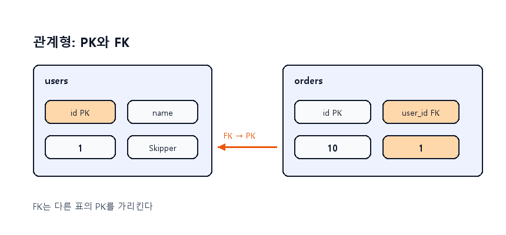
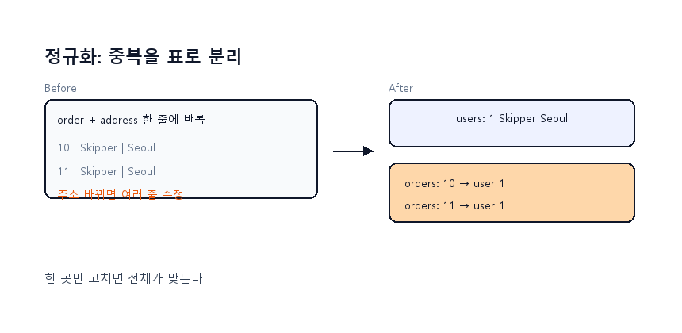
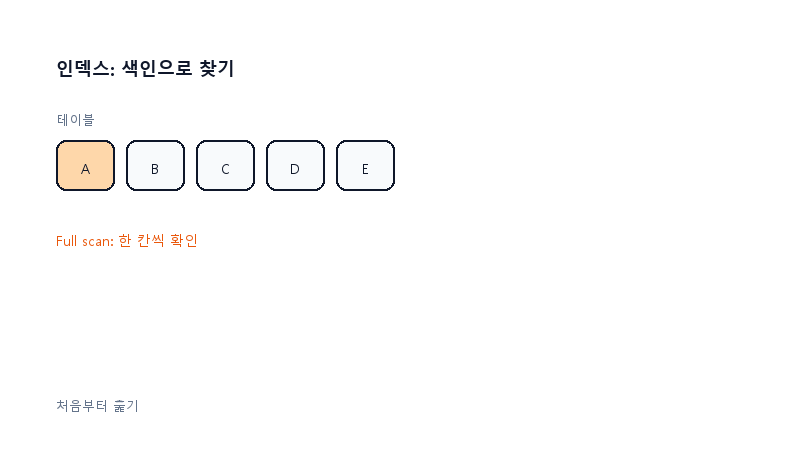
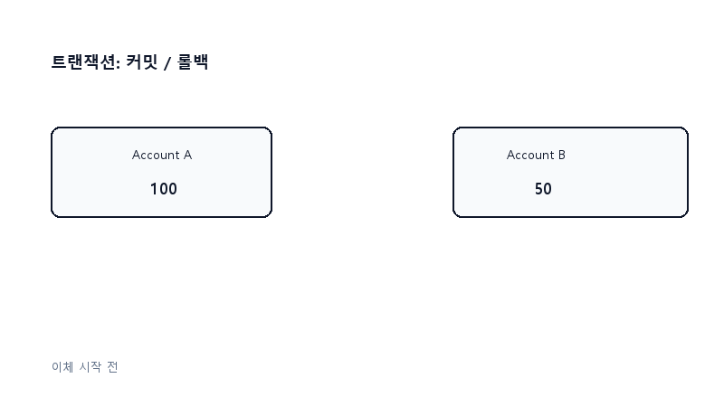
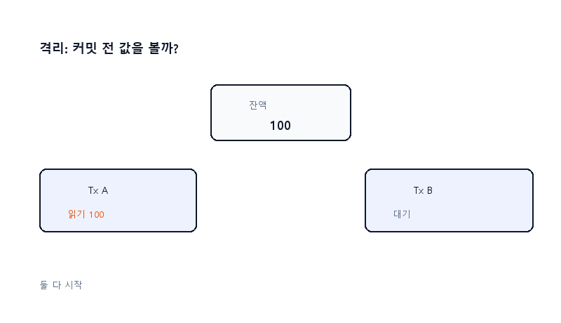
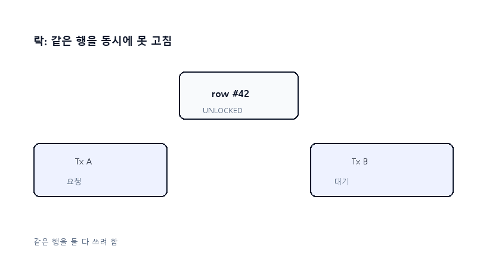
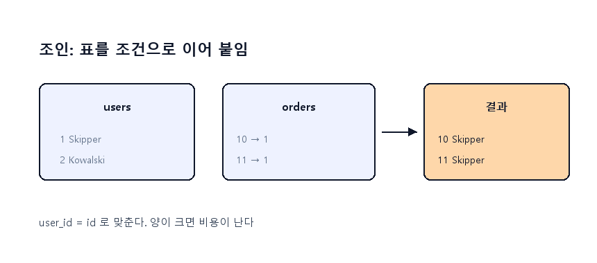
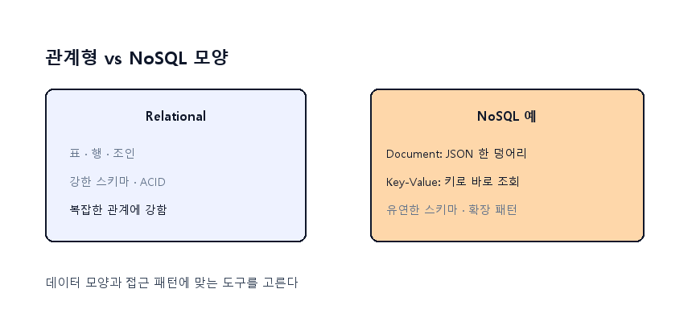

<picture>
  <source media="(prefers-color-scheme: dark)" srcset="../assets/sections/banner-cs-dark.svg" />
  
</picture>

# 05. 데이터베이스 이론

**SQL 문법과 별개로, 왜 이렇게 저장하고 잠그는지를 이해합니다.**

  
  &nbsp;
  
  &nbsp;
  

 

<picture>
  <source media="(prefers-color-scheme: dark)" srcset="../assets/sections/section-goals-dark.svg" />
  
</picture>

백엔드에서 데이터는 “저장만 하면 끝”이 아니다.  
이 장에서는 표의 약속 → 빠른 찾기 → 동시에 고쳐도 안전한 규칙까지 한 줄로 잡는다.

선행: **[04. 네트워크](04_네트워크.md)** — 요청이 도착한 뒤, 그 안의 데이터를 어떻게 지키는지 본다.

 

<picture>
  <source media="(prefers-color-scheme: dark)" srcset="../assets/sections/section-contents-dark.svg" />
  
</picture>

| # | 주제 | 한 줄 |
| :--- | :--- | :--- |
| 01 | 관계형 모델과 키 | 행/열/기본키/외래키 |
| 02 | 정규화 | 중복을 줄여 이상 현상을 막음 |
| 03 | 인덱스 | 찾기 빠르게, 쓰기와 트레이드오프 |
| 04 | 트랜잭션과 ACID | 다 되거나, 다 안 되거나 |
| 05 | 격리 수준 | 동시 읽기의 허용 범위 |
| 06 | 락과 동시성 | 겹치는 수정을 막는 방법 |
| 07 | 조인 전략 개요 | 테이블을 합치는 비용 |
| 08 | NoSQL이 필요한 순간 | 관계형이 불편한 데이터 모양 |

 

<picture>
  <source media="(prefers-color-scheme: dark)" srcset="../assets/sections/section-concept-dark.svg" />
  
</picture>

### 01. 관계형 모델과 키

**데이터는 표(행·열)로 두고, 키로 “누구인지 / 누구와 연결인지”를 밝힌다.**

<picture>
  <source media="(prefers-color-scheme: dark)" srcset="../assets/diagrams/db-keys-dark.png" />
  
</picture>

#### 직관

회원 명단과 주문 장부를 따로 두고,  
주문 칸에 “어느 회원인지” 번호만 적어 두는 것과 같다.

#### 핵심 성질

| 개념 | 내용 |
| :--- | :--- |
| 행 / 열 | 한 건의 기록 / 속성의 칸 |
| 기본키(PK) | 그 행을 유일하게 가리킴 |
| 외래키(FK) | 다른 표의 PK를 가리켜 관계를 만듦 |
| 제약 | NOT NULL, UNIQUE, FK로 “이상한 데이터”를 미리 막음 |

- **쓰임**: ERD, JPA 연관관계, “고아 주문” 같은 무결성 사고 예방

---

### 02. 정규화

**같은 사실을 여러 곳에 반복하지 않게 표를 나누어, 수정·삭제 이상을 줄인다.**

<picture>
  <source media="(prefers-color-scheme: dark)" srcset="../assets/diagrams/db-normalize-dark.png" />
  
</picture>

#### 직관

주문마다 고객 주소 전체를 복사해 두면,  
이사할 때 옛 주문 줄마다 주소를 고쳐야 한다.  
고객 표로 빼 두면 한 곳만 고친다.

#### 핵심 성질

| 감각 | 내용 |
| :--- | :--- |
| 목표 | 중복 ↓, 이상 현상 ↓ |
| 대가 | 조인이 늘어날 수 있음 |
| 현실 | 읽기 성능·편의 때문에 일부 비정규화도 선택 |

- **쓰임**: 스키마 설계 리뷰, “왜 이 컬럼이 여기 있지?”를 물을 때

---

### 03. 인덱스

**미리 정렬·정리해 둔 찾아보기 책갈피. 읽기는 빨라지고, 쓰기는 비용이 는다.**

<picture>
  <source media="(prefers-color-scheme: dark)" srcset="../assets/videos/db-index-dark.gif" />
  
</picture>

#### 직관

사전 색인 없이 책을 한 장씩 넘기는 것(풀 테이블 스캔)과,  
색인에서 쪽수를 찾아 바로 펴는 것(인덱스)의 차이다.

#### 핵심 성질

| 개념 | 내용 |
| :--- | :--- |
| 이득 | 조건 검색·정렬·조인에서 읽을 양이 줄어듦 |
| 비용 | INSERT/UPDATE/DELETE 때 인덱스도 갱신 |
| 선택 | WHERE·JOIN에 자주 나오는 컬럼 후보 |
| 주의 | 너무 많은 인덱스, 선택도 낮은 컬럼 |

- **쓰임**: 느린 쿼리, `EXPLAIN`, 복합 인덱스 순서

---

### 04. 트랜잭션과 ACID

**여러 작업을 “한 묶음”으로 취급해, 다 성공하거나 다 없었던 일로 돌린다.**

<picture>
  <source media="(prefers-color-scheme: dark)" srcset="../assets/videos/db-transaction-dark.gif" />
  
</picture>

#### 직관

계좌 A에서 빼고 B에 넣는 이체.  
한쪽만 반영되면 안 되니, 둘 다 끝나야 확정(커밋), 아니면 취소(롤백).

#### 핵심 성질

| 속성 | 감각 |
| :--- | :--- |
| Atomicity | 전부 또는 전무 |
| Consistency | 제약·규칙을 깨지 않은 상태로 유지 |
| Isolation | 동시에 도는 다른 일과 어떻게 섞일지 |
| Durability | 커밋 후 장애가 나도 결과가 남음 |

- **쓰임**: 결제·재고, `@Transactional`, 커넥션 풀과 트랜잭션 경계

---

### 05. 격리 수준

**동시에 읽을 때, 아직 확정되지 않은/중간에 바뀐 값을 얼마나 볼 수 있게 할지.**

<picture>
  <source media="(prefers-color-scheme: dark)" srcset="../assets/videos/db-isolation-dark.gif" />
  
</picture>

#### 직관

옆 사람이 아직 제출 전인 시험지를 훔쳐보는 것이 허용되는지(더티 리드)의 문제다.  
격리 수준이 높을수록 안전하지만, 대기·충돌이 늘 수 있다.

#### 핵심 성질

| 현상 | 감각 |
| :--- | :--- |
| Dirty read | 커밋 전 값을 읽음 |
| Non-repeatable read | 같은 행을 다시 읽었더니 값이 바뀜 |
| Phantom read | 조건에 맞는 행의 “집합”이 바뀜 |

대표 수준 이름(READ UNCOMMITTED → SERIALIZABLE)은 DB마다 기본값·구현이 다르다.  
입문에서는 “어떤 이상 현상을 막을지”만 먼저 구분하면 된다.

- **쓰임**: 동시 주문, 잔액 조회, 리포트 일관성

---

### 06. 락과 동시성

**같은 행을 동시에 고치지 못하게, 잠깐 줄을 세운다.**

<picture>
  <source media="(prefers-color-scheme: dark)" srcset="../assets/videos/db-lock-dark.gif" />
  
</picture>

#### 직관

화이트보드 마커를 한 명만 쓰게 하는 것과 같다.  
너무 오래 잡으면 대기열이 늘고, 서로 잡으면 데드락이 난다.

#### 핵심 성질

| 개념 | 내용 |
| :--- | :--- |
| 공유/배타 락 | 읽기 공유 vs 쓰기 독점에 가까운 감각 |
| 행 락 / 테이블 락 | 잠그는 범위 |
| 낙관적 락 | 버전 컬럼으로 “중간에 바뀌었나” 검사 |
| 비관적 락 | 먼저 잠그고 수정 |

- **쓰임**: 재고 차감, `SELECT FOR UPDATE`, JPA `@Version`, DB 데드락 로그

---

### 07. 조인 전략 개요

**나눠 둔 표를 조건으로 다시 이어 붙여 한 결과를 만든다. 비용이 있을 수 있다.**

<picture>
  <source media="(prefers-color-scheme: dark)" srcset="../assets/diagrams/db-join-dark.png" />
  
</picture>

#### 직관

회원 표와 주문 표를 “회원 번호가 같은 줄끼리” 이어 한 장면에 보는 것.

#### 핵심 성질

| 감각 | 내용 |
| :--- | :--- |
| Nested loop | 한쪽을 돌며 다른 쪽을 찾음 |
| Hash / Merge | 대량·정렬·해시로 맞추는 전략 (엔진이 선택) |
| 주의 | 조인 폭발, N+1(ORM), 인덱스 부재 |

- **쓰임**: 목록 API 성능, `EXPLAIN`, fetch join vs 지연 로딩

---

### 08. NoSQL이 필요한 순간

**표로 쪼개기 어색하거나, 수평 확장·유연한 스키마가 더 중요할 때의 선택지.**

<picture>
  <source media="(prefers-color-scheme: dark)" srcset="../assets/diagrams/db-nosql-dark.png" />
  
</picture>

#### 직관

댓글 트리, 로그 스트림, 쇼핑카트 JSON처럼  
“한 덩어리로 읽고 쓰는 편”이 자연스러울 때가 있다.

#### 핵심 성질

| 모양 | 감각 | 예 |
| :--- | :--- | :--- |
| Document | JSON 문서 단위 | MongoDB |
| Key-Value | 키로 값 | Redis |
| Wide-column | 큰 규모 행·열 | Cassandra 계열 |
| Graph | 관계 탐색 | Neo4j 등 |

관계형을 버리는 이유가 아니라, **데이터 모양과 접근 패턴에 맞추는 도구**다.  
트랜잭션·조인·일관성 요구가 크면 관계형이 여전히 강하다.

- **쓰임**: 캐시, 세션, 이벤트 로그, 검색/추천 등 보조 저장소

 

<picture>
  <source media="(prefers-color-scheme: dark)" srcset="../assets/sections/section-summary-dark.svg" />
  
</picture>

### 무엇을 먼저 떠올릴까

| 상황 | 후보 개념 |
| :--- | :--- |
| 표를 어떻게 나눌지 | 키 · 정규화 |
| 조회만 유독 느릴 때 | 인덱스 · 조인 · EXPLAIN |
| 중간에 끊기면 안 될 때 | 트랜잭션 · ACID |
| 동시에 읽고 쓸 때 | 격리 수준 · 락 |
| JSON 덩어리·캐시가 자연스러울 때 | NoSQL / 키값 |

데이터베이스는 “SQL 문장”보다 먼저 **약속과 동시성 규칙**이다.  
느림·깨짐·중복을 이 단어들로 말할 수 있으면 된다.

 

<picture>
  <source media="(prefers-color-scheme: dark)" srcset="../assets/sections/section-next-dark.svg" />
  
</picture>

다음 장: **[06. 설계 패턴](06_설계패턴.md)** — 반복되는 설계 고민의 공통 언어
