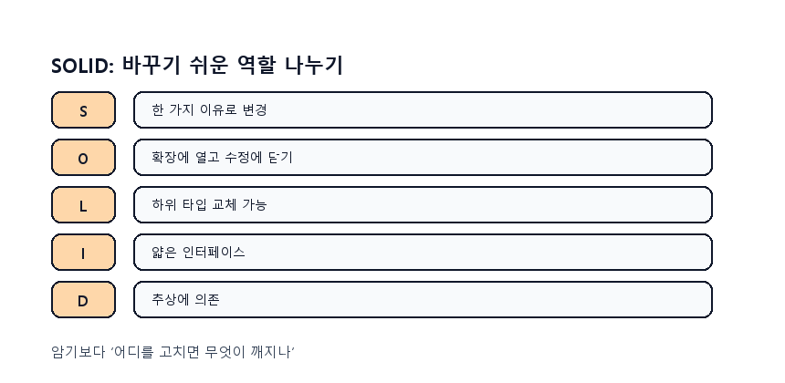
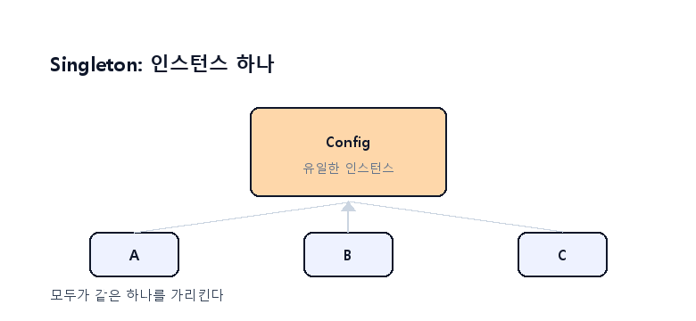
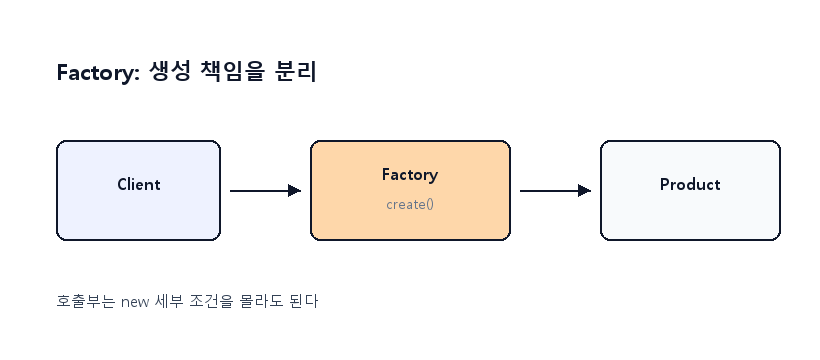
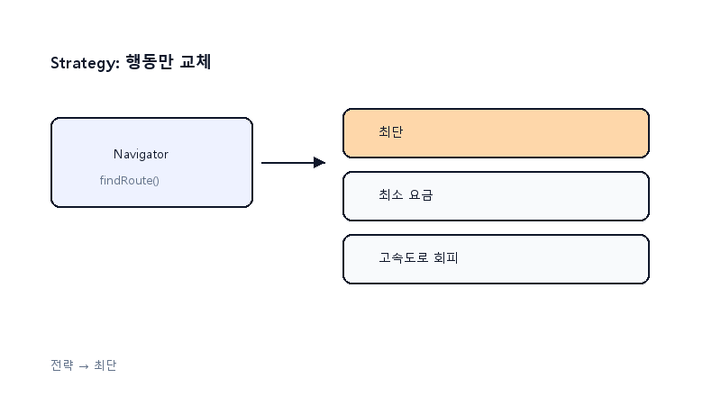
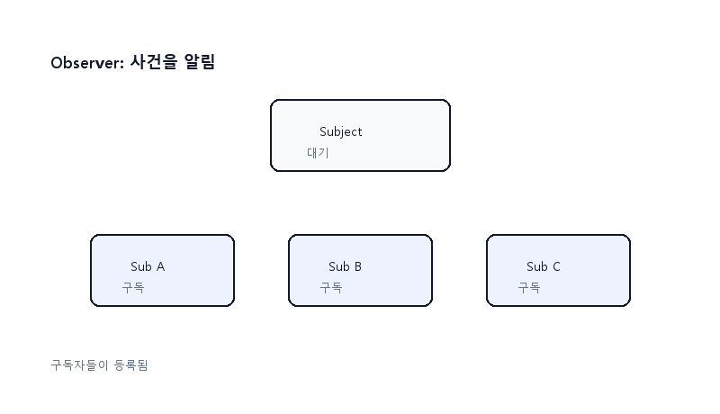
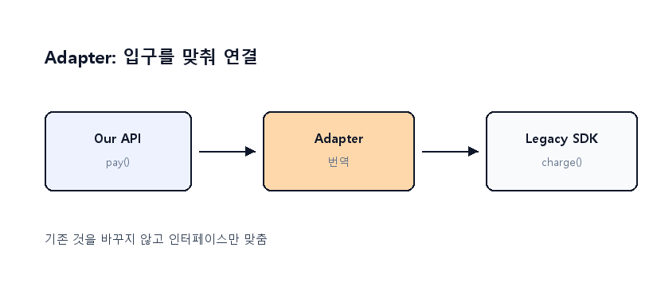
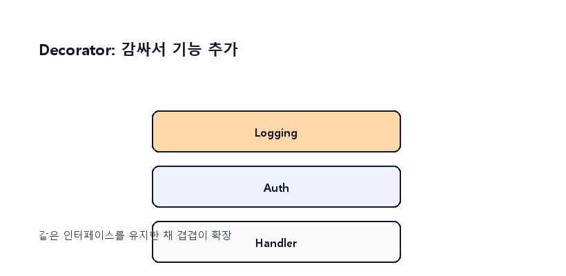
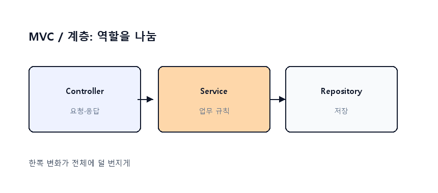

<picture>
  <source media="(prefers-color-scheme: dark)" srcset="../assets/sections/banner-cs-dark.svg" />
  
</picture>

# 06. 설계 패턴

**자주 마주치는 설계 고민에 대한 공통 언어와 구조를 익힙니다.**

  
  &nbsp;
  
  &nbsp;
  

 

<picture>
  <source media="(prefers-color-scheme: dark)" srcset="../assets/sections/section-goals-dark.svg" />
  
</picture>

패턴은 만능 공식이 아니라, “이런 상황에서 역할을 이렇게 나누면 좋다”는 합의된 이름이다.  
이 장에서는 원칙(SOLID)과 백엔드에서 자주 듣는 패턴의 직관만 잡는다.

선행: **[05. 데이터베이스](05_Database_Theory.md)** — 데이터 규칙을 본 뒤, 코드를 나누는 말로 올라온다.

 

<picture>
  <source media="(prefers-color-scheme: dark)" srcset="../assets/sections/section-contents-dark.svg" />
  
</picture>

| # | 주제 | 한 줄 |
| :--- | :--- | :--- |
| 01 | SOLID 개요 | 바꾸기 쉬운 코드를 위한 원칙 |
| 02 | Singleton | 인스턴스를 하나로 |
| 03 | Factory | 생성 책임을 분리 |
| 04 | Strategy | 행동을 교체 가능하게 |
| 05 | Observer | 사건을 구독자에게 알림 |
| 06 | Adapter | 다른 인터페이스를 연결 |
| 07 | Decorator | 감싸서 기능 확장 |
| 08 | MVC/계층 구조 | 화면/도메인/저장 분리 |

 

<picture>
  <source media="(prefers-color-scheme: dark)" srcset="../assets/sections/section-concept-dark.svg" />
  
</picture>

### 01. SOLID 개요

**클래스가 “한 가지 이유로 바뀌고”, 확장하기 쉽게 역할을 나누는 다섯 가지 감각.**

<picture>
  <source media="(prefers-color-scheme: dark)" srcset="../assets/diagrams/pattern-solid-dark.png" />
  
</picture>

#### 직관

도구함에서 망치·드라이버·자를 한 덩어리로 묶지 않는 것과 같다.  
바꿀 이유가 섞이면, 작은 수정도 전체가 흔들린다.

#### 핵심 성질

| 원칙 | 감각 |
| :--- | :--- |
| S Single Responsibility | 바꾸는 이유가 하나 |
| O Open-Closed | 확장에는 열고, 수정에는 닫기 |
| L Liskov Substitution | 하위 타입으로 바꿔도 계약이 깨지지 않음 |
| I Interface Segregation | 쓰지도 않는 메서드에 의존하지 않음 |
| D Dependency Inversion | 구체보다 추상에 의존 |

- **쓰임**: 서비스/리포지토리 분리, DI, “이 클래스 책임이 너무 많다”는 리뷰 언어

> 암기보다 “어디를 고치면 무엇이 깨지는가”를 묻는 습관이 핵심이다.

---

### 02. Singleton

**어떤 타입의 인스턴스를 애플리케이션에서 하나로 제한한다.**

<picture>
  <source media="(prefers-color-scheme: dark)" srcset="../assets/diagrams/pattern-singleton-dark.png" />
  
</picture>

#### 직관

회사 공용 프린터를 대수로 두지 않고 창구 하나만 쓰는 것.  
설정·캐시 매니저처럼 “전역에서 같은 것”이 필요할 때 이름이 붙는다.

#### 핵심 성질

| | 내용 |
| :--- | :--- |
| 이득 | 공유 상태·자원의 단일 진입점 |
| 위험 | 테스트 어려움, 숨은 전역 의존, 멀티스레드 초기화 |
| 현실 | Spring Bean 기본 스코프 등이 “컨테이너가 관리하는 하나”에 가깝다 |

- **쓰임**: 로거, 설정, 연결 풀(직접 구현보다 프레임워크에 맡기는 경우가 많음)

---

### 03. Factory

**객체를 “누가 어떻게 만들까”를 쓰는 쪽에서 떼어 낸다.**

<picture>
  <source media="(prefers-color-scheme: dark)" srcset="../assets/diagrams/pattern-factory-dark.png" />
  
</picture>

#### 직관

손님이 메뉴만 고르면, 주방에서 어떤 재료로 만들지 정하는 것.  
호출부는 `new`의 세부 조건을 몰라도 된다.

#### 핵심 성질

| | 내용 |
| :--- | :--- |
| 목표 | 생성 로직 집중, 타입 교체 용이 |
| 형태 | 단순 팩토리 · 팩토리 메서드 · 추상 팩토리 스펙트럼 |
| 주의 | 팩토리가 모든 것을 알면 또 다른 거대 클래스가 됨 |

- **쓰임**: 결제 수단 객체 생성, 환경별 클라이언트 생성, DI 컨테이너의 일부 역할

---

### 04. Strategy

**같은 “할 일”의 알고리즘(행동)을 갈아끼울 수 있게 한다.**

<picture>
  <source media="(prefers-color-scheme: dark)" srcset="../assets/videos/pattern-strategy-dark.gif" />
  
</picture>

#### 직관

내비게이션에 “최단 / 최소 요금 / 고속도로 회피”를 바꾸는 것.  
경로 찾기라는 틀은 같고, 계산 방식만 바꾼다.

#### 핵심 성질

| | 내용 |
| :--- | :--- |
| 구조 | 공통 인터페이스 + 여러 구현 |
| 이득 | if/else 거대 분기 대신 교체 |
| 관련 | OCP와 자주 같이 이야기됨 |

- **쓰임**: 할인 정책, 정렬·압축 알고리즘, 인증 방식 선택

---

### 05. Observer

**사건이 나면, 관심 있는 구독자들에게 알린다.**

<picture>
  <source media="(prefers-color-scheme: dark)" srcset="../assets/videos/pattern-observer-dark.gif" />
  
</picture>

#### 직관

유튜브 채널 구독. 영상이 올라오면 구독자에게 알림이 간다.  
발행자(Subject)는 구독자 목록만 알고, 각자 반응은 알아서 한다.

#### 핵심 성질

| | 내용 |
| :--- | :--- |
| 이득 | 느슨한 결합으로 반응 추가 |
| 주의 | 알림 순서·예외·순환 구독 |
| 친척 | 이벤트 버스, 메시지 큐, UI 리스너 |

- **쓰임**: 도메인 이벤트, Spring `ApplicationEvent`, 웹훅/알림

---

### 06. Adapter

**이미 있는 것의 입구를, 내가 원하는 인터페이스로 바꿔 끼운다.**

<picture>
  <source media="(prefers-color-scheme: dark)" srcset="../assets/diagrams/pattern-adapter-dark.png" />
  
</picture>

#### 직관

해외 콘센트를 여행용 어댑터로 맞추는 것.  
우리 쪽은 `pay()`를 부르는데 레거시는 `charge()`만 있으면, 어댑터가 가운데서 번역한다.

#### 핵심 성질

| | 내용 |
| :--- | :--- |
| 목표 | 호환되지 않는 인터페이스 연결 |
| 형태 | 래퍼 클래스가 호출을 번역 |
| 주의 | 어댑터 안에 비즈니스가 과도하게 쌓이지 않게 |

- **쓰임**: 레거시 API 래핑, 외부 SDK를 우리 포트에 맞추기, Anti-Corruption Layer 감각

---

### 07. Decorator

**객체를 감싸서 역할을 유지한 채 기능을 덧붙인다.**

<picture>
  <source media="(prefers-color-scheme: dark)" srcset="../assets/diagrams/pattern-decorator-dark.png" />
  
</picture>

#### 직관

커피에 샷·시럽을 올리는 것.  
기본 음료는 같고, 감싼 만큼 기능(가격·맛)이 더해진다.

#### 핵심 성질

| | 내용 |
| :--- | :--- |
| 이득 | 상속 폭발 없이 조합으로 확장 |
| 구조 | 같은 인터페이스를 구현한 래퍼가 원본을 위임 |
| 친척 | 미들웨어, 필터 체인, Java I/O 스트림 |

- **쓰임**: 로깅·캐시·인증을 요청 처리에 겹겹이 추가

---

### 08. MVC / 계층 구조

**화면·업무 규칙·저장을 나누어, 한쪽 변화가 전체에 덜 번지게 한다.**

<picture>
  <source media="(prefers-color-scheme: dark)" srcset="../assets/diagrams/pattern-mvc-dark.png" />
  
</picture>

#### 직관

식당에서 홀(화면)·주방(도메인)·창고(저장)를 나누는 것.  
메뉴판만 바꿔도 창고 전체를 다시 짓지 않는다.

#### 핵심 성질

| 층 | 감각 |
| :--- | :--- |
| Presentation / Controller | 요청을 받고 응답을 조립 |
| Domain / Service | 비즈니스 규칙 |
| Persistence / Repository | DB·외부 저장 |

MVC는 UI 쪽 이름이고, 백엔드에서는 **Controller–Service–Repository** 같은 계층으로 자주 번역된다.

- **쓰임**: Spring 계층, 클린 아키텍처의 경계 감각, 테스트 지점 나누기

 

<picture>
  <source media="(prefers-color-scheme: dark)" srcset="../assets/sections/section-summary-dark.svg" />
  
</picture>

### 무엇을 먼저 떠올릴까

| 상황 | 후보 |
| :--- | :--- |
| 책임이 한 클래스에 몰릴 때 | SOLID · 계층 분리 |
| 객체를 한 곳만 쓰고 싶을 때 | Singleton (신중히) |
| 생성 조건이 복잡할 때 | Factory |
| 알고리즘만 바꾸고 싶을 때 | Strategy |
| 사건 반응을 붙이고 싶을 때 | Observer / 이벤트 |
| 외부/레거시 입구가 안 맞을 때 | Adapter |
| 기능을 겹겹이 더할 때 | Decorator / 미들웨어 |
| 화면·규칙·DB가 뒤섞일 때 | MVC · 계층 구조 |

패턴 이름은 자랑거리가 아니라 **팀과 리뷰에서 쓰는 짧은 말**이다.  
상황에 맞는 역할 나누기를 말할 수 있으면 충분하다.

 

<picture>
  <source media="(prefers-color-scheme: dark)" srcset="../assets/sections/section-next-dark.svg" />
  
</picture>

CS 트랙 본문은 여기까지.  
목록으로 돌아가기: **[cs/README.md](README.md)**
