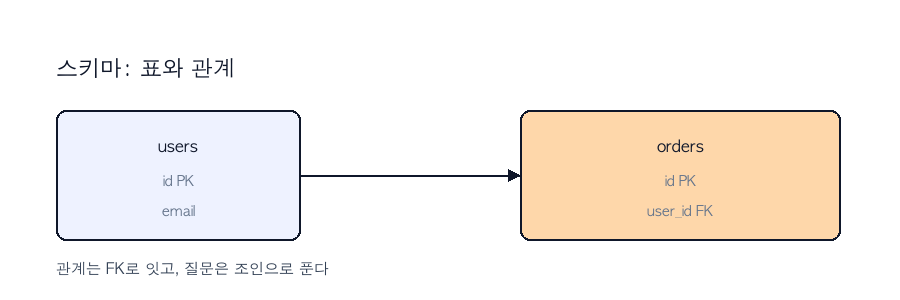

<picture>
  <source media="(prefers-color-scheme: dark)" srcset="../assets/sections/banner-cs-dark.svg" />
  
</picture>

# 01. 스키마와 모델링

**표와 관계로 “무엇을 저장할지”를 먼저 정한다.**

  
  &nbsp;
  
  &nbsp;
  

 

<picture>
  <source media="(prefers-color-scheme: dark)" srcset="../assets/sections/section-goals-dark.svg" />
  
</picture>

쿼리 최적화보다 앞서는 질문은 “한 행이 무엇을 의미하는가”다.  
스키마가 흔들리면 인덱스·ORM·API가 전부 같이 흔들린다.

관련: CS **[05. 데이터베이스 이론](../cs/05_Database_Theory.md)**

 

<picture>
  <source media="(prefers-color-scheme: dark)" srcset="../assets/sections/section-contents-dark.svg" />
  
</picture>

| # | 주제 | 한 줄 |
| :--- | :--- | :--- |
| 01 | 테이블·행·열 | 저장 단위 |
| 02 | 키 | 식별과 연결 |
| 03 | 관계 | 1:N, N:M |
| 04 | 정규화 감각 | 중복을 줄일지 |

 

<picture>
  <source media="(prefers-color-scheme: dark)" srcset="../assets/sections/section-concept-dark.svg" />
  
</picture>

### 01. 테이블·행·열

**같은 종류의 사실을 표로 모은다.**

#### 직관

엑셀 시트다.  
행은 한 건의 사실, 열은 그 사실의 속성이다.

#### 핵심 성질

| 개념 | 내용 |
| :--- | :--- |
| table | 엔티티/이벤트 단위의 집합 |
| row | 한 인스턴스 |
| column | 타입·제약(NULL, UNIQUE 등) |
| 타입 | 숫자·문자·시간·JSON 등 |

- **쓰임**: “주문”과 “주문 상품”을 한 표에 넣을지 나눌지 고민할 때

> 이름이 모호하면 스키마가 모호하다. `data`, `info` 같은 열 이름은 나중에 비용을 낳는다.

---

### 02. 키

**행을 가리키고, 표를 잇는 손잡이다.**

<picture>
  <source media="(prefers-color-scheme: dark)" srcset="../assets/diagrams/database-schema-dark.png" />
  
</picture>

#### 직관

행마다 붙는 고유 번호(식별)와, 다른 표로 가는 “누구 것” 화살표(연결)다.  
(실무 PK는 주민번호 같은 자연키보다 `id` 대리키를 쓰는 경우가 많다.)

#### 핵심 성질

| 개념 | 내용 |
| :--- | :--- |
| Primary Key | 표 안에서 행을 유일하게 식별 |
| Foreign Key | 다른 표의 PK(또는 UNIQUE)를 가리킴 |
| 자연키 / 대리키 | 업무 값 vs `id` 같은 인조 키 |
| 제약 | DB가 깨진 관계를 막아 줌 |

- **쓰임**: 조인 기준, ORM 연관, 삭제 정책(CASCADE 등)

> FK를 앱 코드에만 맡기면, 우회 경로에서 고아 행이 생긴다.

---

### 03. 관계

**현실의 연결을 표 구조로 옮긴다.**

#### 직관

회원 한 명이 주문 여러 건(1:N),  
상품과 태그처럼 서로 여러 개(N:M)다.

#### 핵심 성질

| 관계 | 모델링 |
| :--- | :--- |
| 1:1 | 드묾. 프로필 분리 등 |
| 1:N | 자식 표에 FK |
| N:M | 중간 표(연결 테이블) |
| 소유 | “부모 삭제 시 자식은?”을 같이 정함 |

- **쓰임**: ERD를 API 리소스·화면 단위와 맞출 때

> N:M을 한 표에 배열로 우기면, 조회·제약이 곧 어려워진다.

---

### 04. 정규화 감각

**같은 사실을 여러 곳에 적지 않는 쪽으로 기울인다.**

#### 직관

주소가 바뀌었는데 주문서마다 옛 주소가 남아 있으면 혼란이다.  
공통 사실은 한곳에 두고 가리킨다.

#### 핵심 성질

| 감각 | 내용 |
| :--- | :--- |
| 중복 제거 | 갱신 이상 감소 |
| 과도한 분해 | 조인 비용·복잡도 증가 |
| 실무 타협 | 읽기 모델·캐시·비정규화는 **의도적으로** |
| 문서화 | 왜 중복했는지 남김 |

- **쓰임**: 초안 스키마 리뷰, “이 열 여기 있어도 되나?”

> 정규화는 종교가 아니라 **변경 비용을 어디에 둘지**의 선택이다.

 

<picture>
  <source media="(prefers-color-scheme: dark)" srcset="../assets/sections/section-summary-dark.svg" />
  
</picture>

### 무엇을 먼저 떠올릴까

| 상황 | 후보 |
| :--- | :--- |
| 한 건의 의미 | 테이블·행 |
| 누구의 주문인가 | PK / FK |
| 서로 여러 개 | 중간 표 |
| 같은 값이 여러 열에 | 정규화 여부 |

 

<picture>
  <source media="(prefers-color-scheme: dark)" srcset="../assets/sections/section-next-dark.svg" />
  
</picture>

다음 장: **[02. SQL 조회](02_SQL_Queries.md)** — 표에서 답을 꺼내는 말
