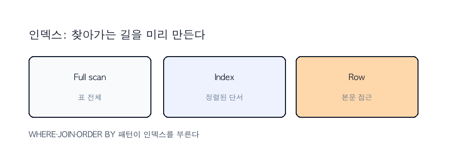

<picture>
  <source media="(prefers-color-scheme: dark)" srcset="../assets/sections/banner-cs-dark.svg" />
  
</picture>

# 03. 인덱스와 실행 계획

**자주 찾는 길에 목차를 두고, 엔진이 어떤 길을 골랐는지 확인한다.**

  
  &nbsp;
  
  &nbsp;
  

 

<picture>
  <source media="(prefers-color-scheme: dark)" srcset="../assets/sections/section-goals-dark.svg" />
  
</picture>

느린 쿼리의 대부분은 “표 전체를 훑는지, 목차로 점프하는지”에서 갈린다.  
인덱스는 만능이 아니라 **읽기를 돕고 쓰기를 조금 비싸게** 만든다.

관련: CS **[05. 데이터베이스 이론](../cs/05_Database_Theory.md)** (인덱스·동시성 이론)

 

<picture>
  <source media="(prefers-color-scheme: dark)" srcset="../assets/sections/section-contents-dark.svg" />
  
</picture>

| # | 주제 | 한 줄 |
| :--- | :--- | :--- |
| 01 | 인덱스 | 목차 |
| 02 | 선택 기준 | 어디에 달까 |
| 03 | 실행 계획 | 길을 읽기 |
| 04 | 트레이드오프 | 쓰기 비용 |

 

<picture>
  <source media="(prefers-color-scheme: dark)" srcset="../assets/sections/section-concept-dark.svg" />
  
</picture>

### 01. 인덱스

**검색·정렬에 쓰는 부가 구조다.**

<picture>
  <source media="(prefers-color-scheme: dark)" srcset="../assets/diagrams/database-index-dark.png" />
  
</picture>

#### 직관

책 뒤 찾아보기이다.  
본문을 처음부터 안 읽고, 단서 → 쪽수로 간다.

#### 핵심 성질

| 개념 | 내용 |
| :--- | :--- |
| B-Tree 계열 | 범위·정렬에 강함 (흔함) |
| 해시 등 | 등호에 특화된 엔진/유형도 있음 |
| PK / UNIQUE | 대체로 인덱스를 동반 |
| 커버링 | 인덱스로 필요한 열을 다 충족 |

- **쓰임**: `WHERE`, `JOIN`, `ORDER BY` 패턴

> 인덱스가 있어도 조건이 목차 키와 안 맞으면 풀 스캔에 가깝게 간다.

---

### 02. 선택 기준

**실제 쿼리 패턴에 인덱스를 맞춘다.**

#### 직관

자주 묻는 질문용 책갈것만 만든다.  
안 여는 장마다 책갈피를 달면 두껍기만 하다.

#### 핵심 성질

| 기준 | 내용 |
| :--- | :--- |
| 선택도 | 값이 잘 흩어져 후보 행을 많이 줄일수록 유리한 경우가 많음 |
| 복합 인덱스 | 왼쪽 접두사 순서가 중요 |
| FK 열 | 조인·자식 삭제 시 도움이 되는 경우가 많음 |
| 과다 인덱스 | 디스크·캐시·쓰기 지연 |

- **쓰임**: 슬로우 쿼리 로그 보고 인덱스 후보 정하기

> “모든 열에 인덱스”는 설계가 아니라 보험 과다 가입이다.

---

### 03. 실행 계획

**엔진이 고른 길을 글로 읽는다.**

#### 직관

내비게이션 경로 미리보기이다.  
예상과 다르면 인덱스·통계·SQL을 의심한다.

#### 핵심 성질

| 개념 | 내용 |
| :--- | :--- |
| `EXPLAIN` (방언별) | 스캔/인덱스/조인 방식 |
| Seq Scan / Index Scan | 이름과 의미는 DB마다 표기가 다름 |
| rows 추정 | 통계에 의존. 빗나가면 계획도 빗나감 |
| 실제 시간 | `ANALYZE` 계열로 측정 |

- **쓰임**: “왜 느린지” 근거를 남길 때

> 계획만 보고 단정하지 말고, **데이터 분포·파라미터**도 같이 본다.

---

### 04. 트레이드오프

**읽기 이득 vs 쓰기·저장 비용.**

#### 직관

목차를 두껍게 만들수록 개정판 낼 때마다 목차도 고쳐야 한다.

#### 핵심 성질

| 이득 | 비용 |
| :--- | :--- |
| 조회 지연 감소 | INSERT/UPDATE/DELETE 시 인덱스 유지 |
| 정렬·조인 도움 | 디스크·메모리 |
| 제약 지원 | 마이그레이션·운영 복잡도 |

- **쓰임**: 쓰기 폭주 테이블에 인덱스 추가 전 검토

> 핫한 쓰기 경로에 인덱스를 잔뜩 달면, 조회는 빨라지고 저장은 버벅일 수 있다.

 

<picture>
  <source media="(prefers-color-scheme: dark)" srcset="../assets/sections/section-summary-dark.svg" />
  
</picture>

### 무엇을 먼저 떠올릴까

| 상황 | 후보 |
| :--- | :--- |
| 같은 조건 반복 조회 | 인덱스 후보 |
| 복합 필터 | 왼쪽 접두사 설계 |
| 왜 느린지 | EXPLAIN |
| 쓰기가 급함 | 인덱스 개수 재검토 |

 

<picture>
  <source media="(prefers-color-scheme: dark)" srcset="../assets/sections/section-next-dark.svg" />
  
</picture>

다음 장: **[04. 트랜잭션 실무](04_Transactions.md)** — 여러 변경을 한 단위로 묶는다
