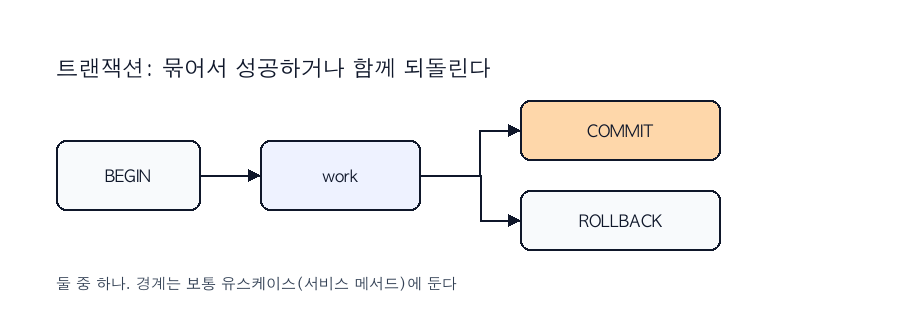

<picture>
  <source media="(prefers-color-scheme: dark)" srcset="../assets/sections/banner-cs-dark.svg" />
  
</picture>

# 04. 트랜잭션 실무

**여러 변경을 한 일감으로 묶어, 성공하면 남기고 실패하면 되돌린다.**

  
  &nbsp;
  
  &nbsp;
  

 

<picture>
  <source media="(prefers-color-scheme: dark)" srcset="../assets/sections/section-goals-dark.svg" />
  
</picture>

재고를 줄였는데 주문 행이 안 생기면 안 된다.  
트랜잭션은 그 “함께”를 DB에 맡기는 경계다.

관련: CS **[05. 데이터베이스 이론](../cs/05_Database_Theory.md)** (ACID·격리)

 

<picture>
  <source media="(prefers-color-scheme: dark)" srcset="../assets/sections/section-contents-dark.svg" />
  
</picture>

| # | 주제 | 한 줄 |
| :--- | :--- | :--- |
| 01 | 경계 | BEGIN~COMMIT |
| 02 | ACID 감각 | 약속 |
| 03 | 격리·동시성 | 겹칠 때 |
| 04 | 앱에서의 위치 | 서비스 메서드 |

 

<picture>
  <source media="(prefers-color-scheme: dark)" srcset="../assets/sections/section-concept-dark.svg" />
  
</picture>

### 01. 경계

**시작과 끝 사이의 변경을 한 단위로 본다.**

<picture>
  <source media="(prefers-color-scheme: dark)" srcset="../assets/diagrams/database-txn-dark.png" />
  
</picture>

#### 직관

계약서 서명이다.  
중간에 그만두면 서명 전으로 돌린다.

#### 핵심 성질

| 개념 | 내용 |
| :--- | :--- |
| BEGIN | 단위 시작 |
| COMMIT | 확정 |
| ROLLBACK | 취소 |
| 자동 커밋 | 문장마다 끝나는 모드도 있음 |

- **쓰임**: 주문+재고, 이체, “둘 다 되거나 둘 다 아니거나”

> 트랜잭션을 길게 열어 두면 락·연결이 오래 잡힌다. **짧은 경계**가 기본이다.

---

### 02. ACID 감각

**운영에서 자주 쓰는 네 가지 약속의 느낌만 고정한다.**

#### 직관

원자성: 중간 상태 없음  
일관성: 제약·규칙을 깨진 채로 커밋하지 않음  
격리: 남의 작업과 섞여 보이지 않게 (수준 있음)  
지속성: 커밋 후 장애에도 남김 (설정·디스크에 의존)

#### 핵심 성질

| 항목 | 실무 감각 |
| :--- | :--- |
| Atomicity | 실패 시 부분 적용 금지 |
| Consistency | 깨진 제약·불변식 상태로 커밋하지 않음 |
| Isolation | 수준에 따라 현상 허용 |
| Durability | 커밋 = 보통 안정 저장 약속 |

- **쓰임**: “이 유스케이스는 트랜잭션이 필요한가?” 판단

> ACID를 외우기보다 **깨지면 어떤 사고인지**로 기억한다.

---

### 03. 격리·동시성

**동시에 겹칠 때, 남의 변경을 어디까지 보게·막게 할지.**

#### 직관

같은 좌석을 두 브라우저가 예매할 때다.  
어느 수준까지 “남의 미확정/동시 변경”을 볼지 정한다.

#### 핵심 성질

| 개념 | 내용 |
| :--- | :--- |
| 격리 수준 | READ COMMITTED, REPEATABLE READ 등 (DB별 기본값 다름) |
| 락 | 행/갭 등을 잡아 충돌 제어 |
| 낙관적 동시성 | 버전 컬럼으로 “누가 먼저 썼는지” |
| 교착 | 락 순서가 꼬이면 발생 가능 |

- **쓰임**: 재고 차감, 잔액, 좌석

> “무조건 SERIALIZABLE”은 안전해 보이지만 처리량이 깎일 수 있다. **필요한 강도**를 고른다.

---

### 04. 앱에서의 위치

**보통 유스케이스(서비스) 경계에 둔다.**

#### 직관

컨트롤러는 입출력을 받고,  
업무 한 건의 “성공/실패”는 서비스가 트랜잭션으로 감싼다.

#### 핵심 성질

| 개념 | 내용 |
| :--- | :--- |
| 서비스 메서드 | `@Transactional` / UnitOfWork 등 |
| 읽기 전용 | 가능한 엔진·ORM에서 read-only 힌트 |
| 외부 I/O | 메일·결제 API를 트랜잭션 안에 오래 두지 않기 |
| 재시도 | 멱등·충돌 응답을 설계 |

- **쓰임**: Spring/Nest/FastAPI에서 DB 세션 경계

> DB 트랜잭션은 프로세스 밖 시스템을 자동으로 롤백하지 않는다. **보상 트랜잭션**이 필요할 수 있다.

 

<picture>
  <source media="(prefers-color-scheme: dark)" srcset="../assets/sections/section-summary-dark.svg" />
  
</picture>

### 무엇을 먼저 떠올릴까

| 상황 | 후보 |
| :--- | :--- |
| 두 표 이상 같이 변경 | 트랜잭션 경계 |
| 동시 예매·재고 | 격리·락·버전 |
| 느린 API + 열린 트랜잭션 | 경계 줄이기 |
| 결제+DB | 외부 연동은 보상/아웃박스 검토 |

 

<picture>
  <source media="(prefers-color-scheme: dark)" srcset="../assets/sections/section-next-dark.svg" />
  
</picture>

다음 장: **[05. NoSQL과 캐시](05_NoSQL_Cache.md)** — 표가 아닌 저장과 빠른 계층
