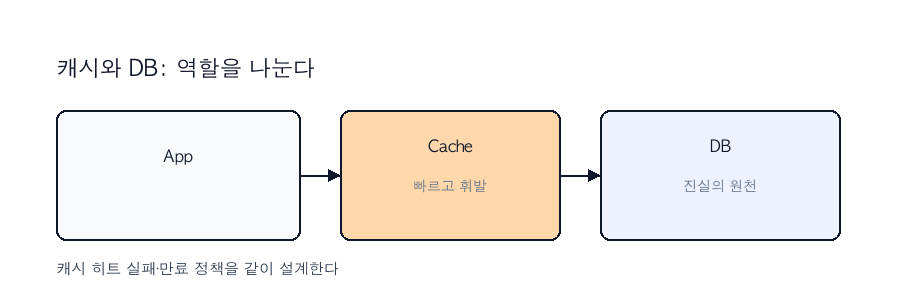

<picture>
  <source media="(prefers-color-scheme: dark)" srcset="../assets/sections/banner-cs-dark.svg" />
  
</picture>

# 05. NoSQL과 캐시

**관계형 표가 불편한 데이터와, 빠르게 읽어낼 계층을 나눈다.**

  
  &nbsp;
  
  &nbsp;
  

 

<picture>
  <source media="(prefers-color-scheme: dark)" srcset="../assets/sections/section-goals-dark.svg" />
  
</picture>

NoSQL은 “SQL 대체”가 아니라 **접근 패턴에 맞춘 다른 상자**다.  
캐시는 진실의 원천이 아니라 **빠른 사본**에 가깝다.

 

<picture>
  <source media="(prefers-color-scheme: dark)" srcset="../assets/sections/section-contents-dark.svg" />
  
</picture>

| # | 주제 | 한 줄 |
| :--- | :--- | :--- |
| 01 | 언제 NoSQL | 패턴 |
| 02 | 문서·키값·기타 | 상자 종류 |
| 03 | 캐시 | 빠른 사본 |
| 04 | 일관성 | 어긋남 |

 

<picture>
  <source media="(prefers-color-scheme: dark)" srcset="../assets/sections/section-concept-dark.svg" />
  
</picture>

### 01. 언제 NoSQL

**유연한 문서, 단순한 키 접근, 거대한 쓰기 분산 등이 필요할 때.**

#### 직관

모든 물건을 표 양식에 억지로 넣지 않고,  
상자 형태를 물건에 맞춘다.

#### 핵심 성질

| 신호 | 내용 |
| :--- | :--- |
| 스키마 가변 | 문서마다 필드가 다름 |
| 키로 단건 접근 | 세션, 프로필 캐시성 데이터 |
| 수평 확장 | 샤딩 전제가 단순한 접근 패턴 |
| 강한 관계·조인 | 여전히 RDB가 편한 경우가 많음 |

- **쓰임**: 제품 선택 회의에서 “왜 표가 불편한가”를 말할 때

> “트렌드라서 Mongo”는 이유가 아니다. **질의 형태**가 이유다.

---

### 02. 문서·키값·기타

**상자마다 잘하는 질문이 다르다.**

#### 직관

파일 캐비닛(문서), 사물함 번호(키값), 타임라인(로그/열) 등이다.

#### 핵심 성질

| 유형 | 감각 | 예 |
| :--- | :--- | :--- |
| Document | JSON 비슷한 문서 | MongoDB |
| Key-Value | 키 → 값 | Redis, DynamoDB 일부 |
| Wide-column / 기타 | 대규모 분산 쓰기 등 | 필요 시 학습 |
| 검색 엔진 | 전문 검색 | 조회 DB와 역할 분리 |

- **쓰임**: “이 데이터는 단건 조회인가, 임의 조인인가”

> 한 제품이 여러 모델을 흉내 내기도 한다. **주 사용 패턴**으로 고른다.

---

### 03. 캐시

**자주 읽는 결과를 가깝고 빠르게 둔다.**

<picture>
  <source media="(prefers-color-scheme: dark)" srcset="../assets/diagrams/database-cache-dark.png" />
  
</picture>

#### 직관

자주 펴보는 페이지에 붙인 포스트잇이다.  
원본 책이 바뀌면 포스트잇도 갈거나 버려야 한다.

#### 핵심 성질

| 개념 | 내용 |
| :--- | :--- |
| hit / miss | 있으면 반환, 없으면 DB 후 채움 |
| TTL | 자동 만료 |
| 무효화 | 갱신 시 키 삭제/갱신 |
| Redis 등 | 세션, 핫 키, 레이트 리밋 |

- **쓰임**: 상품 상세, 권한 정보, 카운터

> 캐시에만 있고 DB에 없으면, 그건 캐시가 아니라 **유실 가능한 주저장**이다.

---

### 04. 일관성

**사본과 원본이 어긋나는 순간을 설계한다.**

#### 직관

거울과 실물이다.  
거울을 언제 닦을지(무효화) 정하지 않으면 틀린 얼굴을 본다.

#### 핵심 성질

| 개념 | 내용 |
| :--- | :--- |
| 지연 | 캐시·복제본이 잠시 옛값 |
| stampede | 만료 동시 재적재 |
| 키 설계 | 충돌·과도한 넓음 주의 |
| source of truth | 어느 저장이 최종인지 (진실의 원천) |

- **쓰임**: “화면에 옛값이 보여요” 장애 분석

> 최종 일관성(eventual)을 택했다면, UX·재시도·표시에 **그 전제**를 반영한다.

 

<picture>
  <source media="(prefers-color-scheme: dark)" srcset="../assets/sections/section-summary-dark.svg" />
  
</picture>

### 무엇을 먼저 떠올릴까

| 상황 | 후보 |
| :--- | :--- |
| 조인·제약 중심 | RDB |
| 키로 단건·유연 문서 | NoSQL 후보 |
| 같은 읽기 폭주 | 캐시 + TTL/무효화 |
| 값이 안 맞음 | source of truth · 무효화 |

 

<picture>
  <source media="(prefers-color-scheme: dark)" srcset="../assets/sections/section-next-dark.svg" />
  
</picture>

다음 장: **[06. ORM과 운영](06_ORM_Operations.md)** — 객체와 SQL 사이, 마이그레이션
