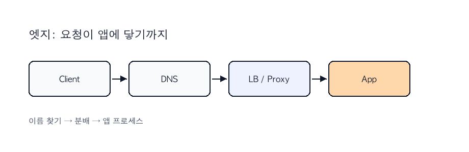

<picture>
  <source media="(prefers-color-scheme: dark)" srcset="../assets/sections/banner-cs-dark.svg" />
  
</picture>

# 02. 네트워크와 엣지

**이름이 해석되고, 문이 열리고, 트래픽이 앱에 도착한다.**

  
  &nbsp;
  
  &nbsp;
  

 

<picture>
  <source media="(prefers-color-scheme: dark)" srcset="../assets/sections/section-goals-dark.svg" />
  
</picture>

배포 관점의 네트워크는 “패킷 이론”보다 **입구 설계**다.  
DNS, 로드밸런서, 리버스 프록시, TLS가 앱 앞단을 만든다.

관련: CS **[04. 네트워크](../cs/04_네트워크.md)**

 

<picture>
  <source media="(prefers-color-scheme: dark)" srcset="../assets/sections/section-contents-dark.svg" />
  
</picture>

| # | 주제 | 한 줄 |
| :--- | :--- | :--- |
| 01 | DNS | 이름 → 주소 |
| 02 | 포트·방화벽 | 문과 허가 |
| 03 | LB · 프록시 | 분배·TLS 종단 |
| 04 | TLS | 암호화 구간 |

 

<picture>
  <source media="(prefers-color-scheme: dark)" srcset="../assets/sections/section-concept-dark.svg" />
  
</picture>

### 01. DNS

**사람이 읽는 이름을 기계가 찾는 주소로 바꾼다.**

<picture>
  <source media="(prefers-color-scheme: dark)" srcset="../assets/diagrams/infra-edge-dark.png" />
  
</picture>

#### 직관

전화번호부다.  
`api.example.com`을 보고 IP(또는 다음 이름)를 찾는다.

#### 핵심 성질

| 개념 | 내용 |
| :--- | :--- |
| A / AAAA | 이름 → IPv4 / IPv6 |
| CNAME | 이름 → 다른 이름 |
| TTL | 캐시 유지 시간 |
| 전파 지연 | 바꾼 직후 전 세계가 동시에 바뀌지 않음 |

- **쓰임**: 도메인 연결, 블루그린 전환, CDN 앞단

> “배포는 됐는데 안 열린다”의 절반은 DNS·캐시 타이밍이다.

---

### 02. 포트·방화벽

**어느 문으로 들어올 수 있는지 허가한다.**

#### 직관

건물 출입구와 경비다.  
앱은 보통 내부 포트에서 듣고, 바깥에는 443만 연다.

#### 핵심 성질

| 개념 | 내용 |
| :--- | :--- |
| listen port | 프로세스가 받는 번호 |
| security group / firewall | 허용 IP·포트 규칙 |
| localhost | 같은 머신 안 통신 |
| 노출 최소화 | 관리 포트·DB는 공개망에 안 연다 |

- **쓰임**: 클라우드 SG, 서버 방화벽, 컨테이너 port publish

> 열어 둔 포트 = 공격면. “일단 다 열고 나중에”는 운영 부채다.

---

### 03. LB · 프록시

**앞단에서 나눠 주고, 뒤에서 앱을 숨긴다.**

#### 직관

안내 데스크다.  
손님은 데스크만 알고, 안쪽 창구(인스턴스)는 늘어나거나 바뀌어도 된다.

#### 핵심 성질

| 개념 | 내용 |
| :--- | :--- |
| Load Balancer | 여러 대상으로 분산, 헬스체크 |
| Reverse Proxy | TLS 종단, 라우팅, 압축, 헤더 |
| Upstream | 프록시가 넘기는 실제 앱들 |
| Health check | 죽은 대상을 빼기 |

- **쓰임**: Nginx/ALB/Ingress 앞단, 무중단 교체의 입구

> 앱 인스턴스 IP를 클라이언트에 직접 주지 않는 것이 기본 자세다.

---

### 04. TLS

**구간을 암호화하고, 보통은 서버가 누구인지 확인한다.**

#### 직관

봉인된 봉투 + (서버) 신분증 확인이다.  
중간에서 내용을 읽거나 서버를 사칭하기 어렵게 만든다.  
클라이언트를 같이 확인하려면 mTLS가 필요하다.

#### 핵심 성질

| 개념 | 내용 |
| :--- | :--- |
| 인증서 | 도메인과 공개키를 묶은 증명 |
| HTTPS | HTTP over TLS |
| 종단 위치 | LB/프록시에서 끝낼지, 앱까지 가져갈지 |
| 갱신 | 만료·자동 재발급 운영 |

- **쓰임**: 공개 API, 쿠키·토큰 전송, 규정 준수

> 인증서 만료는 “갑자기 전 세계 접속 실패”로 보인다. 달력 알림이 인프라다.

 

<picture>
  <source media="(prefers-color-scheme: dark)" srcset="../assets/sections/section-summary-dark.svg" />
  
</picture>

### 무엇을 먼저 떠올릴까

| 상황 | 후보 |
| :--- | :--- |
| 도메인이 안 열림 | DNS · TTL |
| 타임아웃 | 포트·SG·헬스체크 |
| 인스턴스만 바꿈 | LB / 프록시 |
| 자물쇠 경고 | TLS 인증서 |

 

<picture>
  <source media="(prefers-color-scheme: dark)" srcset="../assets/sections/section-next-dark.svg" />
  
</picture>

다음 장: **[03. Docker](03_Docker.md)** — 실행 환경을 이미지로 포장한다
