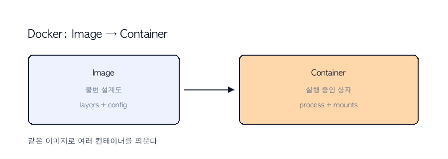

<picture>
  <source media="(prefers-color-scheme: dark)" srcset="../assets/sections/banner-cs-dark.svg" />
  
</picture>

# 03. Docker

**앱과 의존성을 이미지로 묶어, 어디서나 같은 상자로 띄운다.**

  
  &nbsp;
  
  &nbsp;
  

 

<picture>
  <source media="(prefers-color-scheme: dark)" srcset="../assets/sections/section-goals-dark.svg" />
  
</picture>

“내 노트북에선 되는데”를 줄이는 도구가 컨테이너다.  
이미지는 설계도, 컨테이너는 실행 중 상자다.

 

<picture>
  <source media="(prefers-color-scheme: dark)" srcset="../assets/sections/section-contents-dark.svg" />
  
</picture>

| # | 주제 | 한 줄 |
| :--- | :--- | :--- |
| 01 | Image · Container | 설계도 / 실행 |
| 02 | Dockerfile | 빌드 레시피 |
| 03 | Volume · Network | 데이터·연결 |
| 04 | Compose | 여러 상자 한 세트 |

 

<picture>
  <source media="(prefers-color-scheme: dark)" srcset="../assets/sections/section-concept-dark.svg" />
  
</picture>

### 01. Image · Container

**이미지는 불변 스냅샷, 컨테이너는 그 위에서 돌아가는 프로세스 환경이다.**

<picture>
  <source media="(prefers-color-scheme: dark)" srcset="../assets/diagrams/infra-docker-dark.png" />
  
</picture>

#### 직관

게임 설치 파일(이미지)과 지금 켠 플레이 세션(컨테이너)이다.  
같은 설치본으로 세션을 여러 개 띄울 수 있다.

#### 핵심 성질

| 개념 | 내용 |
| :--- | :--- |
| Image | 레이어 + 설정, 레지스트리에 보관 |
| Container | 이미지 + 실행 상태 |
| Tag | `app:1.2.3` 같은 이름표 |
| 격리 | 프로세스·파일·네트워크 네임스페이스 |

- **쓰임**: 로컬=CI=서버 실행 환경 맞추기

> VM보다 가볍고, “머신 전체”가 아니라 **앱 단위**로 포장한다.

---

### 02. Dockerfile

**이미지를 만드는 절차를 코드로 적는다.**

#### 직관

조리 레시프다.  
베이스, 파일 복사, 의존성 설치, 시작 명령이 순서대로 쌓인다.

#### 핵심 성질

| 개념 | 내용 |
| :--- | :--- |
| `FROM` | 베이스 이미지 |
| `COPY` / `RUN` | 파일·설치 레이어 |
| `CMD` / `ENTRYPOINT` | 컨테이너 시작 시 실행 |
| 레이어 캐시 | 위쪽이 안 바뀌면 재사용 |

- **쓰임**: 앱 배포 산출물을 재현 가능하게 만들 때

> 시크릿을 `RUN`에 넣거나 이미지에 구우면 유출이다. 빌드 인자·런타임 주입을 가른다.

---

### 03. Volume · Network

**사라지면 안 되는 데이터와, 상자 간 연결을 붙인다.**

#### 직관

컨테이너 안에는 임시 책상이 있고,  
중요한 서류는 서랍(볼륨)에, 팀 통화는 내부망으로 한다.

#### 핵심 성질

| 개념 | 내용 |
| :--- | :--- |
| Volume / bind mount | 호스트·볼륨에 데이터 유지 |
| 컨테이너 삭제 | 기본적으로 쓰기 레이어는 사라질 수 있음 |
| 사용자 정의/Compose 네트워크 | 서비스 이름으로 상호 호출 (기본 bridge만으로는 DNS 없음) |
| Port publish | `-p 8080:80`처럼 호스트에 노출 |

- **쓰임**: DB 데이터 유지, 로컬에서 API↔DB 연결

> “컨테이너를 지웠더니 DB가 날아감” — 볼륨을 안 붙인 전형적인 실수다.

---

### 04. Compose

**여러 컨테이너를 한 파일로 올리고 내린다.**

#### 직관

밴드 셋리스트다.  
API, DB, 캐시를 각자 이미지가 아니라 **한 무대 구성**으로 적는다.

#### 핵심 성질

| 개념 | 내용 |
| :--- | :--- |
| `services` | 컨테이너 역할 정의 |
| `depends_on` | 기동 순서 힌트 (준비 완료와는 별개) |
| env / secrets | 환경별 주입 |
| 로컬 개발 | 프로덕션 K8s의 축소판 감각 |

- **쓰임**: 로컬 풀스택, 간단한 단일 호스트 배포

> Compose는 편하지만, 대규모 스케일·자기치유는 Kubernetes 쪽 이야기다.

 

<picture>
  <source media="(prefers-color-scheme: dark)" srcset="../assets/sections/section-summary-dark.svg" />
  
</picture>

### 무엇을 먼저 떠올릴까

| 상황 | 후보 |
| :--- | :--- |
| 환경 맞추기 | Image / Dockerfile |
| 데이터 유지 | Volume |
| API+DB 로컬 | Compose |
| 이미지에 키 넣음 | 런타임 시크릿으로 분리 |

 

<picture>
  <source media="(prefers-color-scheme: dark)" srcset="../assets/sections/section-next-dark.svg" />
  
</picture>

다음 장: **[04. Kubernetes](04_Kubernetes.md)** — 원하는 개수와 진입점을 클러스터가 유지한다
