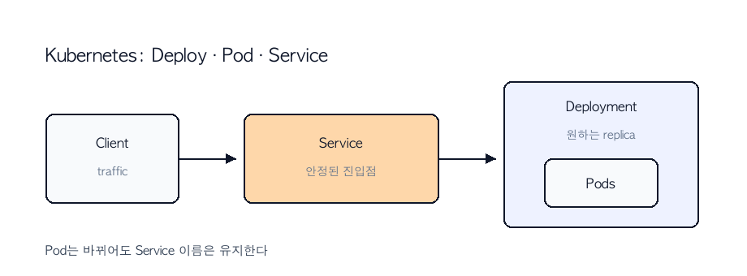

<picture>
  <source media="(prefers-color-scheme: dark)" srcset="../assets/sections/banner-cs-dark.svg" />
  
</picture>

# 04. Kubernetes

**컨테이너의 원하는 상태를 선언하고, 클러스터가 맞춰 준다.**

  
  &nbsp;
  
  &nbsp;
  

 

<picture>
  <source media="(prefers-color-scheme: dark)" srcset="../assets/sections/section-goals-dark.svg" />
  
</picture>

Kubernetes(K8s)는 “컨테이너를 많이, 안정적으로” 돌리기 위한 오케스트레이터다.  
먼저 Pod·Service·Deployment를 잡고, Ingress·StatefulSet·볼륨 등은 필요할 때 이어서 본다.

 

<picture>
  <source media="(prefers-color-scheme: dark)" srcset="../assets/sections/section-contents-dark.svg" />
  
</picture>

| # | 주제 | 한 줄 |
| :--- | :--- | :--- |
| 01 | Pod | 최소 실행 단위 |
| 02 | Deployment | 개수·교체 |
| 03 | Service | 안정된 입구 |
| 04 | 설정·시크릿 | 주입 |

 

<picture>
  <source media="(prefers-color-scheme: dark)" srcset="../assets/sections/section-concept-dark.svg" />
  
</picture>

### 01. Pod

**하나 이상 컨테이너를 함께 스케줄하는 최소 단위다.**

#### 직관

같은 방(네트워크·스토리지 공간)을 쓰는 룸메이트다.  
보통은 앱 컨테이너 하나가 Pod 하나다.

#### 핵심 성질

| 개념 | 내용 |
| :--- | :--- |
| Pod | IP·볼륨을 공유하는 컨테이너 그룹 |
| Node | Pod가 올라가는 워커 머신 |
| 수명 | 짧을 수 있음. IP도 바뀔 수 있음 |
| 직접 관리 | 거의 안 함. 상위 컨트롤러가 만듦 |

- **쓰임**: “한 인스턴스”를 K8s 말로 가리킬 때

> Pod IP를 북마크하지 않는다. 곧 사라질 수 있다.

---

### 02. Deployment

**원하는 replica와 이미지 버전을 선언하고 교체를 맡긴다.**

<picture>
  <source media="(prefers-color-scheme: dark)" srcset="../assets/diagrams/infra-k8s-dark.png" />
  
</picture>

#### 직관

인원 배치표다.  
“웹 3명, 버전 1.4”라고 적으면 매니저(컨트롤러)가 맞춘다.

#### 핵심 성질

| 개념 | 내용 |
| :--- | :--- |
| replicas | 유지할 Pod 수 |
| Rolling update | 조금씩 새 버전으로 교체 |
| Rollback | 이전 ReplicaSet으로 되돌리기 |
| desired state | 선언과 실제의 차이를 계속 보정 |

- **쓰임**: 배포, 스케일 아웃, 장애 Pod 재생성

> `kubectl apply`는 명령이라기보다 **원하는 상태 제출**에 가깝다.

---

### 03. Service

**바뀌는 Pod 앞의 안정된 진입점이다.**

#### 직관

부서 대표 번호다.  
담당자가 바뀌어도 대표 번호는 같다.

#### 핵심 성질

| 개념 | 내용 |
| :--- | :--- |
| ClusterIP | 클러스터 내부용 가상 IP (Service DNS도 함께 붙음) |
| NodePort / LB | 클러스터 밖 노출 형태 |
| selector | 라벨로 대상 Pod 고름 |
| kube-proxy / dataplane | 실제 전달 경로 |

- **쓰임**: 마이크로서비스 간 호출, Ingress 뒤 upstream

> Deployment만 올리고 Service가 없으면, 클러스터 안에서 안정된 이름으로 부르기 어렵다.  
> 인터넷까지 열려면 NodePort·LoadBalancer·Ingress가 추가로 필요하다.

---

### 04. 설정·시크릿

**이미지에 구우지 않고 실행 시 주입한다.**

#### 직관

유니폼(이미지)은 같고, 이름표·출입증(설정·시크릿)만 환경마다 붙인다.

#### 핵심 성질

| 개념 | 내용 |
| :--- | :--- |
| ConfigMap | 비민감 설정 |
| Secret | 민감 값 (여전히 etcd·RBAC 관리 필요) |
| env / volume mount | 주입 방식 |
| 재시작 | 설정 반영을 위해 Pod 교체가 필요한 경우 |

- **쓰임**: 환경별 DB URL, API 키, feature flag

> Secret 오브젝트 ≠ 완벽한 금고. 권한·암호화·유출 경로를 같이 본다.

 

<picture>
  <source media="(prefers-color-scheme: dark)" srcset="../assets/sections/section-summary-dark.svg" />
  
</picture>

### 무엇을 먼저 떠올릴까

| 상황 | 후보 |
| :--- | :--- |
| 인스턴스 하나 | Pod |
| 개수·배포 | Deployment |
| 호출 주소 | Service |
| 환경 값 | ConfigMap / Secret |

 

<picture>
  <source media="(prefers-color-scheme: dark)" srcset="../assets/sections/section-next-dark.svg" />
  
</picture>

다음 장: **[05. CI/CD](05_CICD.md)** — 검증과 배포를 파이프라인으로 옮긴다
