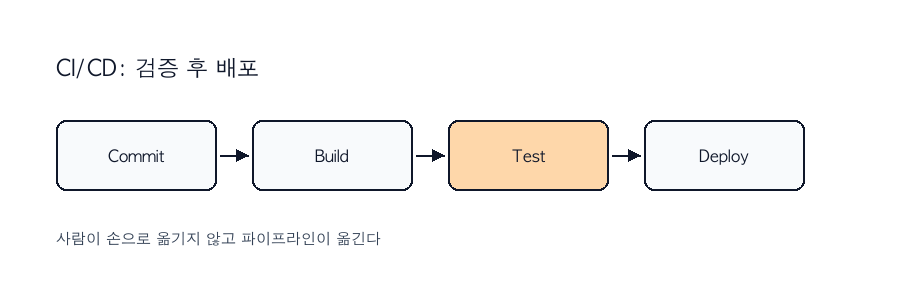

<picture>
  <source media="(prefers-color-scheme: dark)" srcset="../assets/sections/banner-cs-dark.svg" />
  
</picture>

# 05. CI/CD

**코드를 자동으로 검증하고, 검증된 산출물을 환경에 올린다.**

  
  &nbsp;
  
  &nbsp;
  

 

<picture>
  <source media="(prefers-color-scheme: dark)" srcset="../assets/sections/section-goals-dark.svg" />
  
</picture>

CI는 Continuous Integration, CD는 Delivery/Deployment다.  
핵심은 “사람 기억”이 아니라 **반복 가능한 파이프라인**이다.

관련: Tools **[02. 브랜치와 PR](../tools/02_브랜치와PR.md)**

 

<picture>
  <source media="(prefers-color-scheme: dark)" srcset="../assets/sections/section-contents-dark.svg" />
  
</picture>

| # | 주제 | 한 줄 |
| :--- | :--- | :--- |
| 01 | 파이프라인 | 단계 흐름 |
| 02 | CI | 빌드·테스트 |
| 03 | 산출물 | 이미지·패키지 |
| 04 | CD | 환경 배포 |

 

<picture>
  <source media="(prefers-color-scheme: dark)" srcset="../assets/sections/section-concept-dark.svg" />
  
</picture>

### 01. 파이프라인

**이벤트 → 단계 → 성공/실패 기록의 자동화다.**

<picture>
  <source media="(prefers-color-scheme: dark)" srcset="../assets/diagrams/infra-cicd-dark.png" />
  
</picture>

#### 직관

공장 컨베이어다.  
커밋이 들어오면 검사·포장·출고 순서를 기계가 수행한다.

#### 핵심 성질

| 개념 | 내용 |
| :--- | :--- |
| Trigger | push, PR, tag, schedule |
| Job / Step | 단계와 명령 |
| Runner | 실제로 실행하는 머신 |
| 실패 시 중단 | 빨간 불이면 배포하지 않음 |

- **쓰임**: GitHub Actions, GitLab CI, Jenkins 등 공통 뼈대

> YAML에 적힌 파이프라인은 **팀의 배포 계약**이다.

---

### 02. CI

**메인에 섞이기 전에(또는 직후에) 품질 게이트를 통과시킨다.**

#### 직관

출고 전 검수다.  
깨진 테스트를 사람이 기억에 의존해 돌리지 않는다.

#### 핵심 성질

| 개념 | 내용 |
| :--- | :--- |
| lint / typecheck | 빠른 정적 검사 |
| unit / integration | 자동 테스트 |
| 캐시 | 의존성 재다운로드 비용 절감 |
| 필수 체크 | PR 머지 조건으로 고정 |

- **쓰임**: “로컬에선 됐는데”를 공용 환경에서 재현

> 느린 CI는 우회 유혹을 만든다. 빠른 피드백이 품질이다.

---

### 03. 산출물

**검증된 버전을 이름으로 고정해 보관한다.**

#### 직관

합격 도장 찍힌 상자다.  
`main`의 “지금 코드”가 아니라 `app:1.4.2`처럼 **불변 태그**를 올린다.

#### 핵심 성질

| 개념 | 내용 |
| :--- | :--- |
| Artifact | 빌드 결과물 (이미지, jar, 정적 파일) |
| Registry | 이미지/패키지 저장소 |
| 버전 태그 | semver, git sha |
| 재현성 | digest(sha) 또는 덮어쓰지 않는 태그를 쓰면 내용이 고정됨 |

- **쓰임**: 환경마다 다시 빌드하지 않고 같은 산출물 승격

> `latest`처럼 덮어쓰는 태그는 같은 이름이어도 내용이 바뀔 수 있다.  
> prod에서 “다시 빌드”하면 CI를 통과한 그 바이너리와 달라질 수 있다.

---

### 04. CD

**승인·규칙에 따라 환경에 반영한다.**

#### 직관

검수 통과 상품을 매장 선반에 올리는 일이다.  
staging에 먼저, 문제 없으면 production.

#### 핵심 성질

| 개념 | 내용 |
| :--- | :--- |
| 환경 | dev / staging / prod |
| 승격 | 같은 산출물을 다음 환경으로 |
| 전략 | rolling, blue-green, canary |
| 권한 | 누가 prod에 배포할 수 있는가 |

- **쓰임**: Actions deploy job, GitOps, 수동 승인 게이트

> CD의 목표는 속도만이 아니라 **실수 비용 감소**다.

 

<picture>
  <source media="(prefers-color-scheme: dark)" srcset="../assets/sections/section-summary-dark.svg" />
  
</picture>

### 무엇을 먼저 떠올릴까

| 상황 | 후보 |
| :--- | :--- |
| PR마다 깨짐 방지 | CI 게이트 |
| “뭐가 배포됐지?” | 불변 태그 산출물 |
| 환경 승격 | CD / 같은 아티팩트 |
| 배포 실수 | 승인·권한·롤백 |

 

<picture>
  <source media="(prefers-color-scheme: dark)" srcset="../assets/sections/section-next-dark.svg" />
  
</picture>

다음 장: **[06. 클라우드와 관측](06_Cloud_Observability.md)** — 빌리고, 보고, 장애에 대응한다
