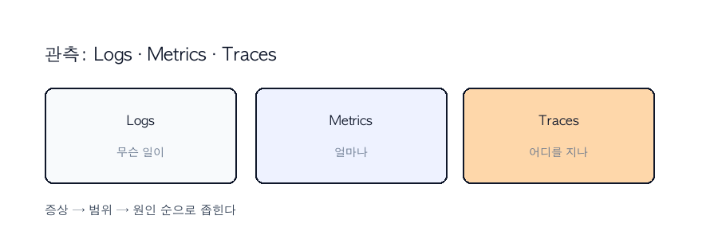

<picture>
  <source media="(prefers-color-scheme: dark)" srcset="../assets/sections/banner-cs-dark.svg" />
  
</picture>

# 06. 클라우드와 관측

**자원을 빌리고, 신호를 모아, 장애를 좁혀 간다.**

  
  &nbsp;
  
  &nbsp;
  

 

<picture>
  <source media="(prefers-color-scheme: dark)" srcset="../assets/sections/section-goals-dark.svg" />
  
</picture>

클라우드 이름(AWS/GCP/Azure)보다 먼저 잡는 것은 **컴퓨트·스토리지·네트워크·IAM**이다.  
관측은 로그·메트릭·트레이스로 “지금 어디가 아픈지”를 본다.

 

<picture>
  <source media="(prefers-color-scheme: dark)" srcset="../assets/sections/section-contents-dark.svg" />
  
</picture>

| # | 주제 | 한 줄 |
| :--- | :--- | :--- |
| 01 | 클라우드 기본 | 빌리는 블록 |
| 02 | IAM · 비용 | 누구·얼마 |
| 03 | 관측 3축 | logs/metrics/traces |
| 04 | 장애 대응 | 좁히기 |

 

<picture>
  <source media="(prefers-color-scheme: dark)" srcset="../assets/sections/section-concept-dark.svg" />
  
</picture>

### 01. 클라우드 기본

**서버·디스크·망을 제품 단위로 빌려 조합한다.**

#### 직관

레고 세트다.  
직접 랙을 두지 않고, 필요한 블록(VM, DB, LB, 오브젝트 스토리지)을 API로 만든다.

#### 핵심 성질

| 개념 | 내용 |
| :--- | :--- |
| Compute | VM, 컨테이너 서비스, 서버리스 |
| Storage | 블록 / 객체 / 관리형 DB |
| Network | VPC, 서브넷, LB, DNS |
| Region · AZ | 지리·가용 구역 |

- **쓰임**: “어디에 무엇을 둘지” 아키텍처 초안

> 제공자마다 상품명은 달라도 **블록의 역할**은 통한다.

---

### 02. IAM · 비용

**누가 무엇을 할 수 있는지, 얼마가 나가는지 함께 본다.**

#### 직관

출입 카드와 영수증이다.  
권한 과다와 방치 자원이 사고·청구서의 단골이다.

#### 핵심 성질

| 개념 | 내용 |
| :--- | :--- |
| IAM | 주체·권한·리소스 정책 |
| least privilege | 최소 권한 |
| 태그 / 예산 알림 | 비용 귀속·상한 |
| 유휴 자원 | 꺼지지 않은 테스트 인스턴스 |

- **쓰임**: CI 배포 역할, 사람 계정 vs 워크로드 역할

> 키를 노트북에 두고 넓은 권한을 주면, 클라우드 전체가 그 노트북과 운명을 같이한다.

---

### 03. 관측 3축

**증상·규모·경로를 나눠 본다.**

<picture>
  <source media="(prefers-color-scheme: dark)" srcset="../assets/diagrams/infra-observe-dark.png" />
  
</picture>

#### 직관

진료 기록(로그), 체온·맥박(메트릭), 동선 CCTV(트레이스)다.

#### 핵심 성질

| 개념 | 내용 |
| :--- | :--- |
| Logs | 사건 서술, 검색·보존 비용 |
| Metrics | 수치 시계열, 알림에 강함 |
| Traces | 요청이 서비스를 가로지른 경로 |
| 상관 | request id / trace id로 묶기 |

- **쓰임**: 대시보드, 알림, 사후 분석

> 알림은 “많이”가 아니라 **행동 가능한 신호**여야 한다.

---

### 04. 장애 대응

**넓게 보고, 좁히고, 고치고, 남긴다.**

#### 직관

화재 대응이다.  
먼저 연기 범위(영향)를 보고, 발화 지점을 찾고, 재발 방지를 적는다.

#### 핵심 성질

| 단계 | 내용 |
| :--- | :--- |
| Detect | 알림·고객 제보 |
| Triage | 영향 범위, 심각도 |
| Mitigate | 롤백, 트래픽 차단, 스케일 |
| Learn | 타임라인, 원인, 액션 아이템 |

- **쓰임**: 온콜, 인시던트 채널, 사후(postmortem)

> 영웅 플레이보다 **영향 축소·롤백·문서**가 팀의 회복력을 만든다.

 

<picture>
  <source media="(prefers-color-scheme: dark)" srcset="../assets/sections/section-summary-dark.svg" />
  
</picture>

### 무엇을 먼저 떠올릴까

| 상황 | 후보 |
| :--- | :--- |
| 어디 올릴지 | compute / storage / network |
| 권한·청구 | IAM · 태그 · 예산 |
| 느림·에러 | metrics(증상) → traces(경로) → logs(원인) |
| 장애 | 영향 축소 → 원인 → 기록 |

 

<picture>
  <source media="(prefers-color-scheme: dark)" srcset="../assets/sections/section-next-dark.svg" />
  
</picture>

Infra 트랙 Ready.  
다음으로 비어 있는 트랙 예: **[frontend/](../frontend/README.md)** · **[database/](../database/README.md)** · **[security/](../security/README.md)**
