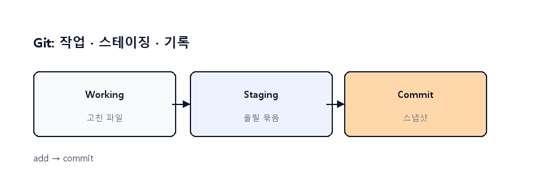

<picture>
  <source media="(prefers-color-scheme: dark)" srcset="../assets/sections/banner-cs-dark.svg" />
  
</picture>

# 01. Git 흐름

**워킹트리에서 커밋·푸시까지의 기본 길을 본다.**

  
  &nbsp;
  
  &nbsp;
  

 

<picture>
  <source media="(prefers-color-scheme: dark)" srcset="../assets/sections/section-goals-dark.svg" />
  
</picture>

협업의 최소 단위는 “파일을 고치고, 기록하고, 공유하는 일”이다.  
Git은 그 기록을 **로컬에서 쌓고**, 원격으로 **동기화**하는 도구다.

 

<picture>
  <source media="(prefers-color-scheme: dark)" srcset="../assets/sections/section-contents-dark.svg" />
  
</picture>

| # | 주제 | 한 줄 |
| :--- | :--- | :--- |
| 01 | 저장소와 클론 | 복사본 |
| 02 | 스테이징·커밋 | 기록 단위 |
| 03 | 원격·푸시·풀 | 공유 |
| 04 | 상태 읽기 | status / diff / log |

 

<picture>
  <source media="(prefers-color-scheme: dark)" srcset="../assets/sections/section-concept-dark.svg" />
  
</picture>

### 01. 저장소와 클론

**저장소(repository)는 프로젝트의 히스토리 상자이고, 클론은 그 복사본이다.**

#### 직관

공용 노트 원본이 있고, 각자 책상에 사본을 두고 필기한다.  
사본이 곧 로컬 저장소다.

#### 핵심 성질

| 개념 | 내용 |
| :--- | :--- |
| `.git` | 히스토리·설정이 들어 있는 숨김 폴더 |
| `git clone` | 원격 저장소를 로컬로 복사 |
| `git init` | 새 로컬 저장소 시작 |
| working tree | 지금 보고 고치는 파일들 |

- **쓰임**: 팀 레포를 받아 작업을 시작할 때

> “폴더만 복사”와 “Git 저장소 클론”은 다르다. 히스토리가 따라온다.

---

### 02. 스테이징·커밋

**고친 것 중 올릴 묶음을 고르고, 스냅샷으로 남긴다.**

<picture>
  <source media="(prefers-color-scheme: dark)" srcset="../assets/diagrams/tools-git-areas-dark.png" />
  
</picture>

#### 직관

택배 상자(스테이징)에 넣을 물건을 고른 뒤, 송장(커밋)을 붙인다.  
책상 위(워킹트리)에 널린 것과 상자에 넣은 것은 다를 수 있다.

#### 핵심 성질

| 개념 | 내용 |
| :--- | :--- |
| working tree | 아직 안 고른 수정 |
| staging (`git add`) | 이번 커밋에 넣을 변경 |
| commit | 메시지와 함께 스냅샷 확정 |
| 좋은 커밋 | 한 가지 이유, 되돌리기 쉬운 크기 |

- **쓰임**: “관련 없는 수정을 한 커밋에 섞지 않기”

> 커밋 메시지는 미래 나와 리뷰어를 위한 **짧은 설명**이다.

---

### 03. 원격·푸시·풀

**로컬 기록을 원격과 맞춘다.**

#### 직관

책상 사본과 공용 노트를 동기화한다.  
`push`는 내 기록을 올리고, `pull`/`fetch`는 남이 올린 기록을 가져온다.

#### 핵심 성질

| 개념 | 내용 |
| :--- | :--- |
| `remote` (origin) | 보통 GitHub 등 원격 이름 |
| `push` | 로컬 커밋을 원격에 반영 |
| `fetch` | 원격 정보를 가져오기만 |
| `pull` | 가져오기 + 합치기(머지/리베이스) |

- **쓰임**: 팀과 같은 히스토리를 맞출 때

> 푸시 전에 `status`/`log`로 “무엇을 올리는지” 확인하는 습관이 안전하다.

---

### 04. 상태 읽기

**지금 어디인지 세 명령으로 먼저 본다.**

#### 직관

계기판이다.  
고친 파일, 차이, 최근 기록이 한눈에 나온다.

#### 핵심 성질

| 명령 | 보는 것 |
| :--- | :--- |
| `git status` | 수정·스테이징·브랜치 상태 |
| `git diff` | 스테이징 전 워킹트리 차이 (staged는 `--staged`) |
| `git log` | 커밋 히스토리 |

- **쓰임**: 커밋/푸시/PR 직전, 충돌·분실 불안할 때

> 막히면 코드를 더 고치기 전에 **상태를 읽는 것**부터 한다.

 

<picture>
  <source media="(prefers-color-scheme: dark)" srcset="../assets/sections/section-summary-dark.svg" />
  
</picture>

### 무엇을 먼저 떠올릴까

| 상황 | 후보 |
| :--- | :--- |
| 레포를 받을 때 | clone |
| 일부만 커밋하고 싶을 때 | add → commit |
| 팀에 반영할 때 | push |
| 헷갈릴 때 | status / diff / log |

 

<picture>
  <source media="(prefers-color-scheme: dark)" srcset="../assets/sections/section-next-dark.svg" />
  
</picture>

다음 장: **[02. 브랜치와 PR](02_Branch_PR.md)** — 갈래를 나누고 검토 창구로 합친다
