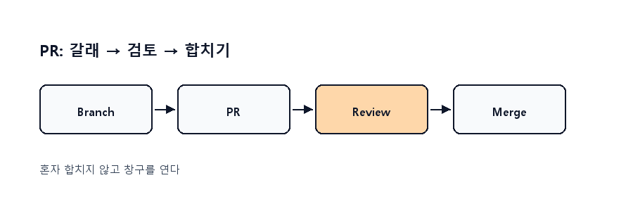

<picture>
  <source media="(prefers-color-scheme: dark)" srcset="../assets/sections/banner-cs-dark.svg" />
  
</picture>

# 02. 브랜치와 PR

**갈래를 나누고 풀 리퀘스트로 합친다.**

  
  &nbsp;
  
  &nbsp;
  

 

<picture>
  <source media="(prefers-color-scheme: dark)" srcset="../assets/sections/section-goals-dark.svg" />
  
</picture>

`main`에 바로 푸시하면 팀 전체가 흔들린다.  
브랜치로 작업을 분리하고, PR로 **검토 가능한 창구**를 연다.

 

<picture>
  <source media="(prefers-color-scheme: dark)" srcset="../assets/sections/section-contents-dark.svg" />
  
</picture>

| # | 주제 | 한 줄 |
| :--- | :--- | :--- |
| 01 | 브랜치 | 작업 갈래 |
| 02 | 머지 vs 리베이스 | 합치는 감각 |
| 03 | Pull Request | 검토 창구 |
| 04 | 충돌 | 겹친 수정 |

 

<picture>
  <source media="(prefers-color-scheme: dark)" srcset="../assets/sections/section-concept-dark.svg" />
  
</picture>

### 01. 브랜치

**히스토리의 갈래. 한 줄기를 기준으로 나뉘었다가 다시 만날 수 있다.**

#### 직관

공용 도로(`main`)에서 공사 우회로를 파는 일이다.  
우회로에서 작업을 끝내고 본선에 합류한다.

#### 핵심 성질

| 개념 | 내용 |
| :--- | :--- |
| `main` / `master` | 기본 줄기(팀 규칙에 따름) |
| feature 브랜치 | 기능·수정 단위의 작업 갈래 |
| `checkout` / `switch` | 갈래 이동 |
| 브랜치 이름 | 의도가 보이게 (`feat/...`, `fix/...`) |

- **쓰임**: 이슈 하나 ≈ 브랜치 하나인 경우가 많다

---

### 02. 머지 vs 리베이스

**갈래를 합치는 두 가지 감각.**

#### 직관

머지는 “합류 지점을 남기는 합류”,  
리베이스는 “내 커밋을 최신 본선 위에 다시 쌓기”에 가깝다.

#### 핵심 성질

| 방식 | 감각 |
| :--- | :--- |
| merge | 합류 커밋이 생김, 히스토리에 갈래가 남음 |
| rebase | 선형에 가깝게, 공유 브랜치에서는 주의 |
| 팀 규칙 | “PR은 merge”, “로컬만 rebase”처럼 정해 두는 편이 안전 |

- **쓰임**: 충돌 해결 전후에 “어떤 합치기인지”를 팀에 맞출 때

> 이미 푸시한 공용 브랜치를 함부로 rebase하면 히스토리가 어긋날 수 있다.

---

### 03. Pull Request

**코드가 본선에 들어가기 전 검토·토론·CI 창구.**

<picture>
  <source media="(prefers-color-scheme: dark)" srcset="../assets/diagrams/tools-pr-flow-dark.png" />
  
</picture>

#### 직관

출고 검수대다.  
설명·스크린샷·테스트 메모를 붙여 “이렇게 바꿔 주세요”를 요청한다.

#### 핵심 성질

| 개념 | 내용 |
| :--- | :--- |
| base / head | 어디에 합칠지(base), 무엇을 가져올지(head) |
| 설명 | 왜·무엇을·어떻게 검증했는지 |
| CI | 자동 검사 통과 여부 |
| draft PR | 아직 리뷰 전 초안 |

- **쓰임**: 리뷰 가능한 크기로 나누어 올리기

> PR 본문은 “커밋 나열”보다 **의도·리스크·확인 방법**이 중요하다.

---

### 04. 충돌

**같은 줄을 서로 다르게 고치면 자동 합류가 막힌다.**

#### 직관

한 문단에 두 사람이 다른 문장을 쓴 상태다.  
어느 쪽을 살릴지, 어떻게 섞을지 사람이 고른다.

#### 핵심 성질

| 개념 | 내용 |
| :--- | :--- |
| conflict marker | `<<<<<<<` 등으로 양쪽이 표시됨 |
| 해결 | 파일을 고친 뒤 add · 머지/리베이스 계속 |
| 예방 | 작은 PR, 자주 본선 동기화 |

- **쓰임**: PR이 “conflicted”일 때, pull 직후

> 충돌은 실패가 아니라 **겹친 수정을 드러내는 신호**다.

 

<picture>
  <source media="(prefers-color-scheme: dark)" srcset="../assets/sections/section-summary-dark.svg" />
  
</picture>

### 무엇을 먼저 떠올릴까

| 상황 | 후보 |
| :--- | :--- |
| 기능 작업 시작 | 브랜치 |
| 팀 검토 | PR |
| 히스토리 합치기 | merge / rebase (팀 규칙) |
| 같은 줄 수정 | 충돌 해결 |

 

<picture>
  <source media="(prefers-color-scheme: dark)" srcset="../assets/sections/section-next-dark.svg" />
  
</picture>

다음 장: **[03. 코드 리뷰](03_Code_Review.md)** — 제안과 질문으로 품질을 나눈다
