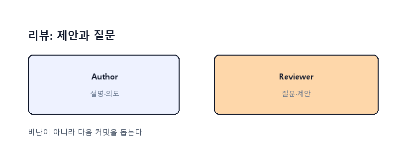

<picture>
  <source media="(prefers-color-scheme: dark)" srcset="../assets/sections/banner-cs-dark.svg" />
  
</picture>

# 03. 코드 리뷰

**리뷰의 목적과 코멘트·승인 습관을 잡는다.**

  
  &nbsp;
  
  &nbsp;
  

 

<picture>
  <source media="(prefers-color-scheme: dark)" srcset="../assets/sections/section-goals-dark.svg" />
  
</picture>

리뷰는 검사 점수가 아니라 **같이 책임을 지는 대화**다.  
버그를 줄이고, 맥락을 공유하고, 팀의 기준을 맞춘다.

 

<picture>
  <source media="(prefers-color-scheme: dark)" srcset="../assets/sections/section-contents-dark.svg" />
  
</picture>

| # | 주제 | 한 줄 |
| :--- | :--- | :--- |
| 01 | 리뷰 목적 | 품질·공유 |
| 02 | 무엇을 볼까 | 동작·경계·읽기 |
| 03 | 코멘트 습관 | 제안과 질문 |
| 04 | 승인·요청 변경 | 다음 단계 |

 

<picture>
  <source media="(prefers-color-scheme: dark)" srcset="../assets/sections/section-concept-dark.svg" />
  
</picture>

### 01. 리뷰 목적

**완벽한 코드가 아니라, 합쳐도 되는지를 함께 본다.**

<picture>
  <source media="(prefers-color-scheme: dark)" srcset="../assets/diagrams/tools-review-dark.png" />
  
</picture>

#### 직관

출고 전 동료 점검이다.  
“이거 왜 이렇게 됐지?”를 미리 묻고, 나중에 장애로 묻지 않는다.

#### 핵심 성질

| 목적 | 내용 |
| :--- | :--- |
| 품질 | 버그·보안·성능 리스크 |
| 공유 | 설계 의도 전달 |
| 기준 | 팀 컨벤션·테스트 습관 정렬 |

- **쓰임**: PR을 “통과 도장”이 아니라 대화로 다룰 때

---

### 02. 무엇을 볼까

**우선순위를 두고 본다.**

#### 직관

요리 검수다.  
맛(동작) → 위생(안전) → 플레이팅(가독성) 순으로 보면 덜 헤맨다.

#### 핵심 성질

| 우선 | 질문 |
| :--- | :--- |
| 동작 | 요구를 만족하는가, 테스트가 있는가 |
| 경계 | 에러·권한·빈 입력은? |
| 읽기 | 이름·구조가 의도를 말하는가 |
| 스타일 | 포맷터·린트가 이미 커버하면 깊게 파지 않기 |

- **쓰임**: 큰 PR에서 무엇을 먼저 코멘트할지 고를 때

---

### 03. 코멘트 습관

**비난이 아니라 제안과 질문.**

#### 직관

빨간 펜이 아니라 sticky note다.  
“이게 틀렸다”보다 “이런 경우는 어때?”가 다음 커밋을 만든다.

#### 핵심 성질

| 습관 | 내용 |
| :--- | :--- |
| nit | 취향·미세 지적 (필수가 아님을 표시) |
| 질문 | 의도 확인 |
| 제안 | 대안 코드·링크 |
| 칭찬 | 좋은 판단도 남기기 |

- **쓰임**: 리뷰 문화가 거칠어질 때 기준을 리셋

> Author도 설명 없이도 읽히게, Reviewer도 근거 있게.

---

### 04. 승인·요청 변경

**다음 행동이 보이게 상태를 고른다.**

#### 직관

검수 도장이다.  
통과 / 수정 후 재검 / 보류를 분명히 한다.

#### 핵심 성질

| 상태 | 감각 |
| :--- | :--- |
| Approve | 합쳐도 됨 (팀 규칙상) |
| Request changes | 반드시 고칠 점 |
| Comment | 의견만 (브랜치 보호 규칙에 따라 머지 조건은 팀마다 다름) |
| 후속 | 이슈로 미룰지 PR에서 끝낼지 |

- **쓰임**: “승인인지 수정 요청인지” 애매한 PR을 정리할 때

 

<picture>
  <source media="(prefers-color-scheme: dark)" srcset="../assets/sections/section-summary-dark.svg" />
  
</picture>

### 무엇을 먼저 떠올릴까

| 상황 | 후보 |
| :--- | :--- |
| 리뷰가 감정적으로 흐를 때 | 목적·제안·질문으로 되돌리기 |
| 큰 diff | 동작·경계 우선 |
| 스타일만 지적 | 린트/포맷에 맡기기 |
| 끝맺음 | Approve / Request changes |

 

<picture>
  <source media="(prefers-color-scheme: dark)" srcset="../assets/sections/section-next-dark.svg" />
  
</picture>

다음 장: **[04. 이슈와 문서](04_이슈와문서.md)** — 할 일과 결정을 남긴다
